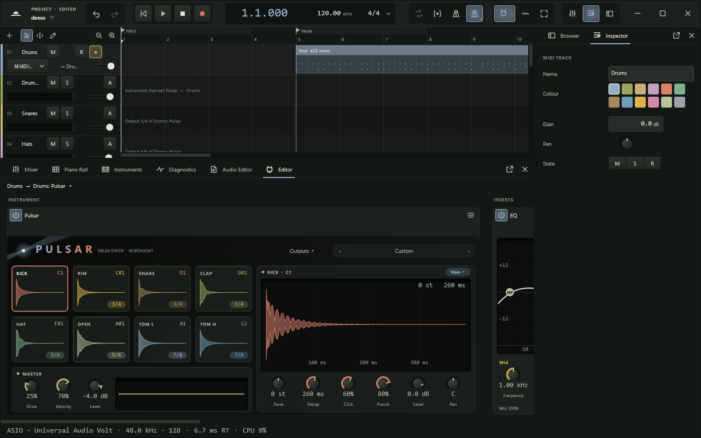

# Northlight

A digital audio workstation for Windows, built for low-latency recording and careful
mixing. Native ASIO, VST3 and CLAP hosting, a lock-free multicore engine, and an
interface designed before it was built. Free software under the GNU AGPLv3.



**Status:** in active development, with no release yet. See the
[roadmap](docs/roadmap.md) for where it stands.

## What it does

- **Records** many inputs at once, with input monitoring, latency measured through a
  loopback cable, loop and punch recording into take lanes with swipe comping, and
  recordings that survive a crash.
- **Mixes** with buses, FX tracks, sends, fader groups, sidechains and delay
  compensation everywhere, plus a six-module channel strip on every channel.
- **Hosts** VST3 and CLAP instruments and effects. Plugins are scanned in a separate
  process, so a bad one cannot take Northlight down.
- **Plays MIDI** through a piano roll with controller lanes, six bundled instruments,
  external MIDI devices and Standard MIDI Files.
- **Follows the music** with a tempo track, clip time-stretch and transposition, and
  vocal pitch editing.
- **Delivers** WAV, AIFF, FLAC and Ogg Vorbis exports with loudness normalisation and
  dither, and freezes tracks to save processing.

[docs/user-guide.md](docs/user-guide.md) shows how to use it.

## Building

You need Windows 10 or 11 and Visual Studio 2022 or later with the **Desktop
development with C++** workload. Then:

```powershell
.\scripts\build.ps1 -Run
```

Everything else, ASIO support included, is downloaded on the first build.
[docs/building.md](docs/building.md) covers the presets, options and tests.

## Documentation

| Document | What it covers |
|---|---|
| [docs/building.md](docs/building.md) | Building, options, tests, launch options for unattended checks |
| [docs/architecture.md](docs/architecture.md) | How the application is put together: modules, threads, engine, plugins, UI |
| [docs/rt-rules.md](docs/rt-rules.md) | What real-time threads may and may not do |
| [docs/decisions.md](docs/decisions.md) | Why things are built the way they are |
| [docs/roadmap.md](docs/roadmap.md) | Goals, non-goals, and what comes before a first release |
| [docs/user-guide.md](docs/user-guide.md) | A tour of Northlight for users: setup, recording, mixing, instruments, export |
| [docs/design/](docs/design/README.md) | The brand, the design system and the specification of every screen |
| [CONTRIBUTING.md](CONTRIBUTING.md) | How to contribute: checks, code conventions, commits |
| [CODE_OF_CONDUCT.md](CODE_OF_CONDUCT.md) | How we treat each other in the project |
| [SECURITY.md](SECURITY.md) | How to report a security problem privately |

## Licence

Northlight is free software: you can redistribute it and modify it under the terms of
the GNU Affero General Public License, version 3, as published by the Free Software
Foundation. It is distributed in the hope that it will be useful, but WITHOUT ANY
WARRANTY; without even the implied warranty of MERCHANTABILITY or FITNESS FOR A
PARTICULAR PURPOSE. See [LICENSE](LICENSE) for the full text.

In practice:

- Anyone who receives the application, free or paid, is entitled to its complete
  source code under the same licence. A build that is sold or shared must say where
  its source is.
- Changes you distribute, or offer to people over a network, are AGPLv3 too.
- Plugins the application hosts (VST3, CLAP) are separate programs and keep their own
  licences.

Northlight is built on third-party code under compatible licences: JUCE (AGPLv3), the
Steinberg ASIO SDK (GPLv3 option), the VST3 SDK, CLAP, Signalsmith Stretch and
nlohmann/json (MIT), and the codecs and libraries bundled in JUCE. Their notices and
licence texts are in [THIRD_PARTY_NOTICES.md](THIRD_PARTY_NOTICES.md), and every build
ships them beside the executable. The splash photograph is by Gytis Bukauskas on
Unsplash ([assets/splash](assets/splash/README.md)).
