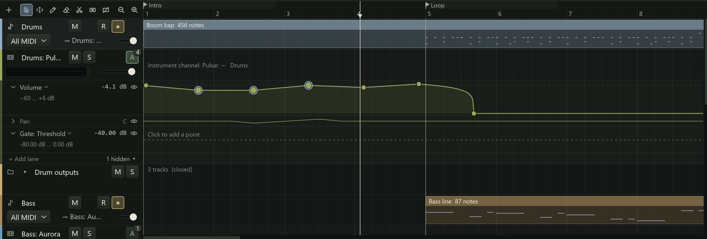

**Automation** makes a setting change by itself as the song plays: the vocal's volume
coming up in the chorus, a delay's feedback rising at the end of a line, a filter
opening over eight bars. Each automated setting has a **lane** under its track, with a
line that shows its value over time. This page covers showing, adding and arranging
lanes. Drawing the line is on [Drawing and editing](editing-automation.md), and
recording it from the controls is on [Recording automation](modes.md).

## Which channels have lanes

Every channel that makes sound has automation lanes: audio tracks, instrument
channels and instrument outputs, buses, FX tracks and the master. MIDI tracks and
folders do not, since they make no sound of their own: to automate a synth, automate
its instrument channel. The controllers inside a MIDI clip, such as the mod wheel, are
edited in the [piano roll](../midi/piano-roll.md).

## Opening the lanes

Click the **A** button in a track's header, or select the track and press A. The
track's lanes open under its row; click or press again to close them. The track menu
has **Show automation lanes** too, and so do the menus of buses and the master.

The number on the **A** button counts the track's lanes, hidden ones included, so you
can see that a track has automation even with its lanes closed. The **A** is coloured
by the track's [automation mode](modes.md).

Open lanes sit under the track's row (and under its take lanes, when they are shown).
The track's clips stay where they were and can be edited as usual. Closing a folder
hides the lanes of the tracks inside it.

## Adding a lane

1. Open the track's lanes.
2. Click **+ Add lane** in the row under the lanes (or right-click **A** and choose
   **Add lane**).
3. Choose a parameter from the menu.

A new lane has no points yet. It shows the setting's current value as a dashed line
with "Click to add a point", and plays nothing until you add one.

You do not always need to add a lane first. In the Touch, Latch and Write modes,
moving a control while the song plays makes a lane for it (see
[Recording automation](modes.md)).

## What can be automated

The parameter menu lists:

- **Volume**: the channel's fader.
- **Pan** (not on the master, which has none).
- Each processor on the channel, as a submenu of its parameters: the instrument, the
  inserts (built-in effects and VST3 or CLAP plugins) and the
  [channel strip](../mixing/channel-strip.md) modules. A processor that is switched off
  is marked "(off)".

A dot after a name marks a parameter that already has a lane.

:::note
Sends, mute and solo cannot be automated yet.
:::

## The lane's header

Each lane has a header in the header column. From left to right:

- An arrow that collapses or expands the lane.
- The parameter's name. Click it for the lane's menu.
- The value at the playhead.
- An eye, which hides the lane.

On a lane at least 44 pixels tall, a second line gives its range, such as "−60 … +6
dB" for Volume or "L100 … R100" for Pan.

The lane's menu is headed **This lane shows**, with the parameter menu under it, then
**Delete point** (when you right-clicked a point), **Collapse lane** or **Expand
lane**, **Hide lane**, **Clear points** and **Delete lane**.

Choosing another parameter in the lane's menu changes what an empty lane shows. For a
lane that has points, it shows that parameter's lane instead, adding one if needed, so
no points are lost.

## Sizing, collapsing and hiding lanes

- **Size:** drag a lane's bottom edge up or down.
- **Collapse:** click the arrow in its header. The lane becomes a thin strip that
  still shows its line, but cannot be edited; click the strip to expand it again.
- **Hide:** click the eye. The lane leaves the view, and the row under the lanes says
  how many are hidden ("2 hidden"). Click that for a menu that shows each one again,
  or **Show all**.

Right-click a track's **A** button for **Expand all lanes**, **Collapse all lanes**
and **Show the hidden lane** (or **Show 3 hidden lanes**).

Collapsing and hiding change only what you see: a collapsed or hidden lane still
plays. Lane sizes, and which lanes are collapsed or hidden, are saved with the project.

**Delete lane** removes the lane and its points. Like every automation edit, it can be
undone.

## While automation plays

Controls follow their automation as the song plays. The mixer's faders, value fields
and pan knobs, and the channel strip's controls, move with it, so you can see what the
automation is doing.
