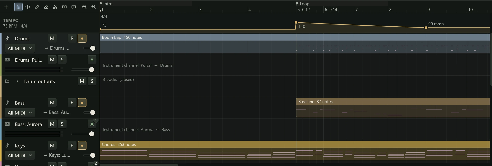

The **tempo** is how fast the music goes, in beats per minute (BPM). The **time
signature** says how many beats make a bar: 4/4 is four quarter notes a bar, 6/8 six
eighth notes. Together they decide where the bars and beats fall, so they drive the
ruler, the [snap grid](playback.md#the-snap-grid), the click and anything that syncs
to the song. This page covers setting them, changing them during a song, and
stretching audio to fit.

## Setting the tempo

The readout in the header bar shows the tempo and the time signature at the playhead.

- Drag the tempo up or down, or click it and type a new one (20 to 400 BPM).
- To tap a tempo, click the tempo field and press T in time with the music, at least
  twice. It takes the average of your last taps.
- Click the time signature to choose another from its list.

These set the tempo and signature in force where the playhead is: at the start of the
song, or the change on the tempo track that the playhead is in.

## The tempo track

To change tempo or time signature part way through a song, use the tempo track.
Right-click the ruler and choose **Show tempo track**. It appears as a lane under the ruler,
and stays shown in later projects until you hide it.

The lane draws the tempo as a line across the song: flat where the tempo holds, rising
or falling over a ramp. A round handle marks the song's start and each change, with its
tempo beside it. Time signature changes are tags along the lane's top edge. The header
on the left reads TEMPO, with the tempo and signature at the playhead.

### Tempo changes

1. Double-click the lane where the new tempo should start, or right-click there and
   choose **Add tempo change here**. The change snaps to the grid (hold Alt to place it
   freely), and starts at the tempo already playing there.
2. Drag its handle up or down to set the tempo. Hold Shift for finer steps.

To edit a change afterwards:

- Drag its handle sideways to move it along the song. It snaps as clips do.
- Double-click its handle to type a tempo, then press Enter.
- Right-click its handle for **Set tempo...**, **Ramp from the previous tempo** and
  **Delete tempo change**. Clicking a handle and pressing Delete removes it too.

The handle at the song's start sets the opening tempo; it can be dragged up and down
and typed into, but not moved or deleted.

### Ramps

A **ramp** makes the tempo glide into a change instead of jumping to it, for a
gradual speed-up or slow-down. Right-click a change's handle and tick **Ramp from the
previous tempo**: the tempo then moves evenly from the one before, beat by beat, to
reach the change's tempo at its handle. The label beside the handle reads "90 ramp".

### Time signature changes

Right-click the lane over the bar where the new signature should start, and choose
from **Time signature from bar 9** (the bar under the pointer): 2/4, 3/4, 4/4, 5/4,
6/4, 7/4, 3/8, 5/8, 6/8, 7/8, 9/8 or 12/8. A signature always starts at the beginning
of a bar. Right-click its tag to choose another signature or **Remove time signature
change**.

The grid counts beats in the signature of the bar it is in, so in a 6/8 bar the
**Beat** grid is an eighth note.

Right-click the lane and choose **Hide tempo track** to put it away. The changes keep
playing while it is hidden.

## What a tempo change moves

Tempo changes sit at musical positions, on bars and beats. When you change the tempo,
things that belong to the music keep their bars and beats, and move in time:

- MIDI clips and their notes
- markers and regions
- automation
- audio clips set to **Follow tempo changes** (below)

Other audio clips stay where they are in time, as a recording should: a vocal sung at
120 BPM would sound wrong if it were moved or stretched without being asked.

## Stretching and transposing clips

An audio clip can play faster or slower without changing its pitch (time-stretch), or
higher or lower without changing its timing (transpose).

- **Stretch by hand:** hold Alt and drag a clip's right edge. The clip stretches to the
  new end, snapped to the grid, and the tooltip shows the speed it will play at. A clip
  can be stretched from a twentieth of its own length up to twenty times it.
- **Transpose:** right-click the clip and choose from **Transpose**: up or down 1, 2,
  5, 7 or 12 semitones, or **Original pitch**.
- **Reset stretch and pitch** in the clip menu puts the clip back as it was recorded.

A stretched or transposed clip's header shows its speed ("66.7%") and its
transposition ("+3.0 st"). Northlight works out the stretched audio in the background
after an edit, and the header says "stretching 40%" until it is done. Playback can
start straight away; the clip is silent past the point the work has reached.

A stretch speeds up or slows down the whole clip evenly. To change the timing of one
note inside a clip, split the clip first.

### Following the tempo

Tick **Follow tempo changes** in an audio clip's menu and the clip is treated like
MIDI: when the tempo changes, it keeps its bars and beats, stretching to fit. Its
header shows a note (♩). Use it for loops and other material that should stay in time
with the song.

### Stretch to project tempo

A drum loop or a sample recorded at another tempo can be fitted to the song in one
step.

1. Right-click the clip and choose **Stretch to project tempo...**.
2. The sheet asks for the tempo the clip was recorded at. Northlight fills in a guess:
   from a tempo in the file's name, from a length that makes a whole number of bars, or
   from the beats it hears. Check it, and type the right tempo if you know it.
3. Click **Stretch**.

The clip is stretched to play at the song's tempo from where it starts, and follows
later tempo changes.

Pitch edits made in the Audio Editor play through a clip's stretch and transposition,
so you can stretch or transpose a vocal you have [corrected](../pitch/correct.md).
