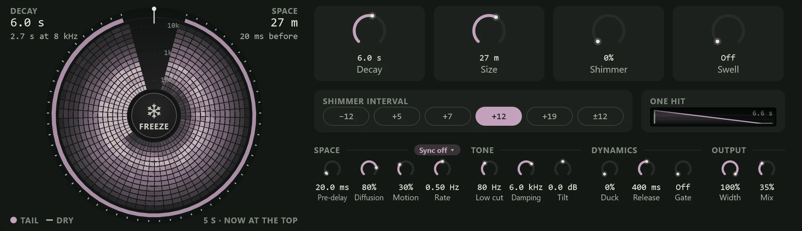

Bloom is a reverb for effects rather than rooms: tails up to a minute long, held
forever with Freeze, climbing in pitch with Shimmer, or swelling in like a reversed
reverb. Use the plain [Reverb](reverb.md) to put a sound in a believable space; use
Bloom for pads, ambient washes, huge snares and sound design. It is in the
**Reverb & Delay** group of the effects menu.

## Reading the flower

The display at the left draws the reverb's tail (the reverb alone, without the dry
sound) over the last five seconds as a flower.

- **Time runs round the circle**, clockwise, to now at the top, marked by a line and a
  dot. Everything older has travelled further round; after five seconds it leaves.
- **Pitch runs outward.** Low frequencies are near the centre and high ones near the
  rim, with dotted rings at 100 Hz, 1k and 10k. Each petal lights up as loud as the
  tail is at that frequency and moment.

So each note you play opens the flower from the top, and as it fades round the circle
you can see the highs die first (the outer petals darken before the inner ones). A
long decay fills the whole flower; a gated one leaves gaps.

- **The rim** shows the tail's level as a coloured band, with the dry sound's level as
  small ticks outside it. When the tail is loud against the dry sound, the band is
  thick.
- **Spirals** appear when Shimmer is on, climbing outward (or inward for -12) to show
  the tail rising in pitch.
- **The corners** read out the settings: **DECAY** at the top left with the decay time
  and how long the highs last ("2.7 s at 8 kHz"); **SPACE** at the top right with the
  size in metres and the pre-delay ("20 ms before"). While frozen, DECAY shows ∞
  over "held".

### Freeze

The round button at the flower's heart is **Freeze** (it reads **FREEZE**, and
**FROZEN** while held). Click it, or focus it and press Enter or Space, to hold the
tail as it is, for as long as you like. The input is kept out while frozen, so you can
play over a held chord, and the tail keeps moving a little so it never sounds like a
loop. Slices of the flower that are drawn while frozen turn to ice, so you can see
how long it has been held. Click again to let it go.

## The controls

**The large knobs**

| Control | What it does |
| --- | --- |
| **Decay** | How long the tail takes to fade by 60 dB, from 0.4 s to a minute (6 s by default). |
| **Size** | The size of the space, from a large room (5 m) to an impossible one (88 m). Larger spaces sound smoother and slower to build. A change glides rather than jumps. |
| **Shimmer** | How much of the tail is pitch-shifted on every pass, so it climbs by the interval again and again. 0% is off. |
| **Swell** | Makes the tail build slowly after each note, like a reversed reverb, over up to 4 s. Off at the bottom. |

**SHIMMER INTERVAL** chooses what the shimmer shifts by: **−12** (an octave down), **+5**
(a fourth), **+7** (a fifth), **+12** (an octave up, the default), **+19** (an octave and
a fifth) or **±12** (both octaves). While frozen, the shimmer controls dim, since the
shimmer leaves the loop.

**ONE HIT** draws what a single hit becomes with the current settings: the pre-delay,
the swell rising, the decay falling (the highs' faster fall dashed), and the gate's
cut. The span at its top right is how long the tail lasts.

**The smaller knobs**, in four groups:

- **SPACE**: **Pre-delay** (0 to 500 ms) is the gap before the tail starts, which keeps
  the start of a note clear. The **Sync off** chip beside the caption sets the
  pre-delay as a note value instead. **Diffusion** sets how quickly the echoes blur
  into a smooth tail (lower is grainier). **Motion** moves the tail, from a slow
  chorus to warping, and **Rate** sets how fast.
- **TONE**: **Low cut** and **Damping** make the lows and highs past them fade faster
  than the rest, so a long tail does not turn to mud or fizz. **Tilt** makes the
  whole tail brighter or darker, ±6 dB.
- **DYNAMICS**: **Duck** lowers the tail while the dry sound plays (up to 24 dB at
  100%), so a huge tail fills the gaps instead of burying the part. **Release** sets
  how quickly it comes back. **Gate** cuts the tail a set time after the sound stops
  (off at the bottom, up to 2 s), for gated drums. It never cuts a frozen tail.
- **OUTPUT**: **Width** is the tail's stereo width; **Mix** is the balance of tail
  and dry sound (35% by default).

The effect's header reads **Frozen** while Freeze holds, or how far the tail is ducked
("Duck -4.2 dB").

## Presets

- **Default**: a 6 s tail in a 27 m space.
- **Huge Shimmer**, **Fifths Shimmer**, **Crystal Air** and **Octave Cloud**: shimmer
  up an octave, a fifth, an octave and a fifth, and both ways.
- **Endless Pad**: a minute-long, moving tail.
- **Reverse Swell** and **Slow Bloom**: tails that build in after each note.
- **Ducked Hall**: a hall that gets out of the way while the part plays.
- **Synced Wash**: an eighth-note pre-delay with ducking.
- **Gated Verb**: a dense tail cut short.
- **Warped Space**: heavy motion.
- **Dark Abyss**: a long, dark tail that falls an octave.
- **Send: Shimmer**: an octave shimmer with Mix at 100%, for an FX track.

## Tips

- **On an FX track**, set **Mix** to 100% so the FX track carries only the tail, and
  send to it from each track ([Routing](../mixing/routing.md)). The
  **Send: Shimmer** preset is ready for this.
- **Pads from anything.** Play a chord, press **Freeze**, and play over it. Automate
  Freeze to catch a moment in a song and hold it under the next section.
- **Shimmer gets loud in the highs.** Raise **Low cut** and lower **Damping** a
  little to keep a climbing tail from turning harsh.
- **Bypass keeps it running**, so the tail is current when you switch Bloom back on.
  Bloom adds no [latency](../reference/glossary.md).
