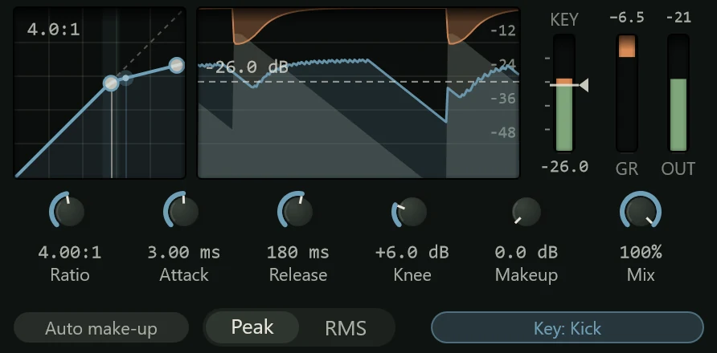

The Compressor turns a sound down when it gets loud, so the loud and quiet parts sit
closer together: a vocal stays in front, a bass holds steady, drums gain punch.

It is the same compressor as the Clean model in every channel's
[channel strip](../mixing/channel-strip.md), so it sounds and looks the same. As an
insert you can put it anywhere in a chain of effects, use more than one, and give it a
**sidechain key**: another track it listens to instead of its own input. Add it from
the effects menu's **Dynamics** group (see [Inserts](../mixing/inserts.md)).

## How compression works

A compressor watches the level of the sound. While the level is above the
**threshold**, it reduces the gain; below it, the sound passes untouched. The amount
it turns down is the **gain reduction**, shown in dB.

- **Ratio** is how firmly it holds the level above the threshold. At 2:1 a sound that
  goes 10 dB over the threshold comes out 5 dB over it; at 10:1, only 1 dB over.
- **Attack** is how quickly it clamps down once the level crosses the threshold, and
  **Release** how quickly it lets go once the level falls back.
- **Knee** softens the change at the threshold, so compression fades in gradually
  rather than starting all at once.
- Turning the loud parts down makes the whole sound quieter, so **makeup** gain turns
  it back up afterwards.

## The display

From left to right:

- **The curve** shows what the compressor does to each input level: input across,
  output up. Below the threshold it follows the dashed diagonal (no change); above it,
  it bends flatter, the flatter the higher the ratio. The shaded area is the knee. A dot
  rides the curve with the level coming in right now.
- **The history** shows the last three seconds: the input in grey, the output in
  colour, and the gain reduction hanging down from the top in red. The threshold is
  the dashed line.
- **IN** is the input level with the threshold across it; the part above the line,
  in red, is what is being compressed. **GR** shows the gain reduction and **OUT** the
  output level.

The header shows the gain reduction while the compressor is working.

### Setting the threshold

The threshold has no knob: you set it against the sound itself.

- Drag the threshold line on the **IN** meter, or click anywhere on the meter to move
  it there. Scroll over it to move it in 0.5 dB steps. Hold Shift for fine control.
- Drag in the **history**, or on the **curve** to the left of the knee.
- Double-click the meter to reset the threshold to -18 dB.

Dragging on the curve to the right of the knee bends the ratio instead.

## Controls

| Control | Range | What it does |
|---|---|---|
| **Ratio** | 1:1 to 20:1 (default 3:1) | How hard it compresses above the threshold. 2:1 to 4:1 is gentle to firm; 8:1 and up holds peaks down hard. |
| **Attack** | 0.1 to 100 ms (default 10 ms) | A fast attack catches the start of every note; a slower one lets the hit of a drum or a pick through before clamping down, which keeps punch. |
| **Release** | 10 ms to 2 s (default 120 ms) | A fast release recovers between notes and sounds more lively; a slow one is smoother. Too fast can make the level pump audibly. |
| **Knee** | 0 to 24 dB (default 6 dB) | 0 is a hard knee, abrupt and obvious; a wide knee is gentler and harder to hear. |
| **Makeup** | 0 to 24 dB | Gain added after compression. |
| **Mix** | 0 to 100% | How much of the compressed sound is mixed with the original. Below 100% is **parallel compression**: the dry sound keeps its punch while the compressed one fills in underneath. |

Under the knobs:

- **Auto make-up** adds makeup gain for you as you change the threshold and ratio, so
  switching the compressor on and off doesn't change the level much. It adds to any
  **Makeup** you set.
- **Peak / RMS** chooses how the compressor measures the level. **Peak** reacts to
  every short peak; **RMS** follows the average loudness, which is smoother and closer
  to what you hear, and suits vocals and bass.
- **Sidechain** picks a key (see below).

## Sidechain

With a sidechain key, the compressor listens to another track and turns this one down
when that track is loud. The classic use is a bass that ducks a little every time the
kick hits, so the two don't fight.

1. Click **Sidechain** under the knobs.
2. Choose the track to listen to, and whether to take its signal **Pre-fader** (before
   its fader, so its level doesn't depend on the fader) or **Post-fader**.

The button lights and shows the key ("Key: Kick (post)"), and the meter's caption
changes from IN to KEY: the meter, the grey trace in the history and the threshold now
follow the key. Choose **None** to take the key away. The same choices are in the
insert's menu. See [Routing](../mixing/routing.md#sidechains) for more.

## Presets

| Preset | What it does |
|---|---|
| **Default** | 3:1 at -18 dB, 10 ms attack, 120 ms release. |
| **Vocal Smooth** | Gentle RMS levelling for a lead vocal. |
| **Vocal Upfront** | Firmer and faster, to hold a vocal at the front of the mix. |
| **Gentle Leveling** | A low ratio, slow and soft-kneed: evens out a performance without being heard. |
| **Drum Bus** | 4:1 with a medium attack, for a group of drums. |
| **Parallel Smash** | Heavy compression mixed in at 35% under the dry sound. |
| **Kick Punch** | A slower attack that lets the kick's click through. |
| **Snare Snap** | Firm and quick to recover, for a snare that cracks. |
| **Bass Even** | Holds a bass line at a steady level. |
| **Acoustic Guitar** | Smooths strumming without squashing it. |
| **Mix Bus** | A light 2:1 for the whole mix. |
| **Peak Catcher** | High threshold, high ratio, fast: only the loudest peaks are touched. |
| **Room Squash** | Crushes a room or overhead mic, mixed in at 50%. |

See [Presets](presets.md) for how presets work.

## Tips

- **Start from the threshold.** Set Ratio to about 3:1, then lower the threshold
  until the GR meter shows 3 to 6 dB of reduction on the loudest parts. Adjust attack
  and release by ear, then the makeup.
- **Compare at the same level.** Louder always sounds better, so use **Auto make-up**
  or match the level by ear before you judge whether compression helps.
- **Watch the history.** If the red reduction never returns to the top between notes,
  the release is too slow or the threshold too low.
- For whole mixes and groups, the [Glue Compressor](glue-compressor.md) is built for
  the job. To stop peaks going over a fixed level, use the [Limiter](limiter.md).

## The Opto Compressor

Northlight also has an **Opto Compressor** insert, in the same **Dynamics** group. It
is the Opto model of the channel strip's compressor: a vintage optical compressor, in
the style of the LA-2A, where a lamp and a light cell set the gain. It has few
controls and a smooth, forgiving sound, and its release slows down the longer it has
been working, which suits vocals, bass and anything that needs levelling without
fuss.

Its display has a **VU meter** that shows the gain reduction (click it to show the
output level instead), a picture of the **lamp and cell** that glows with the
reduction, and the three-second history.

| Control | What it does |
|---|---|
| **Peak reduction** | How much it compresses (0 to 100%, default 40%). Turn it up until the needle shows the reduction you want. |
| **Gain** | Makeup gain, -12 to +24 dB. |
| **Compress / Limit** | Compress is about 3:1; Limit about 10:1, firmer. |
| **Emphasis** | Makes it react more to high frequencies, so bright or sibilant sounds are held back more. |
| **Colour** | The warmth of a valve stage after the compressor (default 30%; 0 is clean). |
| **Mix** | Blends in the uncompressed sound, for parallel compression. |

Its presets: **Default**, **Vocal Leveler**, **Gentle Vocal**, **Vocal Limit**,
**Bright Source** (more Emphasis), **Bass Smooth**, **Acoustic Guitar**, **Warm
Bus**, **Clean Leveler** (no Colour), **Valve Colour** (barely compressing, mostly
warmth), **Parallel Opto** and **Room Crush**.
