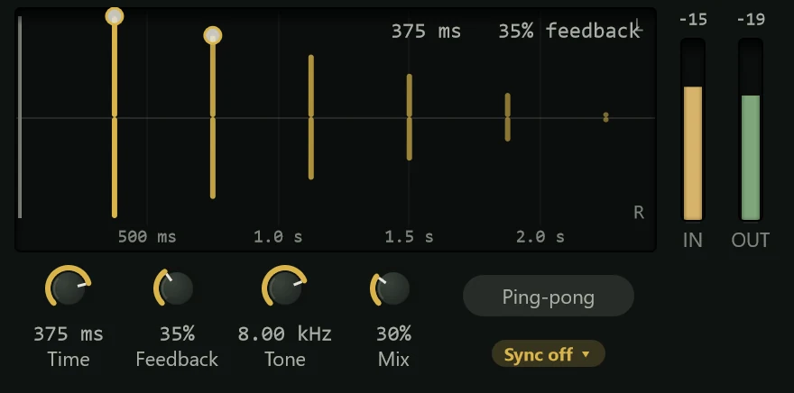

The Delay repeats a sound after a set time, as echoes that can stay in time with the
song, bounce between left and right, and darken as they fade.

Delay is used for everything from a single short "slapback" that thickens a vocal or
guitar, to rhythmic echoes that fill the gaps between phrases, to long trails that
throw the last word of a line into the distance. This is a clean, plain delay; for the
warmer, wobbling sound of a tape machine, use [Tape Echo](tape-echo.md). Add it from
the effects menu's **Reverb & Delay** group (see [Inserts](../mixing/inserts.md)).

As with reverb, a delay often lives on an **FX track** that several tracks send to,
with **Mix** at 100% (see [Routing](../mixing/routing.md)); the **Send: 1/4 Echo**
preset is set up for that.

## The display

The graph shows what happens to one short sound: the grey line at the left is the
original, and each coloured bar after it is an echo, as loud as the feedback leaves it.
Later echoes are paler when **Tone** darkens them. With **Ping-pong** on, the echoes
alternate: left ones point up (L), right ones down (R).

The readout at the top right gives the time ("375 ms", or the note value and its time
when synced), the feedback, and "ping-pong" when it is on. **IN** and **OUT** meters
sit beside the graph.

You can set the two main controls on the graph:

- **Drag the first echo** left or right to change the time. When synced, it snaps to
  the nearest note value.
- **Drag the second echo** up or down to change the feedback.

## Controls

| Control | Range | What it does |
|---|---|---|
| **Time** | 1 ms to 2 s (default 375 ms) | The time between echoes, when not synced. A change glides to the new time, like tape, so it never clicks. |
| **Feedback** | 0 to 95% (default 35%) | How much of each echo is fed back to make the next. 0% gives a single echo; higher values give more, longer-lasting repeats. |
| **Tone** | 500 Hz to 20 kHz (default 8 kHz) | A filter on the echoes. Lower it and each repeat gets darker than the last, so they fade into the background. |
| **Mix** | 0 to 100% (default 30%) | The balance of echoes and the original sound. |
| **Ping-pong** | Off / On | Sends the echoes back and forth between left and right. |
| **Sync** | Sync off, or 1/64 to 1/1 | Locks the time to a note value at the project's tempo. |

The **Sync** chip offers straight note values from 1/64 to 1/1, plus triplets (T) and
dotted values (D). While synced, the **Time** knob dims and shows the note value, and
the echoes follow any tempo change in the song.

## Presets

| Preset | What it does |
|---|---|
| **Default** | 375 ms with a few repeats, at 30%. |
| **Slapback** | One short echo at 110 ms, the classic rockabilly vocal and guitar sound. |
| **Short Double** | A single 25 ms echo that thickens a sound. |
| **Eighth Echo** | Echoes on every eighth note. |
| **Dotted Eighth** | Dotted-eighth echoes, which fall between the beats. |
| **Quarter Echo** | Echoes on every beat. |
| **Ping-pong 1/8** | Eighth-note echoes bouncing between the sides. |
| **Ping-pong Dotted** | Dotted-eighth echoes bouncing between the sides. |
| **Triplet Bounce** | Eighth-note triplets, ping-pong. |
| **Dub Throw** | Long, dark, repeating dotted-quarter echoes. |
| **Dark Tail** | Quarter-note echoes that fade into darkness. |
| **Long Ambient** | Slow, dark, bouncing half-note echoes for pads and space. |
| **Send: 1/4 Echo** | Quarter-note echoes at 100% Mix, for an FX track. |

See [Presets](presets.md) for how presets work.

## Tips

- **Sync it for rhythm.** Echoes in time with the song add movement without
  cluttering it. Dotted eighths are a favourite on guitars and vocals.
- **Darken the repeats.** A Tone of 3 to 6 kHz keeps echoes behind the dry sound so
  they don't compete with it.
- **Throw single words.** Put the delay on an FX track and
  [automate](../automation/lanes.md) the send so only the last word of a line goes
  into the echoes.
- **Careful with high feedback.** Near 95% the echoes take a long time to die away and
  build up; turn it down if the mix gets crowded.
