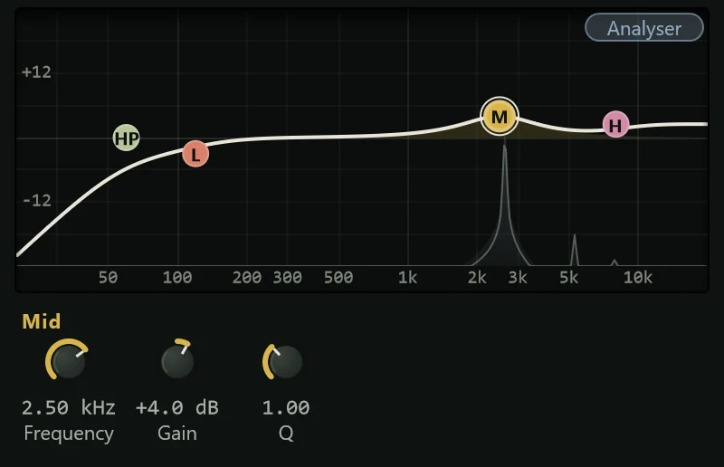

The EQ turns parts of the frequency range up or down, so you can take out mud, add
presence or air, or make room for one sound next to another.

An EQ (short for equaliser) works on frequency: low frequencies are the bass and the
weight of a sound, the middle is its body and most of its character, and the high
frequencies are its brightness and air. Turning a band up is a **boost**; turning it
down is a **cut**.

This EQ has four bands, which covers most everyday tone shaping. Every channel also
has a six-band EQ in its [channel strip](../mixing/channel-strip.md), switched on in
place; use this insert when you want an EQ at a particular point in a chain of
effects, or a second one. Add it from the effects menu's **EQ & Filter** group (see
[Inserts](../mixing/inserts.md)).

## The display

The graph runs from 20 Hz at the left to 20 kHz at the right, with level up and down
(±24 dB). The white line is the overall response: what the EQ does to the sound.
Each band is a coloured node on that line, and the selected band's own curve is
shaded in its colour.

Behind the curves the **analyser** shows the sound itself: the coloured fill is the
spectrum after the EQ, the faint grey line the spectrum before it. Watching both
while the song plays shows you where a sound has too much or too little, and what your
change did. The **Analyser** pill switches it off and on.

Hover over the graph to read the frequency and level under the pointer; hover over a
node to read its settings.

### Working on the graph

- **Drag a node** to move the band: left and right for frequency, up and down for
  gain. Hold Shift for fine control, or Alt to change the gain only.
- **Scroll** over the mid node to make it narrower or wider (its Q).
- **Click a node** to select it and show its knobs underneath.
- **Double-click** the high-pass node to switch it on or off.
- **Right-click a node** for **Switch band on** / **Switch band off** (the high-pass
  only) and **Reset band**.

## The bands and controls

The four bands, from left to right, and the knobs each shows under the graph when
selected:

| Band | Knobs | What it does |
|---|---|---|
| **High-pass** | **Frequency** (Off, or up to 1 kHz) | Removes everything below the frequency. Off by default. |
| **Low shelf** | **Frequency** (30 Hz to 1 kHz, default 120 Hz), **Gain** (±18 dB) | Raises or lowers everything below the frequency. |
| **Mid** | **Frequency** (100 Hz to 10 kHz, default 1 kHz), **Gain** (±18 dB), **Q** (0.3 to 10) | A bell-shaped boost or cut around the frequency. |
| **High shelf** | **Frequency** (1.5 kHz to 18 kHz, default 8 kHz), **Gain** (±18 dB) | Raises or lowers everything above the frequency. |

A few terms:

- A **high-pass** filter lets the highs pass and removes the lows. It is the tool for
  rumble, handling noise and low-end mud that a sound doesn't need. Drag its node
  in from the left edge to switch it on; double-click it, or right-click it and choose
  **Switch band off**, to switch it off.
- A **shelf** lifts or lowers everything past its frequency by the same amount, like
  a step. It is the gentle way to add weight or brightness.
- **Q** sets how wide the mid band is. A low Q (around 0.5 to 1) is broad and
  musical; a high Q (4 and up) is narrow, for finding and cutting one troublesome
  frequency.

The shelves and the mid band are always in; at 0 dB of gain they leave the sound
alone. Double-click any knob to put it back to its default.

## Presets

| Preset | What it does |
|---|---|
| **Default** | Flat: every band at 0 dB, the high-pass off. |
| **Low Cut 80 Hz** | Removes rumble under 80 Hz; a safe start for almost anything but bass and kick. |
| **Vocal Presence** | Brings a voice forward: a little less low end, more presence and air. |
| **De-mud** | Cuts the boxy area around 350 Hz. |
| **De-harsh** | A narrow cut around 3.5 kHz for harsh or shrill sounds. |
| **Air** | A high shelf boost above 12 kHz. |
| **Kick Tighten** | More thump, less box, more click. |
| **Snare Crack** | More body and snap, less ring. |
| **Bass Definition** | Weight plus the upper harmonics that let a bass line read on small speakers. |
| **Acoustic Guitar** | Less boom, a little more sparkle. |
| **Overheads** | Clears the lows and mud from drum overheads, lifts the cymbals. |
| **Smile Curve** | More lows and highs, slightly fewer mids: a quick "bigger" sound. |
| **Telephone** | A narrow, honky band with the lows and highs gone, for an effect. |

See [Presets](presets.md) for how to step through, save and delete presets.

## Tips

- **Cut before you boost.** Taking away what's in the way often does more than
  turning up what you want, and it keeps the level down.
- **Sweep to find a problem.** Raise the mid band's gain a lot, set a high Q, and
  sweep it slowly left and right while the song plays. Where it sounds worst, turn the
  gain down below zero.
- **High-pass most things.** Vocals, guitars, keys and cymbals rarely need anything
  under 80 to 120 Hz, and removing it leaves room for the kick and bass.
- **Listen in context.** A sound that seems thin on its own often sits perfectly in
  the mix. Judge EQ with the other tracks playing, and switch the EQ off and on (the
  power button in its header) to check you've made it better, not only louder.
