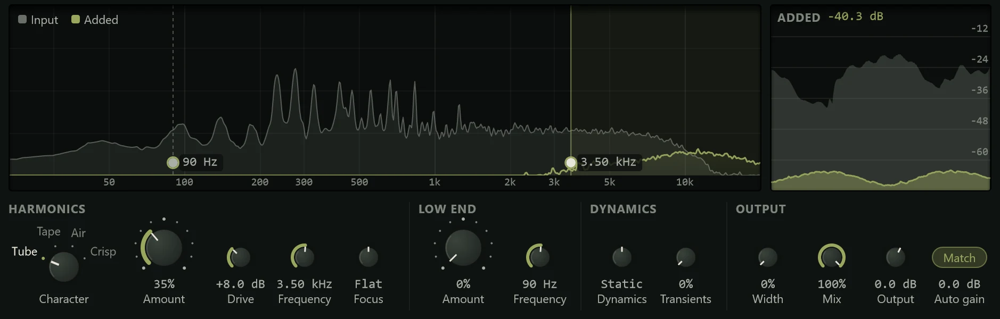

The Exciter adds new harmonics to a sound that lacks them, so a dull recording gains
presence, air or weight without an EQ boost.

An EQ can only turn up what is already in a sound: if a recording has no top end, an
EQ boost there only raises hiss. The Exciter makes new high frequencies (harmonics)
from the sound above a frequency you choose, and mixes a little of them back in. It can
do the same for the bass, adding harmonics that let small speakers suggest notes too
low for them to play. The original sound passes through untouched, and it adds no
latency. It is in the effects menu's **Drive & Colour** group (see
[Inserts](../mixing/inserts.md)).

## The display

**The harmonic spectrum** shows the sound from 20 Hz to 20 kHz: the input as a grey
fill, and what the Exciter adds in colour. Where the colour rises above the grey, the
Exciter has made something that wasn't there. The region above the harmonics' crossover
frequency, and the region below the bass frequency, are tinted while they add
anything.

The two frequencies are vertical handles with their values beside them. Press
anywhere in the spectrum to move the nearer handle there and drag it; double-click to
reset the nearer one. A handle is dashed while its section adds nothing.

**The excitation history**, to the right, shows the last three seconds: the input's
level in grey and the level of what is added in colour. **ADDED**, at its top left, is
how far the added sound sits below the input ("-26.8 dB"); the card's header shows the
same figure.

## Controls

The controls are in four groups.

### HARMONICS

- **Character**: the kind of harmonics. **Tube** is warm (the octave and the twelfth);
  **Tape** adds an edge; **Air** adds a sheen an octave above the crossover; **Crisp** is
  bright and dense.
- **Amount** (default 35%): how loud the harmonics are against the sound they come
  from. 50% sits 6 dB below it, 100% 6 dB above.
- **Drive** (0 to 24 dB, default 8 dB): how hard the curve is driven. Low drive gives
  only the first harmonics; more makes the series denser and grittier. Drive changes the
  character, not the level.
- **Frequency** (700 Hz to 16 kHz, default 3.5 kHz): only the sound above this drives
  the harmonics. Lower for presence (2 to 4 kHz), higher for air (8 kHz and up).
- **Focus** (Dark to Edge, Flat in the middle): tilts what is added darker or brighter.

### LOW END

- **Amount** (default 0%, off): harmonics of the bass, added above it. 100% matches the
  level of the low band.
- **Frequency** (30 to 250 Hz, default 90 Hz): the bass below this is what the
  harmonics are made from.

### DYNAMICS

- **Dynamics** (Fill to Push, Static in the middle): makes the excitation follow the
  music. **Push** adds more on the loud moments; **Fill** more in the quiet ones and the
  tails.
- **Transients**: adds extra harmonics at the start of each note or hit, for snap.

### OUTPUT

- **Width**: spreads what is added out to the sides. The mono sum never changes, so it
  is safe for mono playback.
- **Mix**: scales everything the Exciter adds.
- **Output** (-18 to +12 dB): the output level.
- **Auto gain** (the **Match** pill, on by default): turns the output down by the
  loudness the Exciter adds, never up, so switching it on and off compares the sound
  rather than the level. Under the pill is how much it is turning down right now.

## Presets

| Preset | What it does |
|---|---|
| **Default** | Tube harmonics above 3.5 kHz at 35%. |
| **Vocal Presence** | Tube harmonics from 3 kHz, a little more in quiet moments. |
| **Vocal Air** | Air above 9 kHz for a breathy top end. |
| **Drum Snap** | Crisp harmonics with extra on the transients. |
| **Bass Growl** | Tape edge on a bass's upper range, plus bass harmonics. |
| **Sub Enhance** | Bass harmonics only, so a sub bass reads on small speakers. |
| **Guitar Edge** | Tape harmonics from 2 kHz, focused towards edge. |
| **Warm Tape** | Lower, darker tape harmonics. |
| **Piano Clarity** | Gentle tube harmonics with a little transient lift. |
| **Mix Sparkle** | A light air sheen with some width, for a whole mix. |
| **Wide Shimmer** | Crisp harmonics spread wide. |
| **Dull Revive** | Plenty of crisp harmonics from 4 kHz, for a dull recording. |

See [Presets](presets.md) for how presets work.

## Tips

- **Subtle is the point.** Set Amount so you miss it when you switch it off, rather than
  hear it when it's on. Keep **Auto gain** on while you judge.
- **Find the frequency by ear.** Sweep **Frequency** while the song plays: too low and
  the sound gets harsh, too high and nothing much happens.
- **Bass on small speakers.** On a bass or kick, try **Sub Enhance** and check on
  laptop speakers or headphones.
- **Watch the hiss.** Very quiet sounds don't excite anything, so a noise floor isn't
  brought up, but a noisy recording with Air at high Amount can still sound fizzy.
- If what you need is to turn up a frequency that is already there, an [EQ](eq.md) is
  the simpler tool.
