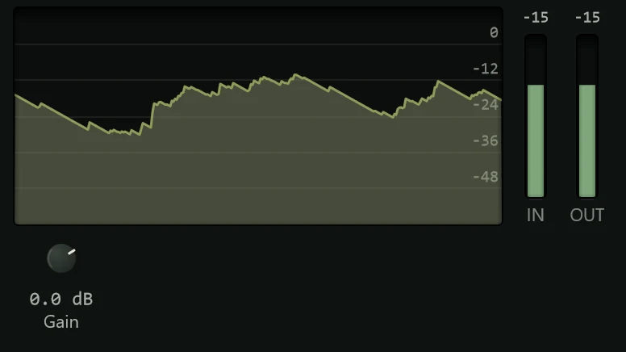

Gain turns the level up or down at one point in a chain of effects, and does nothing
else.

A track's fader sets its level in the mix, but it comes after all the inserts. Many
effects, compressors and saturation above all, sound different depending on how loud
the sound going into them is. Gain lets you set that level: turn a quiet recording up
before a compressor, turn a hot one down before a tape machine like
[Orbit](orbit.md), or push a mix a little harder into the [Limiter](limiter.md). It
is in the effects menu's **Stereo & Utility** group (see
[Inserts](../mixing/inserts.md)).

## The display

The history shows the last three seconds of the level coming in (grey) and going out
(coloured), so you can see the difference the Gain makes. The **IN** and **OUT**
meters beside it show the levels now.

## Controls

**Gain** sets the change in level, from -60 dB to +24 dB. The default, 0 dB, leaves
the sound as it is. Changes are smoothed, so turning the knob or automating it never
clicks. Double-click the knob to return to 0 dB.

As a rough guide, 6 dB is about double or half the signal's level, and 10 dB is what
most people hear as twice or half as loud.

Gain has no polarity (phase) switch. To flip a channel's polarity, use the **Ø**
button on its mixer strip (see [The mixer](../mixing/mixer.md)).

## Presets

The presets are fixed amounts, so you can step quickly between them: **Default**
(0 dB), **-18 dB**, **-12 dB**, **-6 dB**, **-3 dB**, **+3 dB** and **+6 dB**. See
[Presets](presets.md).

## Tips

- **Set the level into an effect, then the fader.** Use Gain before an effect to get
  the sound you want from it, and the fader for the balance of the mix.
- **Match levels when comparing.** After a chain of effects, a Gain at the end can
  bring the level back to where it was, so switching the chain on and off compares
  the sound, not the loudness.
- **Automate it.** Gain is an easy parameter to [automate](../automation/lanes.md) to
  lift a quiet word or tame a loud passage before compression.
