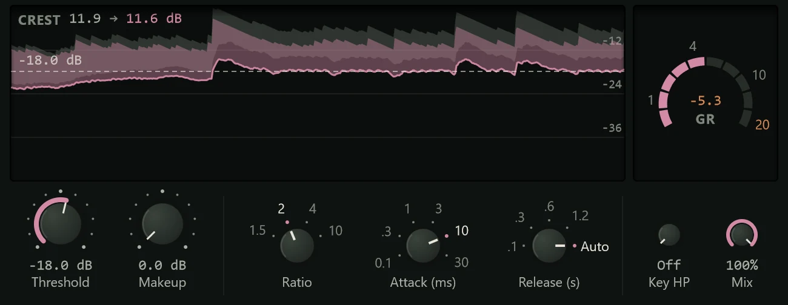

The Glue Compressor is a bus compressor: put it on a group of tracks or on the whole
mix and it makes them move together, so they sound like one performance rather than
separate parts.

It is modelled on the classic console bus compressors. Like them it has stepped
switches for ratio, attack and release, a soft knee, and an **Auto** release that
recovers quickly from a single hit but slowly from sustained compression, so it
doesn't pump. A few dB of reduction from it tightens a drum group, steadies a
stack of backing vocals, or glues a mix. It adds no latency. Add it from the effects
menu's **Dynamics** group (see [Inserts](../mixing/inserts.md)).

New to compression? The [Compressor](compressor.md#how-compression-works) page
explains threshold, ratio, attack and release.

## The display

The Glue's display shows what glue does to a sound, rather than a transfer curve.

**The dynamics ribbon** shows the last three seconds. Each moment is a band from the
sound's body (its average loudness) up to its peaks: the grey band is what goes in,
the coloured band what comes out, and the coloured line the output's average level.
Compare the two bands: with a fast attack the peaks are pulled down towards the body
and the coloured band is thinner; with a slow attack the hits come through over a
lowered body, and it stays wider, which keeps punch.

**CREST**, at the top left, is the crest factor of the last second, going in and
coming out ("14.2 → 9.6 dB"): how far the peaks stand above the body. A drop of a
few dB is the "glue".

The dashed line is the threshold, with its value. Drag anywhere in the ribbon to set
it; double-click to reset it.

**The GR arc** at the right shows the gain reduction on ten segments from 0.5 to
20 dB, with the figure in the middle. The deepest recent reduction stays outlined for a
moment so you can read it. The card's header shows the reduction too.

## Controls

The controls are in three groups.

| Control | Settings | What it does |
|---|---|---|
| **Threshold** | -40 to 0 dB (default -18 dB) | The level above which it compresses. |
| **Makeup** | 0 to 20 dB | Turns the result back up. |
| **Ratio** | 1.5, 2, 4 or 10:1 (default 2:1) | 1.5:1 and 2:1 for a mix; 4:1 for drums and groups; 10:1 for heavy, parallel squashing. |
| **Attack (ms)** | 0.1, 0.3, 1, 3, 10 or 30 ms (default 10) | Slower attacks let the transients (the start of each hit) through and keep punch; faster ones flatten them. 30 ms is the usual start for a mix. |
| **Release (s)** | 0.1, 0.3, 0.6, 1.2 s or Auto (default Auto) | Auto adapts: quick back from a hit, slow back from held compression. Pick a fixed time to make it breathe with the tempo. |
| **Key HP** | Off, or 20 to 400 Hz | Filters the low end out of what the compressor listens to (not out of the sound), so a kick or bass doesn't make the whole mix duck. |
| **Mix** | 0 to 100% | Blends the uncompressed sound back in, for parallel compression. |

Ratio, Attack and Release are rotary selectors: drag, scroll or use the arrow keys to
click between positions.

## Presets

| Preset | What it does |
|---|---|
| **Default** | 2:1 at -18 dB, 10 ms attack, Auto release. |
| **Mix Bus Glue** | The classic: 2:1, 30 ms, Auto, a couple of dB of reduction on a mix. |
| **Gentle Mix Bus** | Lighter, at 1.5:1. |
| **Mastering Touch** | Very light, with the key filtered at 100 Hz. |
| **Drum Bus Punch** | 4:1 with a 10 ms attack: tighter drums that still hit. |
| **Drum Smash** | 10:1, very fast, mixed in at 40% under the dry drums. |
| **Parallel Glue** | 4:1 at 50% Mix, with the key filtered. |
| **Pumping Bus** | Fast attack and 0.3 s release, for audible pumping in time. |
| **Vocal Bus** | Holds a group of vocals together. |
| **Bass Bus** | For bass guitar and synth bass together. |
| **Guitar Bus** | For a group of guitars. |
| **Pad Glue** | Slow and gentle for pads and sustained sounds. |

See [Presets](presets.md) for how presets work.

## Tips

- **2 to 4 dB is plenty.** On a mix, set Ratio to 2:1, Attack to 30 ms, Release to
  Auto, and lower the threshold until the arc shows a couple of dB on the loud parts.
  Then match the level with Makeup and compare with the power button.
- **Drums like it fast to release.** On a drum group, try 4:1, 10 ms attack and 0.1 or
  0.3 s release, and listen for the room and cymbals rising between hits.
- **Use Key HP on bass-heavy material.** If the whole mix ducks on every kick, raise
  Key HP to 80 to 150 Hz.
- **Put it on a bus.** The Glue works on sounds that are already mixed together. See
  [Routing](../mixing/routing.md) for buses.
