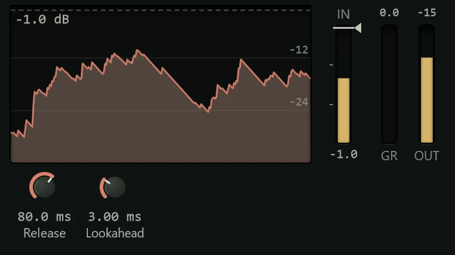

The Limiter makes sure the sound never goes over a level you choose, the
**ceiling**, by turning down the peaks that would cross it.

A limiter is a compressor taken to the extreme: anything above the ceiling is held to
it, however loud. Its main job is at the end of the chain on the master, so the mix
can't clip (go over 0 dBFS, the most a digital file can hold, where the waveform's
tops are cut off and it distorts). It is also handy on a drum bus to catch the odd
stray hit. Add it from the effects menu's **Dynamics** group (see
[Inserts](../mixing/inserts.md)).

This is a lookahead limiter: it delays the sound by a millisecond or two so it can see
each peak coming and turn down smoothly before it arrives. That way nothing gets
through, and it avoids the distortion a sudden gain change would cause. Northlight
compensates for that delay so everything stays in time (see
[Delay compensation](../mixing/delay-compensation.md)).

Every channel's [channel strip](../mixing/channel-strip.md) also has a limiter, with
no lookahead and no delay, for catching peaks on a single track.

## The display

- **The history** shows the last three seconds: the input in grey, the output in
  colour and the gain reduction hanging from the top in red, on a scale down to
  -36 dB. The ceiling is the line across it.
- **IN** shows the level coming in with the ceiling across it. Whatever shows in red
  above the line is being limited.
- **GR** shows the gain reduction and **OUT** the output level.

While the limiter is working, its header shows how much it is turning down, in red.

## Controls

**Ceiling** (-24 to 0 dB, default -0.3 dB) is set on the display, not with a knob:
drag the line in the history or on the **IN** meter, or click the meter to move the
line there. Scroll over the meter to move it in 0.5 dB steps, hold Shift for fine
control, and double-click to reset it.

| Knob | Range | What it does |
|---|---|---|
| **Release** | 1 ms to 1 s (default 50 ms) | How quickly the gain comes back up after a peak. Short sounds louder but can distort low notes; longer is smoother. |
| **Lookahead** | 0 to 10 ms (default 1.5 ms) | How far ahead it looks. More is cleaner on fast peaks and adds that much delay. At 0 there is no delay, and the limiter clips anything it can't catch in time. |

The limiter has no input gain. To push a mix harder into it, raise the level before it,
for example with a [Gain](gain.md) insert placed in front.

## Presets

| Preset | What it does |
|---|---|
| **Default** | Ceiling -0.3 dB, 50 ms release, 1.5 ms lookahead. |
| **Streaming -1 dB** | A -1 dB ceiling, which leaves room for the small overs that encoding to streaming formats can add. |
| **Transparent** | Slow release and long lookahead, for the least audible limiting. |
| **Fast Peaks** | Very quick release with short lookahead: louder, less subtle. |
| **Smooth Release** | A slow 300 ms release. |
| **Bass Safe** | A longer release and lookahead, so low notes don't distort. |
| **Drum Bus Catch** | Catches drum hits at -3 dB and lets go fast. |
| **Low Latency** | No lookahead and no delay, for use while recording. |
| **Stem -6 dB** | Keeps a group or stem under -6 dB. |

See [Presets](presets.md) for how presets work.

## Tips

- **Put it last.** On the master, the limiter goes at the end of the inserts, after any
  EQ and compression, so nothing after it can push the level over again.
- **Use it lightly.** A few dB of reduction on the loudest moments is usually
  unnoticeable. If the GR meter is busy all the time, the mix is being squashed: turn
  the level going in down.
- **Leave a little headroom.** A ceiling of -1 dB is a safe choice for files that will
  be streamed or turned into MP3s.
- For loudness and level targets when you export, see [Exporting](../exporting/index.md)
  and [Metering and loudness](../mixing/metering.md).
