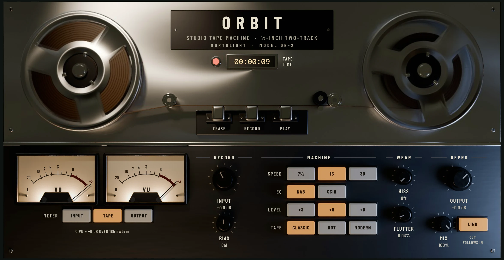

Orbit is a studio reel-to-reel tape machine, for the warmth, gentle compression and
smoothed-over peaks that recording to tape gives a mix or a group.

Recording to tape changes a sound in ways many people like: loud peaks are rounded off
softly instead of clipping, the low end gains a little weight, and the highs saturate
first, so harshness is tamed. Orbit models the tape itself and the machine around it:
the tape's magnetism, the record and playback EQ, the tape speed, the bias, hiss and
the wobble of the transport. Use it subtly on a bus or the master, or push it hard on
drums. It is in the effects menu's **Drive & Colour** group (see
[Inserts](../mixing/inserts.md)).

Orbit delays the sound by 1.5 ms (to make room for the flutter's wander). Northlight
compensates for that, so everything stays in time (see
[Delay compensation](../mixing/delay-compensation.md)).

## The face

**The transport** at the top is for show and for feedback: the reels turn while the
song plays and the insert is on, the counter shows the song position as **TAPE TIME**,
and the red pilot lamp is lit while the insert is on.

**The VU meters** (L and R) read the level the way a VU meter on a real machine does:
slowly, showing the average level rather than every peak. 0 VU is -18 dBFS: a steady tone at
-18 dBFS reads 0, and music's short peaks don't pin the needles. The **METER** keys under them
choose what they read:

- **INPUT**: the level going onto the tape, after **INPUT**.
- **TAPE**: what comes back off the tape (the default).
- **OUTPUT**: the level leaving Orbit.

Aim for the needles to swing around 0 on the loud parts. While the tape is
compressing by more than a fraction of a dB, the card's header shows how much
("Tape 1.2 dB").

## Controls

The panel is in four groups. The keys in a row work like radio buttons: the chosen one
is lit.

### RECORD

- **INPUT** (-12 to +18 dB): how hard you drive the tape. This is the main control.
  Higher means more saturation and compression; around 0 to +3 dB is a light touch.
- **BIAS** (-100 to +100, **Cal** at 0): a real machine's bias setting. Under-biased
  (below Cal) is grittier and keeps a little more top end; over-biased is cleaner and
  darker.

### MACHINE

- **SPEED** (**7½**, **15**, **30** inches per second; default 15): slower tape has a
  bigger low-end bump lower down and loses more top end, for a warmer, older sound.
  30 ips is the cleanest and most extended.
- **EQ** (**NAB** or **CCIR**): the two recording standards, the American and the
  European. They differ slightly in the low end and in how the highs saturate. At 30
  ips the machine uses the AES standard whichever you choose.
- **LEVEL** (**+3**, **+6**, **+9**; default +6): how hot 0 VU hits the tape. Higher
  levels saturate sooner at the same input.
- **TAPE** (**CLASSIC**, **HOT**, **MODERN**): the tape formula. Classic saturates
  early and has the most character; Modern has the most headroom and is the cleanest.

### WEAR

- **HISS** (Off to 100%): tape noise, more at slower speeds.
- **FLUTTER** (0 to 0.3%, default 0.03%): the slow wander and quick flutter of the
  tape's speed, which makes the pitch waver slightly. A little adds life; a lot sounds
  like a worn machine.

### REPRO

- **OUTPUT** (-24 to +12 dB): the level leaving Orbit.
- **MIX** (0 to 100%): blends the dry sound back in, for parallel saturation.
- **LINK** (on by default; "OUT FOLLOWS IN"): moves OUTPUT the opposite way to INPUT,
  so the loudness stays about the same while you drive the tape harder. That way you
  hear the tape's effect, not a louder sound.

The knobs turn by dragging, scrolling or with the arrow keys; double-click resets one.

## Presets

| Preset | What it does |
|---|---|
| **Default** | 15 ips, NAB, +6, Classic tape, at unity input. |
| **Mix Bus Glue** | A little more drive on Hot tape, for a mix. |
| **Master Polish** | Light drive at 30 ips on Modern tape, no flutter: clean and subtle. |
| **Drum Squash** | Driven hard at +9 and under-biased, for punchy, saturated drums. |
| **Warm Vocal** | 7½ ips, slightly over-biased, with a touch of flutter. |
| **Parallel Saturation** | Driven hard and mixed in at 35% under the dry sound. |
| **Worn Reel** | Slow, under-biased CCIR tape with hiss and flutter: an old recording. |

See [Presets](presets.md) for how presets work.

## Tips

- **Start with INPUT.** With LINK on, raise INPUT until you hear the peaks soften and
  the sound thicken, then back off a little. Switch Orbit off and on to compare.
- **Use it early in a bus chain.** Tape before a compressor or limiter rounds off the
  peaks, so they have less to do.
- **Slow for warmth, fast for polish.** 7½ ips suits lo-fi and vintage sounds; 30 ips
  suits the master.
- For heavier ageing (crackle, dropouts, wow), try [Patina](patina.md); for tape
  echoes, [Tape Echo](tape-echo.md).
