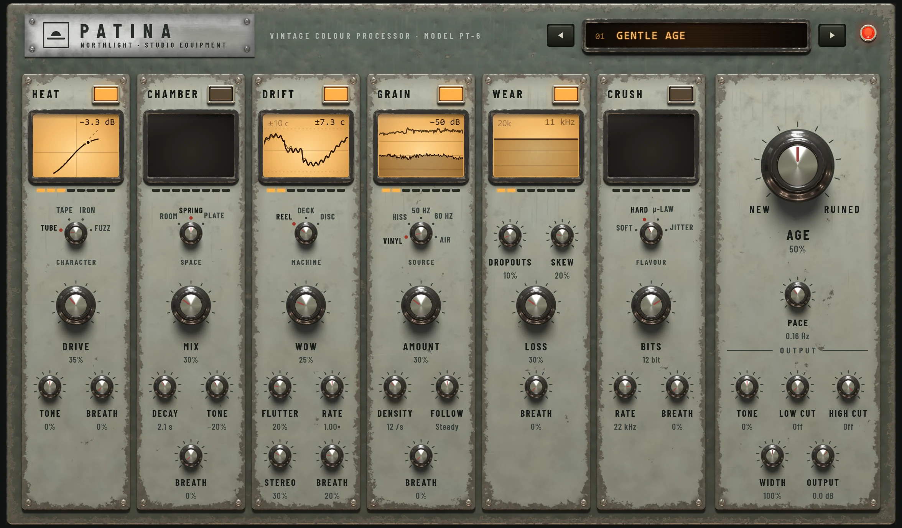

Patina ages a sound: a little warmth and wobble for a vintage feel, or tape hiss,
crackle, dropouts and crushed bits until it sounds like a broken machine.

Old recordings sound old for many separate reasons: the valves and transformers they
went through, the room or spring reverb they were played in, the wobble of the tape or
record, the noise of the medium, its wear over the years, and in early samplers the
low bit depth. Patina has a stage for each, in the order a real signal chain would
have them, and one **Age** knob that turns them all up or down together. It adds no
latency. It is in the effects menu's **Drive & Colour** group (see
[Inserts](../mixing/inserts.md)).

## The face

Patina's face is a 1960s broadcast rack unit. Along the top are the nameplate, the
preset selector (an amber display between two keys) and a red pilot lamp, lit while
the insert is on. Below are the six stages, then the master section at the right.

Each stage module has, from the top:

- its name and a **push-button** that switches the stage on (lit amber) or off;
- a **window** showing what the stage is doing right now (dark while the stage is
  off);
- a row of eight lamps showing how much of the stage is in play: bright up to the
  amount right now, dim up to where Age puts it;
- a type selector, a main knob and smaller knobs.

All the controls are on the face at once. The windows show:

| Stage | Window |
|---|---|
| Heat | The saturation curve, with a dot riding it at the current level, and how much it is taking off the peaks. |
| Chamber | The level of the reverb over the last three seconds, and its decay time. |
| Drift | The speed wobble over three seconds, in cents (hundredths of a semitone), and the widest swing. |
| Grain | The noise level against the music, so you can see it duck or ride. |
| Wear | The surviving top end, with notches where dropouts happen, and the cutoff frequency. |
| Crush | A close-up of the waveform going in and the stepped one coming out, and the bits and rate in effect. |

Click a push-button, or focus a window and press Space or Enter, to switch a stage.
The knobs turn by dragging, scrolling or the arrow keys; double-click resets one.

## The stages

Every stage has a **Breath** knob. Breath lets the stage's amount drift up and down on
its own, slowly, so the sound never sits still. How fast it drifts is set by **Pace**
in the master section.

### Heat (on by default)

Saturation from driving a circuit.

- **Character**: **Tube** (warm and soft), **Tape** (highs saturate first, with a
  low-end bump), **Iron** (a transformer: the lows driven hardest) or **Fuzz** (a
  broken stage that sputters and clips).
- **Drive**: how hard it is driven.
- **Tone**: darker or brighter after the saturation.

### Chamber (off by default)

A short, old-fashioned space mixed over the sound.

- **Space**: **Room**, **Spring** or **Plate**.
- **Mix**: how much of the space you hear.
- **Decay**: how long it rings (shown in seconds).
- **Tone**: darker or brighter.

### Drift (on by default)

The wow and flutter of a transport whose speed isn't quite steady.

- **Machine**: **Reel** (studio tape: slow wander, fine flutter), **Deck** (a cassette:
  quicker and more irregular) or **Disc** (a warped record turning at 33⅓).
- **Wow**: the slow pitch wobble.
- **Flutter**: the fast one.
- **Rate**: slower or faster than the machine would run (shown as 0.5× to 2×).
- **Stereo**: how far the two sides wobble apart.

### Grain (on by default)

The medium's own noise.

- **Source**: **Vinyl** (crackle, pops and rumble), **Hiss** (tape hiss), **50 Hz** or
  **60 Hz** (mains hum) or **Air** (the quiet tone of a room).
- **Amount**: the noise level.
- The second knob changes with the source: **Density** (how often vinyl crackles),
  **Colour** (of the hiss), **Buzz** (of the hum) or **Tone** (of the room air).
- **Follow**: **Duck** turns the noise down while the music plays, so it shows in the
  gaps; **Ride** makes it rise with the music; **Steady** in the middle keeps it level.

### Wear (on by default)

The damage of age.

- **Loss**: how much top end is gone.
- **Dropouts**: how often and how deeply the sound drops out, as on worn tape.
- **Skew**: the two channels drift apart in time and tone, as when a tape head is out
  of line.

### Crush (off by default)

An early digital sampler's converters.

- **Flavour**: **Soft** (filtered, smooth), **Hard** (no filters: the aliasing of early
  samplers), **μ-law** (an 8-bit telephone or drum machine) or **Jitter** (an unsteady
  clock).
- **Bits**: from 16 down to 2. Fewer bits is grainier and noisier.
- **Rate**: the sample rate, from 48 kHz down to 1 kHz. Lower is duller and more
  metallic.

### Age, Pace and the output

- **Age** (NEW to RUINED, 50% by default) scales every stage at once. At 50% the stages
  play as you set them; lower takes them back towards clean, and higher pushes each
  one towards ruin, in proportion to how much of it you're using. It is the one knob
  to reach for first.
- **Pace** (shown in Hz): how quickly every stage's Breath moves.
- **OUTPUT**: **Tone** (a tilt, darker or brighter), **Low cut** and **High cut**
  (Off at their ends; narrow them for a radio or phone sound), **Width** (0% mono to
  200%) and **Output** (level, -24 to +12 dB).

## Presets

| Preset | What it does |
|---|---|
| **Gentle Age** | The defaults: light tube warmth, a little wobble, vinyl, slight wear. |
| **Reel Warmth** | Studio tape: saturation, gentle wow and a little hiss. |
| **Worn Cassette** | A cassette that has been played too often. |
| **Dusty Vinyl** | A crackly record with a slight warp. |
| **Spring Tank** | A spring reverb with light warmth and nothing else. |
| **Plate Memory** | An old plate with room tone. |
| **Old Radio** | Mono, narrow, transformer-driven, with mains hum. |
| **Phone Line** | Telephone bandwidth, μ-law crushed. |
| **Lo-Fi Sampler** | 12-bit, 26 kHz, no filters: the early sampler sound. |
| **Basement Tape** | A home tape recording in a small room, hiss ducking under the music. |
| **Faded Film** | A dark, narrow, wavering old soundtrack. |
| **Broken Machine** | Age at 85%: fuzz, heavy wobble, dropouts and a jittery crush. |

Step through them with the keys either side of the amber display, or click the display
for the list; the preset bar in the card's header shows the same list. See
[Presets](presets.md).

## Tips

- **Use Age as the amount.** Pick a preset, then turn **Age** down until the effect
  sits where you want it. 30 to 40% is often enough to make a part sound "recorded",
  not processed.
- **Switch off what you don't need.** If you only want warmth, turn off Drift, Grain
  and Wear and use Heat alone.
- **Duck the noise.** With Grain's **Follow** towards Duck, the crackle or hiss shows
  in the gaps but stays out of the way of the music.
- **On a bus or a send.** Ageing a whole drum group or a reverb return can sound more
  natural than ageing each track.
- For cleaner tape colour on a mix, try [Orbit](orbit.md).
