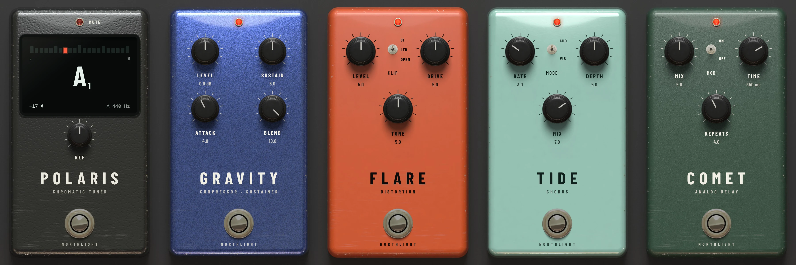

Northlight has five stompboxes, voiced for guitar and bass: Polaris, a tuner; Gravity,
a compressor; Flare, a distortion; Tide, a chorus; and Comet, an analog-style delay.
Each has only the few knobs a pedal has. They are in the **Guitar** group of the
effects menu, beside the [Corona](corona.md) amp.

## Building a pedalboard

A track's inserts run in order from top to bottom, like pedals chained by cables. To
build a pedalboard, insert the pedals on your guitar or bass track in the order you
want, and put Corona last, as the amp at the end of the chain (see
[Inserts](../mixing/inserts.md) to add and reorder them). A common order is:

1. **Polaris** first, so it hears the guitar on its own and its mute silences
   everything after it.
2. **Gravity**, to even out the playing before it is distorted.
3. **Flare**.
4. **Tide**.
5. **Comet**, so the echoes repeat the whole sound.
6. **Corona**.

None of the pedals adds [latency](../reference/glossary.md), and neither does Corona, so
you can play through the whole board live while you record. Use a small buffer
(see [Latency and monitoring](../recording/latency.md)). As with Corona, what you record
is the dry guitar, so you can change the pedals afterwards.

Every pedal works the same way:

- **The knobs** read 0 to 10, as a pedal's do, except Gravity's **LEVEL** (in dB),
  Comet's **TIME** (in ms) and Polaris's **REF** (in Hz). Drag or scroll to turn
  them; double-click to reset.
- **The footswitch** (the chrome button) switches the pedal on and off: click it, or
  focus it and press Space or Enter. This is the same as the power button in the
  effect's header. The red lamp at the top is lit while the pedal is on.
- **A toggle**, on the pedals that have one, flips with a click. On Flare's three-way
  **CLIP**, click above the toggle's middle to move it up and below to move it down.
- When the Editor panel is short, the pedals shrink, the values and toggle positions
  disappear and the names grow; the knob you are turning shows its value in place of
  its name.

## Polaris

A chromatic tuner, from a five-string bass's low B up to the top of a guitar's neck.

The display shows the note you are playing in large letters, with its octave beside it
(middle C is C3, as everywhere in Northlight). Above it, a row of lights runs from flat
(♭, left) to sharp (♯, right), one light for every 5 cents (a cent is a hundredth of a
semitone). The middle light turns green, and so does the note, when you are within 3
cents. The bottom left shows how far off you are in cents, the bottom right the
reference pitch. Play one string at a time: a chord or noise shows as no note.

- **REF** sets the pitch of A above middle C, from 430 to 450 Hz (440 Hz by default).
  Change it to tune to a piano or a recording that is not at 440.
- **The footswitch** mutes the output instead of switching the pedal off, so you can
  tune without being heard. The lamp, labelled **MUTE**, is lit while it mutes. Keep
  Polaris switched on (with the header's power button): switched off, it stops
  reading and its display goes dark.

Presets: **Default**, **Muted**, **A = 432 Hz**, **A = 442 Hz**.

## Gravity

A compressor and sustainer. It squeezes loud notes down and brings quiet ones up, so
every note is the same level and held notes ring on as they fade. It gives clean
guitar its smooth, glassy sustain, and evens out a bass line.

- **LEVEL** is the output level, ±18 dB.
- **SUSTAIN** is how hard it compresses. Higher settings squash more and sustain
  longer.
- **ATTACK** sets how much of each pick or pluck gets through before the compression
  comes in. Higher settings let more of the attack through, for a snappier sound;
  low settings squash the pick too.
- **BLEND** mixes the compressed sound with the dry one. At 10 (the default) you hear
  only the compressed sound; lower settings keep the dry attack and dynamics under
  it, which bass players often prefer.

Presets: **Default**, **Country Squash**, **Funk Snap**, **Endless Sustain**,
**Clean Leveller**, **Bass Glue**, **Slap Bass**.

## Flare

A distortion, from light crunch to a fuzz-like wall.

- **LEVEL** is the output level.
- **CLIP** is a three-way toggle that chooses how the sound is clipped. **SI**
  (silicon) is tight and compressed. **LED** has more headroom and sounds louder and
  more open. **OPEN** has no clipping diodes, so the circuit distorts on its own: the
  grittiest, closest to a fuzz. The level stays about the same when you switch.
- **DRIVE** is how much it distorts. The lows stay tight even at high drive.
- **TONE** darkens or brightens the sound.

Presets: **Default**, **Light Crunch**, **Classic Rock**, **Thick Lead**,
**Wall of Fuzz**, **Bright Grit**, **Bass Drive**.

## Tide

A chorus, which thickens a sound by mixing it with a slightly detuned, moving copy of
itself. The low end is left out of the effect, so on bass the bottom stays solid. The
output is stereo, and it still sounds right in mono.

- **RATE** is how fast the copy moves.
- **MODE** is a toggle: **CHO** (chorus) mixes the moving copy with the dry sound;
  **VIB** (vibrato) replaces the highs with it, so you hear the pitch waver instead.
- **DEPTH** is how far the pitch moves.
- **MIX** is how much of the effect you hear.

Presets: **Default**, **Shimmer**, **Lush**, **Leslie-ish**, **Seasick Vibrato**,
**Bass Chorus**.

## Comet

An analog-style delay. Its repeats get darker and softer each time round, fading into a
warm smear behind the playing rather than repeating it exactly. The dry sound passes
through untouched.

- **MIX** is the level of the echoes.
- **MOD** is a toggle: **ON** adds a slow wobble to the echoes, as on an old pedal.
- **TIME** is the delay, from 40 to 800 ms (350 ms by default). Turning it while you
  play bends the echoes' pitch, as on the real thing. Longer times also sound darker.
- **REPEATS** is how many times the echo repeats. Near the top it runs away into
  oscillation, a sound of its own that you can play with by turning **TIME**.

Presets: **Default**, **Slapback**, **Rockabilly**, **Lead Trail**, **Ambient Wash**,
**Oscillation**.

For a delay you can sync to the tempo, use [Tape Echo](tape-echo.md) or the plain
[Delay](delay.md).
