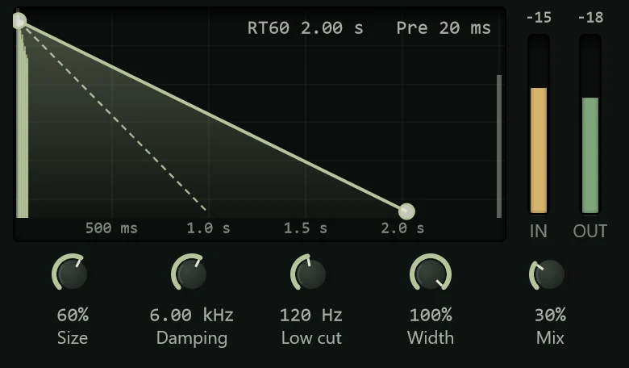

The Reverb puts a sound in a space, from a small room to a cathedral, so it stops
sounding dry and close and sits in the mix with depth around it.

In a real room you hear a sound directly, then its first reflections off the nearby
walls, then a dense wash of reflections that fades away: the **tail**. This reverb
builds the same thing from delays. It is a plain, clean room; for huge or strange
spaces use [Bloom](bloom.md), and for vocals [Vesper](vesper.md). Add it from the
effects menu's **Reverb & Delay** group (see [Inserts](../mixing/inserts.md)).

## On a track or on an FX track

You can put a reverb straight on a track, with **Mix** setting how much reverb you
hear. More often it goes on an **FX track**: several tracks send some of their sound to
it, so they share one space, which sounds more natural and saves putting a reverb on
each. On an FX track, set **Mix** to 100% so it outputs only reverb; the **Send:**
presets do this. See [Routing](../mixing/routing.md).

## The display

The graph shows what the reverb does to a single short sound over time, with level
falling downwards:

- the grey line at the left is the dry sound;
- the gap after it is the **pre-delay**;
- the thin lines are the early reflections, more of them and spread wider for a
  bigger room;
- the coloured slope is the tail, fading by 60 dB over the decay time;
- the dashed line is how fast the high frequencies fade, sooner the more damping
  there is.

At the top right, **RT60** is the decay time and **Pre** the pre-delay. The bar at the
right edge shows how loud the reverb is right now. **IN** and **OUT** meters sit
beside the graph.

### Pre-delay and decay

These two are set on the graph:

- **Drag the start of the tail** (the handle where the slope begins) left or right to
  set the **pre-delay**, 0 to 250 ms (default 20 ms). Pre-delay is the gap before the
  reverb starts. A little (10 to 40 ms) keeps the start of each word or note clear of
  the reverb, so a sound keeps its definition even with a long tail.
- **Drag the end of the tail** to set the **decay**, 0.2 to 12 seconds (default 2 s):
  how long the reverb takes to die away. A small room is under a second; a hall two or
  three; a cathedral much longer.

## Controls

| Knob | Range | What it does |
|---|---|---|
| **Size** | 0 to 100% (default 60%) | How big the space is: the spacing of the reflections. Small sizes sound like rooms, large ones like halls. |
| **Damping** | 1 kHz to 20 kHz (default 6 kHz) | Above this frequency the tail fades faster, as it does in a room with soft furnishings. Lower is darker and warmer; higher is brighter. |
| **Low cut** | 20 Hz to 1 kHz (default 120 Hz) | Removes low frequencies from the reverb only, which keeps it from muddying the bass. |
| **Width** | 0 to 100% | How wide the reverb is in stereo: 0% is mono, 100% fully spread. |
| **Mix** | 0 to 100% (default 30%) | The balance of reverb and the original sound. |

## Presets

| Preset | What it does |
|---|---|
| **Default** | A medium room, 2 s, at 30%. |
| **Ambience** | A very short, subtle space that adds life without sounding like reverb. |
| **Tight Booth** | A tiny, damped space. |
| **Small Room** | A short, natural room. |
| **Drum Room** | A slightly bigger room for drums. |
| **Vocal Plate** | A smooth 2.2 s tail with pre-delay, for vocals. |
| **Bright Plate** | A shorter, brighter plate. |
| **Snare Plate** | A short, bright plate with no pre-delay, for snare. |
| **Dark Chamber** | A heavily damped, dark space. |
| **Concert Hall** | A large 3 s hall. |
| **Cathedral** | A huge 7 s space. |
| **Send: Room**, **Send: Plate**, **Send: Hall** | The same kinds of space at 100% Mix, for an FX track. |

See [Presets](presets.md) for how presets work.

## Tips

- **Less than you think.** Reverb that is obvious when the track plays alone is often
  right in the mix, and too much makes everything distant and muddy. Set it, then turn
  it down a little.
- **Pre-delay for clarity.** If a vocal sounds washed out, add 20 to 40 ms of pre-delay
  before you shorten the decay.
- **Keep the lows out.** Raise **Low cut** to 200 Hz or more on a reverb for vocals or
  guitars; the low end of a reverb is mostly mud.
- **Tame it with EQ.** On an FX track, an [EQ](eq.md) after the reverb can take out
  harshness or boxiness from the whole space at once.
