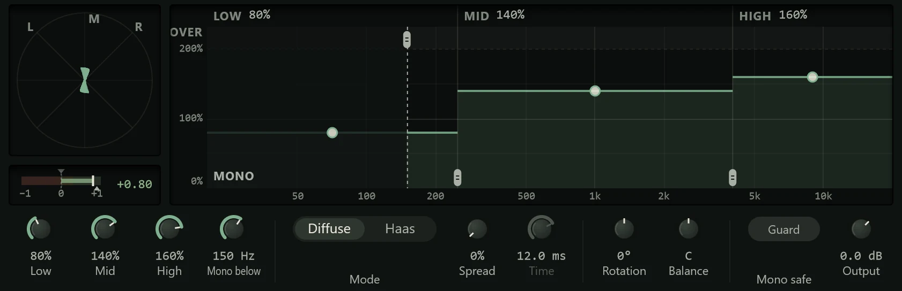

The Stereo Widener makes a stereo sound wider or narrower, separately in the lows, mids
and highs, and can spread a mono sound across the stereo field in a way that still
sounds right when the mix is played in mono. Insert it on a stereo track, a bus or the
master; it is in the **Stereo & Utility** group of the effects menu.

A few terms help here. The **mid** is what the left and right channels have in common
(the centre); the **side** is what differs between them (the width). The widener turns
the side up or down, so the mid, and with it the sound in mono, is left alone.

## Reading the display

The display has three parts.

- **The vectorscope** (the square at the left) draws the output as a cloud of dots,
  with the centre straight up and left and right on the diagonals. A mono sound is a
  vertical line; a wide sound is a broad cloud; a sound that leans sideways, towards
  the horizontal, is going out of phase (left and right cancelling each other). With
  nothing playing it shows **No signal**. A dashed line shows where a centred sound
  now sits if you have used **Rotation**.
- **The correlation meter** (under the scope) reads from -1 to +1 how alike the left
  and right channels are. Near +1 is close to mono and safe. Between 0 and 0.3
  (amber) is wide. Below 0 (red) means parts of the sound will cancel when the mix is
  played in mono, on a phone speaker or a club system, so keep the bar out of the
  red. A small triangle under the track shows the input's correlation, for
  comparison. The line with a notch above the track is where **Guard** acts (see
  below): drag it to move it.
- **The width bands** (the rest of the display) run from 20 Hz at the left to 20 kHz
  at the right, with width up the side: 0% (mono) at the bottom, 100% (unchanged) in
  the middle, 200% at the top. The **Low**, **Mid** and **High** blocks show each
  band's width.

Over the bands, a thin line shows the width the output actually measures at each
frequency, so you can see what your settings did to the sound. Where it goes past
200%, it runs on into the **OVER** strip at the top, and a warning triangle with a
figure ("340%") marks the widest point. While Guard is narrowing the sound, a dashed
line in each band shows the width it has left.

## Working in the display

- **Drag a band up or down** (anywhere in it) to widen or narrow it. It settles on
  100% and on mono as you pass them. Double-click to reset.
- **Drag a dividing line sideways** to move the crossover between two bands. The low
  crossover goes from 40 Hz to 1 kHz (250 Hz by default) and the high one from 1 to
  16 kHz (4 kHz by default).
- **Drag the dashed Mono below line** to make everything under it mono. The shaded
  area under it is labelled **MONO**.

## The controls

The knobs below the display are in four groups.

| Control | What it does |
| --- | --- |
| **Low**, **Mid**, **High** | Each band's width, 0% (**Mono**) to 200%. The same as dragging the blocks. |
| **Mono below** | Makes the side mono below this frequency, up to 500 Hz. **Off** at the bottom. Keeping the bass centred makes a mix more solid and safer on vinyl and in clubs. |
| **Mode** | How **Spread** widens: **Diffuse** spreads the sound without an echo; **Haas** uses a short delay between the sides. |
| **Spread** | Widens a mono or nearly mono sound by adding a treated copy to the side only. Because it is in the side, it disappears cleanly when the mix is played in mono. The bass under 120 Hz is left out. |
| **Time** | The delay for **Haas** mode, 1 to 30 ms. Dimmed in Diffuse. |
| **Rotation** | Turns the whole image left or right, ±45°, keeping its width. |
| **Balance** | Turns one side down ("L 40", "R 40"; **C** is centred). |
| **Guard** | When on (**Mono safe**), the widener narrows itself whenever the sound would go further out of phase than the line on the correlation meter (0 by default), and lets go again afterwards. The header shows how far it is narrowing ("Guard −35%"). |
| **Output** | The level out, -24 to +12 dB. |

The widener also keeps the loudness steady as you change the width, so a wider
setting does not seem better only because it is louder.

## Presets

- **Default**: everything at 100%, which leaves the sound unchanged.
- **Mix Width**: a gentle lift for a mix bus, with the bass in mono and Guard on.
- **Safe Wide** and **Wide Pad**: wider, guarded settings, the pad widest in the highs.
- **Air Width**: widens only the top.
- **Mono Low End**: takes the bass to mono.
- **Mono to Stereo**, **Haas Widen** and **Guitar Double**: Spread for mono sources,
  diffuse or with a Haas delay.
- **Centre Focus**, **Narrow 50%** and **Mono**: narrower images.

## Tips

- **Check in mono.** Widening tricks that sound great on headphones can vanish or
  thin out in mono. Keep an eye on the correlation meter, or switch on **Guard**.
- **A mono recording has no side to widen.** Turning up **Low**, **Mid** or **High** on
  a mono guitar or vocal does nothing; use **Spread** instead.
- **Width in moderation.** A whole mix past about 130% tends to sound hollow in the
  middle. Widening the highs and pads more than the bass, drums and vocal keeps the
  centre strong.
- **Haas** can sound like a double-tracked part. **Time** between about 10 and 25 ms
  works for guitars; shorter times sound more like width than a second take.
- The widener adds no [latency](../reference/glossary.md).
