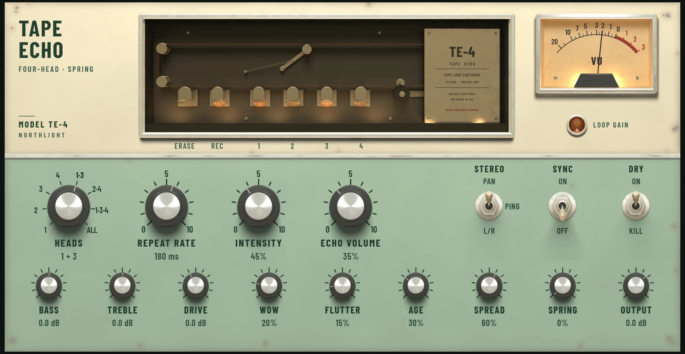

Tape Echo gives a part warm, wobbling echoes that darken as they repeat and can swell
into feedback. It is modelled on a 1970s tape loop machine: a record head writes the
sound onto a loop of tape, four playback heads read it back a moment later, and the
heads can be fed back to the record head so the echoes repeat. You'll find it in the
**Reverb & Delay** group of the effects menu.

Use the plain [Delay](delay.md) when you want clean, exact repeats. Use Tape Echo when
you want them to have character: slapback on a vocal or guitar, dub throws, or a
rhythmic pattern from several heads at once.

## Reading the face

The top half of the console shows what the machine is doing.

- **The transport window** shows the tape path. Under the window the heads are named
  **ERASE**, **REC** and **1** to **4**. The record head and each playback head has a
  neon lamp that glows with the level of the tape passing it, so you can watch an echo
  travel from head to head. A head that is not playing still glows, more dimly. The
  rollers on the right turn with the tape, slower when the repeat rate is long.
- **The VU meter** shows the level being written to the tape at the record head. A
  healthy level reads about 0. The tape saturates as the needle goes into the red,
  which thickens and softens the echoes; **DRIVE** sets how hard you hit it.
- **The LOOP GAIN lamp** shows how close the feedback loop is to running away. It is
  dark while the loop is steady, amber as it nears the edge, and red and flickering
  once the loop is self-oscillating (the echoes keep building on their own). The
  effect's header says **Self-oscillating** at the same time. Hover over the lamp to
  see the loop gain as a number: 1 is the edge.

## The controls

The four large knobs come first, then the three levers, then the nine small knobs.
Drag a knob or use the mouse wheel; double-click to reset it.

| Control | What it does |
| --- | --- |
| **HEADS** | Which playback heads sound: 1, 2, 3, 4, 1·3, 2·4, 1·3·4 or ALL. Head 2 is twice head 1's time, head 3 three times and head 4 four times, so a combination plays a rhythm. 1·3 is the default; 1·3·4 gives a galloping pattern. |
| **REPEAT RATE** | The motor speed, which sets head 1's time (20 ms to 1 s, 180 ms by default). With **SYNC** on it steps through note values instead (1/64 to 1/1, with dotted and triplet values). |
| **INTENSITY** | Feedback: how much of the heads goes back onto the tape, 0 to 120%. Around 100% the loop reaches the edge of oscillation, and past it the echoes build up into the tape's saturation rather than growing without limit. |
| **ECHO VOLUME** | How much echo you hear against the dry sound (35% by default). |
| **STEREO** lever | **PAN**: the active heads alternate left and right (a single head sits in the centre). **PING**: the repeats bounce from side to side. **L/R**: the left and right channels are echoed separately. |
| **SYNC** lever | **ON** locks the repeat rate to the project tempo as a note value, starting at an eighth note. **OFF** sets it freely in milliseconds. |
| **DRY** lever | **ON** passes the dry signal. **KILL** removes it, so only the echoes come out (for an FX track). |
| **BASS**, **TREBLE** | Tone shelves inside the loop, ±12 dB. Because they are in the loop, each repeat is shaped again: turn **TREBLE** down for echoes that grow darker as they fade. |
| **DRIVE** | The record level into the tape, -12 to +18 dB. Higher levels saturate the tape more. |
| **WOW** | Slow drifts in the tape speed, which make the echoes waver in pitch. |
| **FLUTTER** | Fast, small jitters in the tape speed. |
| **AGE** | How worn the tape is: duller highs, hiss under the echoes, and occasional dropouts that travel round the loop. |
| **SPREAD** | How wide the echoes are spread across the stereo field. |
| **SPRING** | Sends the echoes (not the dry sound) to a short spring reverb, with its chirp and drip. |
| **OUTPUT** | The level out, -24 to +12 dB. |

The levers flip with a click anywhere on them. On **STEREO**, click above the middle to
move it up and below to move it down. With a lever focused, Up and Down move it and
Space flips or steps it.

Turn **REPEAT RATE** while something is playing and the echoes bend in pitch as the
motor speeds up or slows down and settles, as on a real machine. This is part of the
sound: automate it for pitch sweeps.

When the Editor panel is short, the console shrinks to fit and switches to a compact
form: the knob values and small print disappear and the names grow. Hover over or turn
a knob to see its value in place of its name.

## Presets

Choose a preset from the bar in the effect's header (see [Presets](presets.md)):

- **Default**: heads 1·3 at 180 ms with moderate feedback.
- **Slapback** and **Vintage Slap**: a single short echo, the second older and darker.
- **Clean Tape**: little wobble and no wear.
- **Multi-head Rhythm**: heads 1·3·4 for a rhythmic pattern.
- **Dub Echo**: a dotted quarter at high feedback, dark and worn.
- **Ping-pong 1/8**: eighth notes bouncing left and right.
- **Stereo Tracks**: heads 2·4, wide, left and right kept apart.
- **Space Wash**: all four heads with feedback and spring reverb.
- **Spring Echo**: a single echo into plenty of spring.
- **Worn Tape** and **Wobbly Lo-fi**: heavy wow, flutter and age.
- **Send: Dub**: the Dub Echo with **DRY** on **KILL** and **ECHO VOLUME** at 100%,
  for an FX track.

## Tips

- **Use it on an FX track to share it.** Put Tape Echo on an
  [FX track](../mixing/routing.md), set **DRY** to **KILL** and **ECHO VOLUME** to
  100%, then send to it from any track. Each track's send sets how much echo it gets,
  and the dry sound stays on the original tracks. The **Send: Dub** preset is set up
  this way.
- **Dub throws.** Automate a vocal's send so only the last word of a line goes to the
  echo, and ride **INTENSITY** up towards the edge so it hangs on. Watch the
  **LOOP GAIN** lamp: amber is lively, red will keep building.
- **Keep runaway feedback under control.** The loop's level depends on **BASS**,
  **TREBLE** and **AGE** as well as **INTENSITY**, so turning up the bass can tip an
  amber loop into red. Turn **INTENSITY** back down to let it die away.
- **Long synced values.** The motor runs from 20 ms to 1 s for head 1. A synced note
  value longer than a second (a whole note at 120 bpm, for example) is held to 1 s.
  Use a later head for longer echoes: head 4 is four times head 1's time.
- **Bypass keeps it running.** Switched off, the machine keeps recording the input, so
  when you switch it back on the echoes are already there. Tape Echo adds no
  [latency](../reference/glossary.md).
