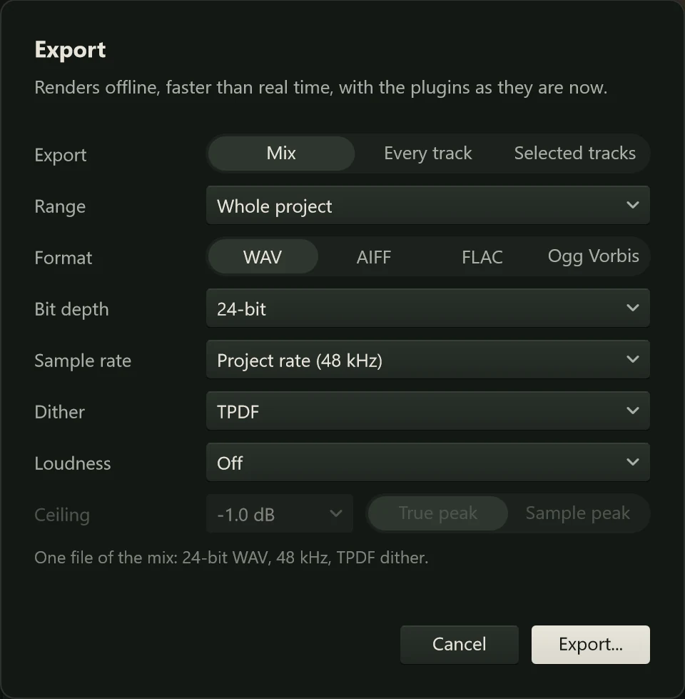

Exporting turns your project into an audio file you can play anywhere, upload,
send to someone or put on a CD. Northlight renders it offline, faster than real
time, with every plugin and setting as it is now, so the file sounds like what you
hear when you press play.

## Opening the Export dialog

Choose **Export...** from the project menu (click the project's name at the top
left), or press Ctrl+E. The dialog has a row for each choice, and a summary
underneath that says in a sentence or two what you are about to get ("One file of
the mix: 24-bit WAV, 48 kHz, TPDF dither."). Click **Export...** to choose where to
save, or **Cancel**.

Northlight remembers your choices for the next export, in every project.

## Export: the mix or stems

The first row chooses what to render:

- **Mix**: one stereo file of everything, through the master, as you hear it.
  Muted tracks stay silent and solos apply.
- **Every track**: one file per track, called a **stem**. Each is rendered with
  every other track muted, so it holds that track alone, through its buses, sends
  and the master's processing. Stems are what a mixing engineer, a collaborator or
  a remixer asks for: they can be lined up from the start in any other program.
- **Selected tracks**: stems of the selected tracks only (and of any track holding
  a selected clip). The summary says how many.

:::note
Stems go through the master's inserts too. With a limiter or compressor on the
master, each stem is processed on its own, so the stems added together won't quite
match the mix. Bypass the master's processing before exporting stems if they need
to add up exactly.
:::

## Range

- **Whole project**: from the start of the song to the end of the last clip.
- **Loop region**: the [loop range](../editing/playback.md#the-loop-range) set in
  the ruler (it doesn't matter whether Loop is on). Greyed out when there is no range.
- **Region:** followed by a name: one of the project's
  [regions](../editing/playback.md#markers-and-regions), for exporting a single section or a song from
  a project that holds several.

Each export starts and ends exactly on its range, with plugin delays compensated.

:::caution
**Whole project** stops where the last clip ends, so a reverb or delay ringing on
after the final note is cut off. To keep the tail, drag a range in the ruler from
the start to a little past the end and choose **Loop region**.
:::

## Format

| Format | What it is | Use it for |
|---|---|---|
| **WAV** | Uncompressed audio, read by everything. | The safe default: masters, stems, sending to a mastering engineer, uploading to a distributor. |
| **AIFF** | Uncompressed, like WAV, common on Macs. | Someone who works in Apple software and asks for it. |
| **FLAC** | Lossless compression: the same audio as WAV in roughly half the space. | Keeping archives, sending full quality by email or download. |
| **Ogg Vorbis** | Lossy compression: much smaller files that drop detail you are unlikely to hear. | Sharing a mix for listening, posting online. Not for anything that will be processed further, and not every player opens it. |

## Bit depth or quality

For WAV, AIFF and FLAC the next row is **Bit depth**: how finely each sample's
level is recorded.

- **16-bit**: CD quality. Fine for a finished file to listen to; use it with
  dither (below).
- **24-bit** (the default): the usual choice for masters and stems, with far more
  detail than anyone can hear.
- **32-bit float** (WAV only): every value exactly as Northlight calculated it,
  including peaks over 0 dB, which can be turned down later without clipping. The
  biggest files; useful for sending to mastering or for further processing.

For Ogg Vorbis the row is **Quality**, a bit rate from **64 kbps** to **500
kbps**. Higher is better and larger; the default, **192 kbps**, is a good balance
for music.

## Sample rate

**Project rate** writes the file at the rate the project runs at (shown in
brackets). You can also choose **44.1 kHz**, **48 kHz**, **88.2 kHz** or **96
kHz**, and Northlight converts the render with a high-quality converter; the
summary says "(converted)". Use 44.1 kHz for a CD, and otherwise leave the project
rate unless someone asks for a particular one (video usually uses 48 kHz).

## Dither

Turning audio into 16 or 24-bit numbers rounds every sample to the nearest step.
On quiet passages, such as a fade or a reverb tail, that rounding becomes a faint,
grainy distortion that follows the music. **Dither** adds a tiny amount of noise
before rounding, which turns that distortion into a smooth, steady hiss far below
the music, which is much less noticeable.

- **Off**: no dither.
- **TPDF** (the default): plain dither, the standard choice.
- **TPDF, noise shaped**: the same, with the noise moved towards the highest
  frequencies, where hearing is least sensitive, so it is quieter to the ear.
  A good choice for 16-bit files.

Dither matters most at 16-bit; at 24-bit it does no harm. The row is greyed out for
32-bit float and Ogg Vorbis, which don't round to whole steps. Dither once, at the
very end: when you send a file to be processed further, export 32-bit float (or
24-bit) rather than dithering to 16-bit.

## Loudness normalisation

How loud a song seems depends on its overall level over time, not only its peaks.
That is measured as **integrated loudness**, in **LUFS** (loudness units relative
to full scale): the higher the number (the closer to 0), the louder. Streaming
services measure every song and turn the loud ones down so a playlist plays at an
even level.

**Loudness** sets a target. Northlight measures the render and raises or lowers its
level to reach it. **Off** (the default) leaves the level as it is. The targets:

| Target | Typical use |
|---|---|
| **-9 LUFS**, **-11 LUFS** | Very loud masters, as some genres are mastered. |
| **-14 LUFS (streaming)** | What Spotify, YouTube and most streaming services play at. |
| **-16 LUFS (Apple Music, podcasts)** | Apple Music's level, and the common podcast target. |
| **-18 LUFS** | Quieter material, audiobooks and dynamic music. |
| **-23 LUFS (EBU R128 broadcast)** | European broadcast television and radio. |

Normalising only changes the level: it does not compress or limit. If reaching the
target would push the peaks over the **Ceiling**, Northlight stops short at the
ceiling and the message after the export says so. To get louder than that, put a
[limiter](../effects/limiter.md) on the master and set its output a little below the
ceiling.

**Ceiling** is the highest the peaks may reach: **-0.1 dB**, **-0.3 dB**, **-0.5
dB**, **-1.0 dB** (the default) or **-2.0 dB**. Beside it, choose how peaks are
measured:

- **True peak** (the default) measures the peaks between the samples too, which a
  player's converter or a lossy encoder can create when it rebuilds the wave. Results
  are in dBTP. Use it, with a ceiling of -1.0 dB, for anything that will be
  streamed or encoded.
- **Sample peak** measures the largest sample (dBFS).

Ceiling and its peak choice are greyed out while Loudness is Off.

When you export stems with normalisation on, Northlight measures the mix first and
gives every stem the same gain, so the stems still add up to the normalised mix.

[Metering and loudness](../mixing/metering.md) explains how to read the master's
loudness meter while you mix.

## Where the files go

- **A mix** asks for a file name. It starts as the project's name ("Song.wav"),
  with " loop" or the region's name added for a range ("Song Chorus.wav").
- **Stems** ask for a folder, starting as "Song Stems". Each stem is named with its
  track's position and name: "01 Drums.wav", "02 Bass.wav", and so on.

While the export runs, the status bar shows its progress ("Bouncing 42%"). When it
finishes, a message gives the file, its length and its loudness (with the gain
applied and the resulting peak, when normalised), with **Show in folder** to find
it in Explorer.

## Which settings to choose

| You want to | Export | Format | Bit depth | Loudness |
|---|---|---|---|---|
| Send the mix to a mastering engineer | Mix | WAV | 32-bit float or 24-bit | Off, with the master's limiter bypassed |
| Upload a finished master to a distributor | Mix | WAV or FLAC | 24-bit (or 16-bit, 44.1 kHz, if asked) | Off if the master is finished; -14 LUFS with a -1.0 dB true peak ceiling if not |
| Burn a CD | Mix | WAV | 16-bit at 44.1 kHz, TPDF noise shaped | As you like |
| Share a mix with friends or online | Mix | Ogg Vorbis (or FLAC) | 192 kbps or more | -14 LUFS |
| Hand the parts to a mixing engineer or a collaborator | Every track | WAV | 24-bit | Off |

To render one track in place, to save processing while you work, use
[Freezing tracks](../mixing/freezing.md) instead.
