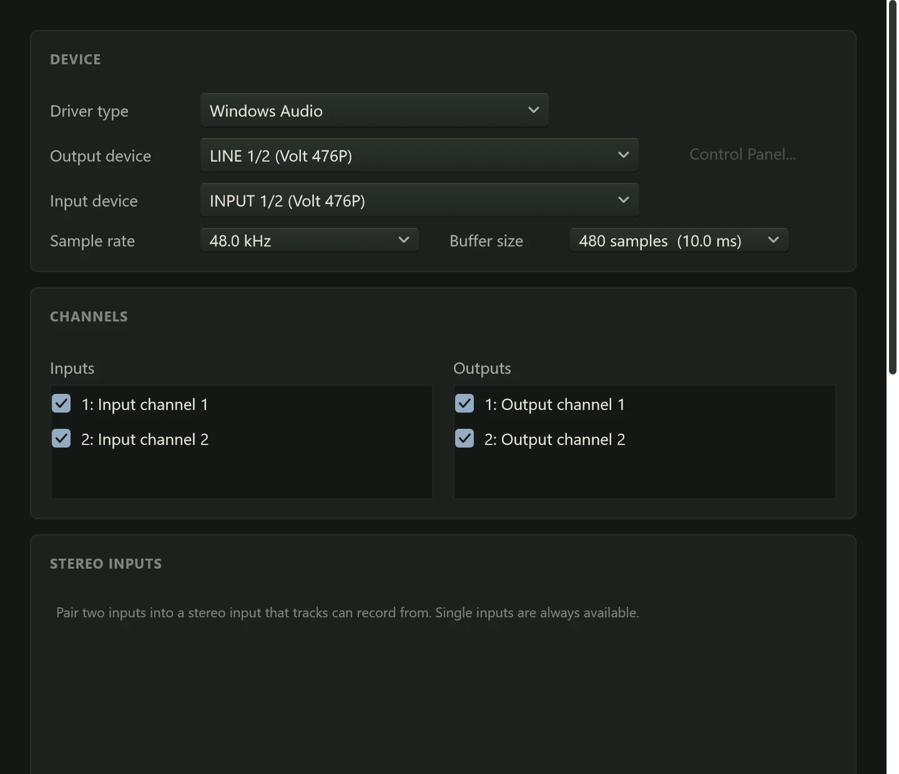

Before Northlight can play or record, it needs to know which audio device to use: the
audio interface you plug microphones and headphones into, or your computer's own sound.
This page covers the first launch, the **Audio Setup** window, and the settings that
decide how quickly sound gets in and out.

## The first launch

The first time Northlight starts, two welcome sheets appear over an empty project.

**Step 1 of 2: Choose your audio device.** Pick the **Driver**, the **Device** and the
**Buffer size** (both explained below). The **Input** meter shows the device's input:
play or sing, and it should move. Click **Use this device** to open it, or **Skip** to
decide later. If the device can't be opened, a message says why, with a button to open
Audio Setup.

**Step 2 of 2: Find your plugins.** Northlight looks for VST3 and CLAP plugins in the
standard folders. **Scan now** starts the scan in the background, so you can work while
it runs; **Later** leaves it for another time. You can scan again from the Browser
whenever you install new plugins (see [Plugins](../mixing/plugins.md)).

These sheets appear only once. Everything they set can be changed in Audio Setup.

## Opening Audio Setup

Open **Audio Setup** from the app menu (the Northlight mark at the left of the header
bar), with Ctrl+Shift+A, or by clicking the device name at the left of the status bar.
The same settings are on the **Audio** page of Preferences.

Audio Setup is laid out in cards: **Device**, **Channels**, **Stereo inputs**,
**MIDI**, **Latency** and **Monitoring**. A line at the bottom says whether the
device is running, with the driver and the number of inputs and outputs.

## ASIO or Windows Audio

The **Driver type** decides how Northlight talks to your device. Windows offers
several kinds of driver, and Northlight lists the ones it finds:

| Driver type | What it is | When to use it |
|---|---|---|
| **ASIO** | A driver made by the interface's maker for music software. | Whenever your interface has one. It gives the lowest latency and the most reliable timing. |
| **Windows Audio** | Windows' ordinary sound system, shared with every other program. | Built-in sound, or a device with no ASIO driver, for listening and mixing. Other programs keep playing, but the latency is high. |
| **Windows Audio (Exclusive Mode)** | Windows Audio with the device to itself. | A device with no ASIO driver when you need lower latency. Other programs fall silent while Northlight has the device. |
| **Windows Audio (Low Latency Mode)** | Shared Windows Audio with smaller buffers, where the device's driver supports it. | A middle way: lower latency without taking the device from other programs. |

Most audio interfaces come with an ASIO driver on the maker's website; install it
before you start. With ASIO, the **Control Panel...** button beside the device opens
the driver's own settings, where some interfaces set their buffer size.

Choose the device in **Device**. With a Windows Audio driver, the input and output
are separate devices, so there is an **Output device** and an **Input device** to
choose.

## Sample rate

The **Sample rate** is how many times a second the sound is measured: 44.1 kHz,
48 kHz, 96 kHz and so on. 48 kHz is a good choice for most work; 44.1 kHz is the
rate of CDs. Higher rates use more of the computer's power for little audible
difference.

A new, empty project takes the device's rate. Once a project has audio in it, it
keeps its rate, and if you later run the device at a different one, the status bar
warns that playback will be pitched, and recording waits until the two match. Set the
device back to the project's rate in Audio Setup.

## Buffer size and latency

Northlight handles sound in small blocks, and the **Buffer size** is the length of a
block in samples. The menu shows each size with how long it lasts at the current rate,
such as "128 samples (2.7 ms)".

**Latency** is the delay between a sound going in and coming back out. While you
record, it is what you hear as a lag between playing a note and hearing it in your
headphones. Smaller buffers mean less latency, but they give the computer less time to
work out each block; if it runs out of time, you hear clicks and the status bar counts
**dropouts**.

So the right size depends on what you're doing:

- **Recording** (tracking) with monitoring through Northlight: 64 or 128 samples. At
  48 kHz that is about 1.3 or 2.7 ms each way, too short to notice.
- **Mixing**, or playing back with many plugins: 512 or 1024 samples. The delay
  doesn't matter when nobody is playing along, and the computer has more time for
  effects.

Start at 128. If you hear clicks, go up a step; if the lag bothers you while you play,
go down one. Windows Audio in its shared mode often runs at 480 samples whatever you
pick, which is about 10 ms at 48 kHz.

## Channels

**Channels** lists your device's **Inputs** and **Outputs**, each with a tick box. Only
ticked inputs can be chosen as a track's input, and each one has a small meter beside
it, so you can play into a microphone and see which input it is on. Untick inputs and
outputs you don't use.

To record a source with a left and a right side, such as a keyboard or a pair of
microphones, pair two inputs under **Stereo inputs** with **Add stereo input**. See
[Inputs](../recording/inputs.md#stereo-inputs).

## Latency: Reported and Measured

The **Latency** card shows two figures. **Reported** is what the driver says its input
and output delays are, and the round trip, the two added up. Drivers often leave out
part of the delay, such as the converters in the interface, so the true round trip is
usually a little longer.

**Measured** is the real round trip, found by sending a click out and listening for it
coming back. Northlight uses it to line up what you record with what you were hearing,
so it is worth measuring once if you record:

1. Connect one of the interface's outputs to one of its inputs with a cable.
2. Under **Loopback**, choose that output and that input.
3. Turn your speakers or headphones down: the click is loud.
4. Click **Calibrate**. Northlight plays five clicks ("Playing click... 3/5") and shows
   the result.

The measurement is kept for that device, sample rate and buffer size. If you change any
of them, Measured reads "Not measured for this device configuration" until you calibrate
again; until then Northlight uses the reported figure. **Clear** forgets the measurement.

The status bar shows the round trip too, brighter when it has been measured. See
[Latency and monitoring](../recording/latency.md) for more.

## Monitoring

**Pass inputs through to outputs** sends the ticked inputs straight to the outputs, at
the **Level** beside it, so you can check a microphone without a track. It is off by
default.

:::caution
With pass-through on, a microphone near your speakers howls. Use headphones.
:::

For recording, use each track's own monitor button instead (see
[Input monitoring](../recording/recording-audio.md#input-monitoring)).

## MIDI devices

The **MIDI** card lists your MIDI **Inputs**, such as keyboards and pad controllers,
each with a tick box. They are all ticked to start with, and a keyboard you plug in
while Northlight runs appears in the list. Every ticked input reaches the MIDI tracks
that listen to it (see [MIDI tracks](../midi/midi-tracks.md)).

**Output** chooses one MIDI output, for playing an external synth or drum machine from
a MIDI track, or **(none)**.
