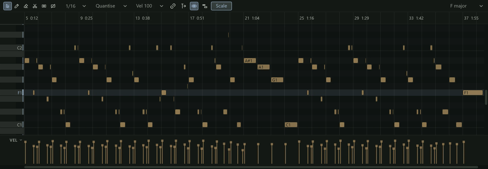
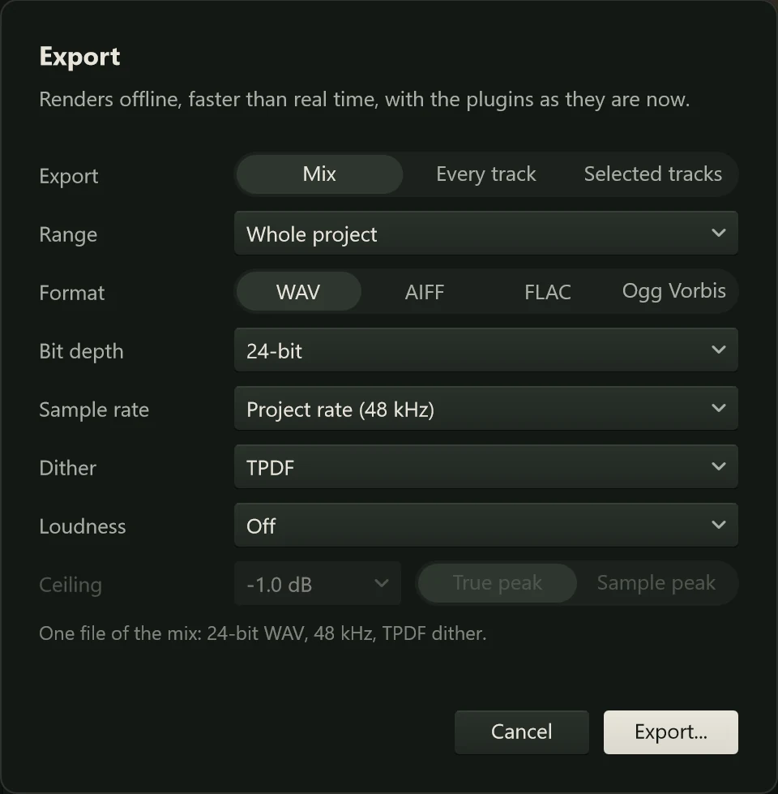

This page walks you through a short song from start to finish: an electric piano part
drawn with the mouse, a recorded part on top, a little reverb, and a WAV file at the
end that any music player can play. It assumes you have never used a DAW (a digital
audio workstation, a program like Northlight for recording and arranging music) and
explains each step as it goes. Each step links to the page that covers it in full.

Before you start, set up your audio device as in [Setting up audio](audio-setup.md),
and put on headphones or turn on your speakers.

## Start a project

1. Open the project menu by clicking the project's name at the left of the header bar,
   and choose **New** (Ctrl+N). If the project you had open has unsaved changes,
   Northlight asks whether to save them first.
2. The empty arrange view says "Start a project". Before adding anything, set the
   tempo: click the tempo in the readout at the top of the window ("120.00 BPM"),
   type a new one, such as 90, and press Enter. Leave it at 120 if you have no
   preference.
3. Save the project now, so that everything you record has a home: press Ctrl+S, choose
   a folder and a name ("First song") and click **Save**. Northlight writes
   `First song.northlight` and keeps the project's audio in a folder beside it, named
   `First song Media`. See [Saving and opening](../projects/saving.md).

## Add an instrument

A MIDI track holds notes, not sound: it plays them on an instrument. Northlight comes
with seven instruments; this song uses Lumen, an electric piano.

1. Click the **+** button (**Add track**) in the corner above the track list.
2. Choose **MIDI track > With a new instrument > Lumen**.

Two rows appear: **MIDI 1**, which holds the notes, and **Lumen**, the instrument
channel that turns them into sound and has the volume fader. The MIDI track is armed
(its **R** is red), so if you have a MIDI keyboard connected you can play Lumen
already. See [MIDI tracks](../midi/midi-tracks.md) and [Lumen](../instruments/lumen.md).

## Draw a part in the piano roll

1. Double-click the empty lane of **MIDI 1** at bar 1. A one-bar **MIDI clip** appears.
   A clip is a block of notes or audio on a track's timeline.
2. Drag the clip's right edge to bar 5, so it lasts four bars.
3. Double-click the clip. The **Piano Roll** opens in the dock under the arrange view
   (F6 shows it at any time). Keys run up its left side and time runs across.
4. Click the pencil in the piano roll's toolbar, or click in the piano roll and press 3.
5. Click in the grid to add notes. Each click adds one at the snapped position, and you
   hear it as you place it. Drag while you click to make a note longer. Try a chord: C,
   E and G stacked in the same beat, then a few more chords along the clip.
6. Press 1 for the select tool to move notes by dragging, and Delete to remove the
   selected ones. Ctrl+Z undoes any step.
7. Press Enter to go back to the start, and Space to play. Space again stops.

The bars in the lane under the notes are their **velocities**, how hard each note is
played: drag one up to make that note louder. See [The piano roll](../midi/piano-roll.md).

## Record an audio part

Next, record something over the piano: a voice, a guitar, anything with a microphone
or an input on your interface.

1. Click Lumen's MIDI track's **R** to disarm it, so it doesn't record too.
2. Press Ctrl+T to add an audio track. It appears as **Audio 1**.
3. In its header, click the input menu (it reads **No input**) and choose the input
   your microphone or instrument is plugged into, such as **In 1**.
4. Click the track's **R** to arm it. Sing or play: the meter in its header should move.
   With monitoring on **Auto**, the default, you hear yourself in your headphones.
5. Press C to turn on **Click** if you want the metronome to play along.
6. Press Enter to go to the start, then R (or the **Record** button) to record. Play
   your part along with the piano.
7. Press Space to stop. The recording appears as a clip on the track.

Not happy with it? Press Ctrl+Z and record again. See
[Recording audio](../recording/recording-audio.md) and
[Inputs](../recording/inputs.md).

:::tip
No microphone? Import a sound instead: press Ctrl+I, choose a WAV, AIFF, FLAC or Ogg
file, and it lands on a new track at the start of the song. You can also drag a file
from Explorer straight onto the arrange view. See [Importing](../projects/importing.md).
:::

## Set the levels

1. Press F2 to show the **Mixer** in the dock. It has a strip for **Lumen**, one for
   **Audio 1** and the **Master** strip at the right, which is everything together.
2. Press Enter and then Space to play the song.
3. Drag each strip's fader until the two parts sit well together. Watch the master's
   meter: keep its loudest moments below the top, out of the red.
4. Turn a strip's pan knob to place its part to the left or right.

See [The mixer](../mixing/mixer.md).

## Add reverb on an FX track

Reverb makes a sound seem to be in a room. Rather than putting a reverb on each track,
you can put one on an **FX track** and **send** some of each track to it, so all the
parts share one room. A send is a second path out of a track, with its own level.

1. On the **Lumen** strip in the mixer, click **+ Send**, then choose
   **New FX track > Reverb**. Northlight adds an FX track called **Reverb** with the
   Reverb effect on it, and a send to it from Lumen.
2. On the **Audio 1** strip, click **+ Send** and choose **Reverb**, the FX track you
   made in step 1.
3. Play the song and drag each strip's send slider to set how much of that track goes
   into the reverb. More send means further away.

To change the room itself, select the **Reverb** strip and press F3: the **Editor**
shows the effect, with its presets in its header. See [Routing](../mixing/routing.md)
and [Reverb](../effects/reverb.md).

## Export the song

1. Press Ctrl+S to save the project.
2. A reverb keeps ringing after the last note, but an export of the whole project ends
   where the last clip ends. To keep the tail, drag in the ruler from bar 1 to a bar or
   two past the end of the song to set a loop range.
3. Press Ctrl+E, or choose **Export** from the project menu. The **Export** sheet opens.
4. Leave **Export** on **Mix**. Set **Range** to **Loop region** (or **Whole project** if
   you skipped step 2). Leave the **Format** on **WAV**, with its 24-bit depth.
5. Click **Export**, choose where to save the file and its name, and click **Save**.

A message says when the file is ready. Play it in any music player, or send it to
someone. [Exporting](../exporting/index.md) explains the other formats, stems,
loudness normalisation and dither.

## Where to go next

- Record several takes and keep the best bits: [Loop, punch and takes](../recording/takes.md).
- Edit clips: split, trim, fade and move them in [Clips](../editing/clips.md).
- Try the other instruments, such as [Aurora](../instruments/aurora.md) or the
  [Pulsar](../instruments/pulsar.md) drum synth.
- Shape each track's sound with its [channel strip](../mixing/channel-strip.md).
