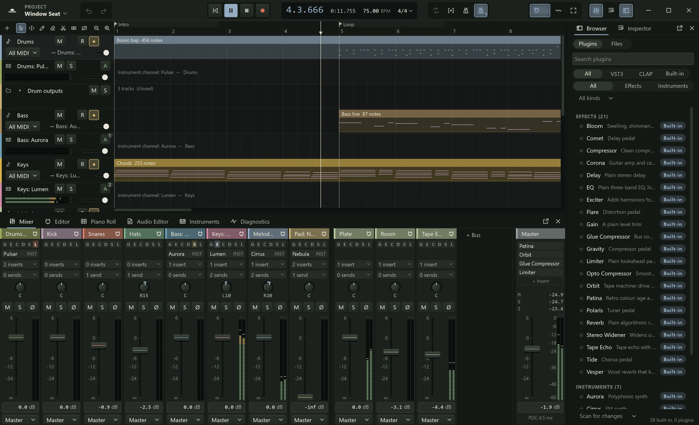

Northlight works in one main window. This page names its parts, so the rest of the
manual can refer to them, and explains how the panels open, close and move.

The window has five zones:

1. The **header bar** along the top: the menus, the transport and the panel buttons.
2. The **arrange view** in the middle: your tracks and their clips along a timeline.
3. The **dock** under it, holding a panel such as the mixer or the piano roll.
4. The **side panel** on the right, holding the browser or the Inspector.
5. The **status bar** along the bottom.

## The header bar

The header bar is also the window's title bar: drag an empty part of it to move the
window, double-click it to maximise, and use the buttons at its far right to minimise,
maximise and close. From left to right it holds:

- **The app menu**, the Northlight mark: **About Northlight**, **Audio Setup**,
  **Plugins**, **Close all plugin windows**, **Preferences**, **Layout** and **Quit**.
- **The project name.** Click it for the project menu: New, Open, Recent, Save,
  Export, adding tracks, importing and the rest (see
  [Saving and opening](../projects/saving.md)). "PROJECT · EDITED" above the name means
  there are unsaved changes.
- **Undo** and **Redo** (Ctrl+Z and Ctrl+Y). Their tooltips name the step they would
  undo or redo.
- **The transport**: **Go to start**, **Play**, **Stop** and **Record**. While playing,
  Play becomes Pause.
- **The readout**: the position in bars and beats and in time, the tempo and the time
  signature. Click a position to type one; drag the tempo or type it.
- **The mode toggles**: **Loop**, **Punch**, **Click** (the metronome) and
  **Count-in**.
- **Snap**, **Ripple** and **Zoom to fit**, which affect editing in the arrange view
  (see [Editing tools](../editing/tools.md)).
- **Mixer**, **Editor** and **Browser**, which show and hide those panels. Each lights
  while its panel is open.

Every button's tooltip gives its key. [Playing and moving around](../editing/playback.md)
covers the transport in full.

## The arrange view

The arrange view is where a song is laid out. Each track is a row: its **header** on the
left, with the name, the mute (**M**), solo (**S**) and arm (**R**) buttons, the input
and a level meter, and its **lane** to the right, where the clips sit along the
timeline. The **ruler** across the top shows bars and beats; click it to move the
playhead, drag in it to set a loop range.

The corner above the track headers holds the **+** button (**Add track**), the seven
editing tools (keys 1 to 7) and two buttons that make the rows shorter or taller. Buses,
FX tracks and the master have rows of their own after the tracks.

A new project's arrange view is empty, with three buttons to start: **Add audio track**,
**Add MIDI track** and **Import audio**. You can also drop audio files on it. See
[Tracks](../editing/tracks.md) and [Clips](../editing/clips.md).

## The panels

Everything else in Northlight is a panel. Each has a key that shows it and puts the
keyboard focus in it:

| Key | Panel | What it is for | Starts in |
|---|---|---|---|
| F2 | **Mixer** | A strip for every channel: faders, inserts, sends. See [The mixer](../mixing/mixer.md). | Dock |
| F3 | **Editor** | The selected channel's channel strip, effects and instrument. See [Inserts](../mixing/inserts.md). | Dock |
| F4 | **Browser** | Plugins, presets and audio files to drag in. | Side panel |
| F5 | **Inspector** | The details of the selected track, clip or notes, to read and type into. | Side panel |
| F6 | **Piano Roll** | The notes of the selected MIDI clip. See [The piano roll](../midi/piano-roll.md). | Dock |
| F7 | **Diagnostics** | How the audio engine is coping, for tracking down clicks. See [Troubleshooting](../reference/troubleshooting.md). | Dock |
| F8 | **Instruments** | Every instrument in the project, which tracks play it, and its outputs. See [MIDI tracks](../midi/midi-tracks.md). | Dock |
| F9 | **Audio Editor** | The pitch of a vocal clip, note by note. See [Vocal pitch editing](../pitch/index.md). | Dock |

F2 has a second job: when the arrange view has the focus and a track is selected, it
renames the track (or the selected clip). Click in the mixer, or anywhere outside the
arrange view, and F2 shows the mixer again.

The dock and the side panel show one panel at a time, with a tab for each panel they
hold. Drag the border between a host and the arrange view to resize it; drag it nearly
shut and it closes. Both remember their size and which panels were open the next time
Northlight starts. The arrange view always keeps enough room to work in.

### Detaching a panel

Any panel can have a window of its own, for example to put the mixer on a second
screen:

- Click the **Open in window** button at the right of the panel's tab row, or drag
  its tab out of the row.
- Or press the panel's key with Shift: Shift+F2 detaches the mixer, and pressing it
  again puts it back.

To put a floating panel back, click its **Return to dock** (or **Return to side
panel**) button, or drag its header onto the dock or the side panel. The Editor,
Browser and Inspector can live in either. Closing a floating panel's window returns it
to where it started, hidden, so it is never lost. A floating window remembers its size
and the screen it was on.

The app menu's **Layout** submenu has two arrangements: **Mix** opens the mixer in its
own window and closes the dock and the side panel; **Edit** is the usual layout.
**Reset layout** puts every panel back where it started.

## The status bar

The status bar along the bottom shows how the audio is running, from left to right:

- **The driver and device**, such as "ASIO · Volt 2". Click it to open Audio Setup.
  A yellow dot means the device you chose is unavailable and another is playing.
- **The sample rate and buffer size**, such as "48.0 kHz · 128". Hover for the
  buffer's length in milliseconds.
- **The round trip**, the latency in and out ("4.3 ms round trip"), bright when it has
  been measured (see [Setting up audio](audio-setup.md#latency-reported-and-measured)).
- **CPU**: how much of the time Northlight has for each block of sound it is using.
  It turns yellow above 70% and red above 90%; past 100% you hear clicks.
- **Dropouts**, shown only when there have been some: each is a click or gap in the
  sound. Click to reset the count.
- **Disk**, only while recording: how fast it is writing and the space left.

At the right, short confirmations such as "Saved Song.northlight" appear and fade.
Messages that need you, such as an error or a question, appear instead as a message at the
bottom left, above the status bar, with a button where there is something to do.
Information goes by itself after a few seconds; warnings and errors stay until you
dismiss them.

## Moving around by keyboard

Tab moves the focus through the window in order: the header bar, the selected track's
header, the arrange view, the dock, the side panel and the status bar. Up and Down
move between tracks. Shift+F10, or the Menu key, opens the menu of whatever has the
focus. See [Keyboard shortcuts](../reference/shortcuts.md) and
[Accessibility](../reference/accessibility.md).
