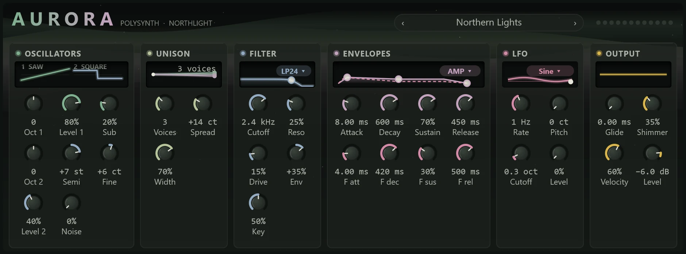

Aurora is Northlight's general-purpose synthesiser: reach for it when you want a bass line, chords, a pluck or a lead without loading a plugin. It plays up to twelve notes at once.

To add it, choose **MIDI track > With a new instrument > Aurora** from the **+** menu, or press Ctrl+Shift+T, which makes a MIDI track with a new Aurora channel. Its face shows in the Editor panel when you select either track. See [MIDI tracks and instruments](../midi/midi-tracks.md) for how the two work together.

## How Aurora makes a sound

If you are new to synths, this is the path every note takes, left to right across the face:

1. Two **oscillators** make a raw, buzzing tone at the note's pitch.
2. **Unison** stacks several slightly detuned copies of each oscillator, which makes the sound thicker and wider.
3. A **filter** removes some of the frequencies, usually the highs, to make the sound darker or brighter.
4. **Envelopes** shape how the sound changes over a note: how fast it starts, how it fades.
5. An **LFO** (low-frequency oscillator, a slow wave you don't hear directly) wobbles the pitch, the filter or the level.
6. The **output** adds glide, a stereo chorus and the overall level.

The [glossary](../reference/glossary.md) explains these words in more detail.

## The face

Across the top, the aurora drifts through the sky and brightens as Aurora plays. It holds still when nothing sounds, or when reduced motion is on. Beside the wordmark are the preset bar and twelve voice lights, one for each note sounding.

Each of the six panels has a display that shows what its controls are doing, and most of the displays can be dragged. Knobs work as everywhere in Northlight: drag up or down (hold Shift for fine steps), turn the mouse wheel, or double-click to return to the default.

## Oscillators

The display shows one cycle of each oscillator's wave. Drag across either wave to morph it smoothly from sine (soft, pure) through triangle and saw (bright, buzzy) to square (hollow). The shapes in between are allowed and often sound best.

| Control | What it does |
|---|---|
| **Oct 1** | Oscillator 1's octave, −2 to +2. |
| **Level 1** | Oscillator 1's volume. |
| **Sub** | A sine an octave under oscillator 1, for weight under a bass. |
| **Oct 2** | Oscillator 2's octave. |
| **Semi** | Oscillator 2's pitch in semitones, −12 to +12. The default, +7, is a fifth above. |
| **Fine** | Oscillator 2's fine tuning, ±50 cents. A few cents against oscillator 1 makes a slow, warm beating. |
| **Level 2** | Oscillator 2's volume. |
| **Noise** | White noise, for breath or a sharper attack. |

## Unison

The display draws the voices as a fan: how far apart they spread is the detune, and their colour is where they sit from left to right. Drag up and down on it to change **Spread**.

| Control | What it does |
|---|---|
| **Voices** | Copies of each oscillator, 1 to 7. One gives a plain, focused sound. |
| **Spread** | How far the outermost copies are detuned, 0 to 50 cents. |
| **Width** | How far the copies are panned apart, 0 to 100%. |

## Filter

The display draws the filter's response. Drag across it for the cutoff and up and down for the resonance. The chip in its corner picks the mode: **LP12** and **LP24** are low-pass filters (gentle and steep) that darken the sound, **BP** (band-pass) keeps a band in the middle, and **HP** (high-pass) thins the sound from below.

| Control | What it does |
|---|---|
| **Cutoff** | Where the filter starts to act, 20 Hz to 20 kHz. |
| **Reso** | Resonance: a peak at the cutoff that makes the filter sing or squelch. |
| **Drive** | Pushes the filter harder, for grit. |
| **Env** | How far the filter envelope moves the cutoff, up or down, by up to five octaves. |
| **Key** | Key tracking: how much the cutoff follows the note, so high notes stay as bright as low ones. |

## Envelopes

An envelope has four stages, ADSR: **attack** (the time to rise to full), **decay** (the time to fall to the sustain level), **sustain** (the level held while the key is down) and **release** (the time to fade after you let go). Aurora has two: one for the volume (amp) and one for the filter.

The display fills the amp envelope and draws the filter envelope as a dashed line. The chip in its corner, **AMP** or **FILTER**, picks which one the handles edit. Drag the peak for the attack, the sustain point across for the decay and up and down for the level, and the end for the release.

The knobs are **Attack**, **Decay**, **Sustain** and **Release** for the amp envelope, then **F att**, **F dec**, **F sus** and **F rel** for the filter envelope. Attacks go up to 5 seconds and releases up to 10.

## LFO

The display shows one cycle of the LFO's wave, with a dot riding it and a marker for its value now. The corner chip picks the shape: **Sine**, **Tri**, **Saw**, **Square** or **Random** (steps to a new random value, like sample and hold).

| Control | What it does |
|---|---|
| **Rate** | How fast it moves, 0.05 to 20 Hz. |
| **Pitch** | Vibrato depth, up to 100 cents. |
| **Cutoff** | How far it sweeps the filter, up to 4 octaves. |
| **Level** | Tremolo: how much it moves the volume. |

## Output

The display is a scope of Aurora's output.

| Control | What it does |
|---|---|
| **Glide** | The time each note takes to slide from the last note's pitch, up to 2 seconds. 0 is off. |
| **Shimmer** | A stereo chorus that widens and softens the sound. |
| **Velocity** | How much playing harder makes a note louder and brighter. |
| **Level** | Aurora's output level, −60 to +6 dB. |

Aurora also follows the pitch bend wheel (±2 semitones), the mod wheel and channel pressure (both add vibrato) and the sustain pedal.

## Presets

Step through the presets with the arrows in the preset bar, or click the name for the list. The name reads **Custom** once you change a setting. You can save your own sounds from the same menu (see [Presets](../effects/presets.md)). Choosing a preset is one undo step.

- **Northern Lights**: the default, a saw with a square a fifth above and a little chorus.
- **Solar Wind**: a wide supersaw, seven voices on each oscillator.
- **Glacier Keys**: soft, bell-like keys that fade while held.
- **Polar Bass**: a driven bass with a sub, a short filter sweep and a little glide.
- **Ice Pluck**: a short, bright pluck with plenty of chorus.
- **Starfield**: a slow pad through a band-pass filter that bubbles at random.
- **Comet Lead**: a square lead with vibrato and glide.
- **Aurora Drift**: a slow pad that breathes with the LFO.

## Tips

- **A classic synth bass:** set **Voices** to 1, a saw on oscillator 1 with **Oct 1** at −1, some **Sub**, LP24 with the cutoff low, **Env** up and a short **F dec**. Raise **Reso** for more squelch.
- **A supersaw:** both oscillators on saw, **Voices** at 7, **Spread** around 25 cents and **Width** at 100%.
- **A pad:** a slow **Attack** (a second or more), a long **Release**, and a slow LFO on **Cutoff**.
- Lots of unison and **Shimmer** can blur a bass. Keep the low end narrow and save the width for chords.
