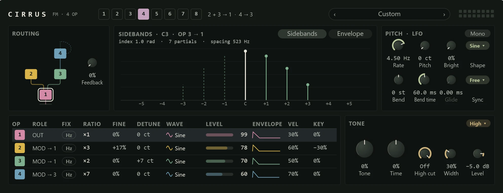

Cirrus is an FM synthesiser, the kind behind the glassy electric pianos, bells and punchy basses of 1980s records. It is good at sounds that are hard to get from a filter: clear, bright, metallic or percussive. It plays up to sixteen notes at once, and its display shows what the FM is doing to the note you are playing.

Add it from the **+** menu with **MIDI track > With a new instrument > Cirrus** (see [MIDI tracks and instruments](../midi/midi-tracks.md)).

## How FM works

Cirrus has four **operators**. Each is a simple wave (usually a sine) with its own level and envelope. An operator does one of two jobs:

- A **carrier** is heard: it is the note.
- A **modulator** isn't heard. It wobbles a carrier's phase very fast, at an audio rate, which adds new frequencies to the carrier called **sidebands**. The louder the modulator, the more sidebands and the brighter the sound.

Each operator runs at a **ratio** of the note's frequency. Whole-number ratios between a modulator and its carrier (1, 2, 3) give harmonic, musical tones; odd ratios (3.5, or a fixed frequency) give bells, clangs and metal. Because each operator has its own envelope, the brightness can change over a note: a modulator that fades quickly gives the bright strike and mellow tail of an electric piano.

The **algorithm** decides which operators are carriers and which modulate which. The [glossary](../reference/glossary.md) has more on these terms.

## The top bar

- **The algorithm buttons**, **1** to **8**. Click one to choose it (or use Left and Right while they have the focus). Beside them the routing is written out, for example "2 → 1 · 4 → 3": operator 2 modulates 1 and 4 modulates 3.
- **The preset bar** and sixteen voice lights.

| Algorithm | Routing | Good for |
|---|---|---|
| 1 | 4 → 3 → 2 → 1 | One stack: rich, bright basses and leads. |
| 2 | 3 and 4 → 2 → 1 | Brass and complex tones. |
| 3 | 3 → 2 → 1, and 4 → 1 | A stack with an extra modulator: mallets. |
| 4 | 4 → 3 → 1, and 2 → 1 | Bells. |
| 5 | 2 → 1, and 4 → 3 | Two pairs: electric pianos (the default). |
| 6 | 4 → 1, 2 and 3 | One modulator under three carriers: pads. |
| 7 | 4 → 3; 1, 2 and 3 heard | A modulated pair with two plain sines. |
| 8 | All four heard | Organ: four sines added together. |

## Routing

The chosen algorithm drawn as a diagram, the operators lit as they sound. Click an operator to select it. Operator 4 can modulate itself, which is called **feedback**: drag its loop up or down, or turn the **Feedback** knob beside it. A little feedback turns a sine towards a saw; a lot turns it to noise.

## The display

The switch at the top right of the display picks what it shows for the selected operator:

- **Sidebands**: the carrier (**C**) and five sidebands either side, as loud as the modulator makes them, on a scale down to −48 dB. The caption names the note playing and the pair, such as "SIDEBANDS · C3 · OP 2 → 1". Underneath are the modulation index (how hard the modulator drives, in radians), how many partials are above −40 dB, and their spacing in hertz. A sideband that would fall below zero hertz folds back and is drawn dashed. If nothing modulates the selected carrier, the display says so.
- **Envelope**: the selected operator's envelope, to drag, with its **Attack**, **Decay**, **Sustain** and **Release** values along the foot.

## Pitch · LFO

| Control | What it does |
|---|---|
| **Rate** | The LFO's speed, 0.05 to 20 Hz. An LFO is a slow wave that moves other settings. |
| **Pitch** | How much the LFO moves the pitch (vibrato), up to 100 cents. |
| **Bright** | How much the LFO moves the modulators' levels, so the brightness pulses. |
| **Shape** | The LFO's wave: **Sine**, **Tri**, **Saw**, **Square** or **Random**. |
| **Bend** | How far each note's pitch starts from the note, ±24 semitones, before it settles. |
| **Bend time** | How long the bend takes to settle. |
| **Glide** | The time to slide from one note to the next. It works in Mono only, and is dimmed otherwise. |
| **Sync** | **Free**, or a note value to lock the LFO to the project's tempo. Synced, **Rate** dims and shows the note value. |

The **Mono** pill at the caption's right plays one note at a time, legato.

## Operators

The table has a row per operator. Change any value where it shows: drag up or down (Shift for fine), turn the mouse wheel, or use the arrow keys, and double-click to reset it. Click a row's number, role or envelope to select that operator.

| Column | What it is |
|---|---|
| **OP** | The operator's number, in its colour. |
| **ROLE** | **OUT** for a carrier, or **MOD → 1** for a modulator and what it feeds. |
| **FIX** | The **Hz** pill: on, the operator runs at a fixed frequency whatever note you play. |
| **RATIO** | The ratio to the note: 0.5, then 1 to 32. While fixed, it shows and edits the frequency (1 Hz to 9.75 kHz). |
| **FINE** | Raises the ratio by 0 to 99%, for in-between ratios: 3 raised by 17% is about 3.5. Off while fixed. |
| **DETUNE** | ±20 cents, for slow beating against the others. |
| **WAVE** | A menu of eight waves: **Sine**, **Half**, **Rectified**, **Quarters**, **Double**, **Double half**, **Soft square** and **Triangle**. The others add brightness of their own. |
| **LEVEL** | 0 to 99: a carrier's loudness, or how strongly a modulator modulates. Click or drag across the bar; its solid part is the level now. |
| **ENVELOPE** | The operator's envelope shape. |
| **VEL** | How much playing harder raises the level. On a modulator, harder notes become brighter. |
| **KEY** | Key scaling: how the level falls (or rises) above middle C, so high notes aren't too bright or too thin. |

## Tone

| Control | What it does |
|---|---|
| **Tone** | Brightens or softens every modulator at once, ±100%. The quickest way to adjust a preset. |
| **Time** | Lengthens or shortens every envelope at once, from a quarter to four times. |
| **High cut** | A low-pass filter on the output, down to 1 kHz. **Off** at the top. |
| **Width** | Spreads the carriers across the stereo field. |
| **Level** | Cirrus's output level, −60 to +6 dB. |

The **Quality** chip at the caption's right is **High** by default: Cirrus runs at twice the sample rate, which keeps high, bright notes clean. **Eco** uses about half the processing.

Cirrus also follows the pitch bend wheel (±2 semitones), the mod wheel and channel pressure (both add vibrato) and the sustain pedal.

## Presets

Step through them with the arrows in the preset bar or click the name for the list; it reads **Custom** once you change a setting. Save your own from the same menu (see [Presets](../effects/presets.md)).

- **Cirrus**: the default, clean, bright FM keys. Try **Tone** on it.
- **Ice Crystal Keys**: a tine electric piano that barks when played hard.
- **Evening Bells**: an inharmonic bell with a long release.
- **Glass Mallets**: marimba and vibes, with a little pitch drop at the strike.
- **Low Sun Bass**: a punchy FM bass, with feedback for grit.
- **Gold Brass**: a brass stab that swells in.
- **Drawbar Haze**: an organ of four sines, with key click.
- **Mare's Tails**: detuned carriers with a slow LFO on the brightness.
- **Jet Stream Lead**: a mono lead with glide and vibrato.
- **Hail**: metallic percussion from fixed-frequency modulators.

## Tips

- **Start from a preset and turn Tone and Time** before anything else: they reshape the whole sound without touching the operators.
- **Learn with algorithm 5.** Select operator 2 and watch the Sidebands display while you raise its **LEVEL** and change its **RATIO**: more level, more sidebands; another ratio, another spacing.
- **An electric piano:** algorithm 5, ratios of 1, with operator 2's level fading quickly (a short **Decay**, low **Sustain**) and **VEL** high on it, so hard notes get the bright strike.
- **Bells:** set a modulator's **RATIO** to 3 and its **FINE** to 17% (a ratio of about 3.5), with long decays.
- **A harsh or noisy high end** usually means a modulator is too loud. Lower its **LEVEL**, use **KEY** to tame the high notes, or bring in **High cut**.
