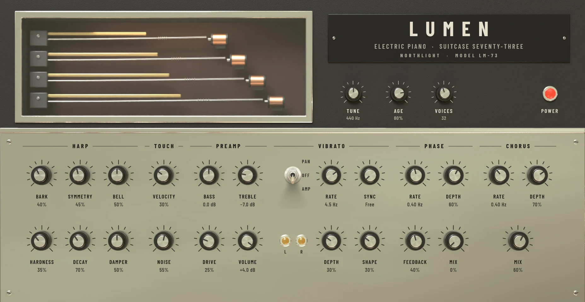

Lumen is an electric piano of the tine kind, the warm, bell-edged keyboard of 1970s soul, jazz and soft rock. It uses no recordings: each note is worked out as you play it, a hammer striking a metal tine in front of a magnetic pickup. So playing harder makes a note brighter as well as louder, with more bell in the attack and, when you dig in, the growl players call bark.

Add it from the **+** menu with **MIDI track > With a new instrument > Lumen** (see [MIDI tracks and instruments](../midi/midi-tracks.md)). It plays best from a keyboard with velocity and a sustain pedal.

## The face

The face is the front of a suitcase piano. On the black case:

- **The harp window**, on the left: four tines behind glass, each a brass tone bar over a steel tine whose tip sits at a pickup. While Lumen plays, the tines vibrate, slowed so you can see them and swinging as wide as the sound is loud. They are still when Lumen is silent or switched off, and with reduced motion on.
- **The nameplate**, on the right, and under it the three small service trims, **TUNE**, **AGE** and **VOICES**, with the red **POWER** lamp, lit while Lumen is on.

On the brushed plate below are six sections of knobs. Each knob shows its name and value under it. Drag a knob up or down (Shift for fine), turn the mouse wheel over it, or double-click to reset it.

## Harp

The harp is the piano's mechanism: tines, tone bars, hammers and dampers.

| Control | What it does |
|---|---|
| **BARK** | How close the tines sit to the pickups. Closer gives more growl when you play hard. |
| **SYMMETRY** | How far the tines sit off the pickups' centre. Centred adds a hollow second harmonic; off-centre gives a rounder, fuller fundamental. |
| **BELL** | The tine's bright, slightly out-of-tune overtones in the attack, the bell-like ping. |
| **HARDNESS** | The hammers' felt. Soft is dark and gentle; hard is short and bright. |
| **DECAY** | How long notes ring while held, 25% to 400% of the natural time. |
| **DAMPER** | How quickly a note stops when you let go. Slow lets notes blur together; fast is tight and staccato. |

## Touch

| Control | What it does |
|---|---|
| **VELOCITY** | How much the strike follows how hard you play. At 0 every note is the same; at 100 it is very dynamic. |
| **NOISE** | The mechanical sounds: the action's knock and the dampers' soft thump. |

## Preamp

| Control | What it does |
|---|---|
| **BASS** | A low shelf, ±12 dB. |
| **TREBLE** | A high shelf, ±12 dB. |
| **DRIVE** | Overdrives the preamp, for a gritty, compressed tone. |
| **VOLUME** | Lumen's output level, −60 to +6 dB. |

## Vibrato

Despite the name on the old pianos, this is a tremolo: a regular rise and fall in level.

- **The lever** chooses the mode: **PAN** (up), the suitcase piano's stereo auto-pan, which moves the sound from side to side; **OFF** (middle); or **AMP** (down), the level pulsing in both speakers. Click above the lever's middle to move it up a position, below to move it down.
- **RATE**: the speed, 0.5 to 12 Hz.
- **SYNC**: **Free**, or a note value that locks the tremolo to the project's tempo. While it is set, **RATE** dims and shows the note value.
- **DEPTH**: how strong it is.
- **SHAPE**: from a smooth sine to a choppy square.

The two amber lamps, **L** and **R**, light as each side's level: the light moves between them with the pan and pulses in both with the amplitude tremolo. They are dark when the vibrato is off.

The mod wheel adds to the tremolo's depth, so you can ride it as you play.

## Phase

A four-stage phaser, the sweeping, swirling sound of 1970s funk keys. At **MIX** 0 (the default) it is off.

| Control | What it does |
|---|---|
| **RATE** | The sweep's speed, 0.05 to 5 Hz. |
| **DEPTH** | How wide the sweep is. |
| **FEEDBACK** | How pronounced and resonant the sweep sounds. |
| **MIX** | How much of the phaser you hear. |

## Chorus

A chorus thickens and widens the sound, as on the brighter 1980s electric pianos. At **MIX** 0 (the default) it is off. **RATE** (0.1 to 5 Hz), **DEPTH** and **MIX** work as on the phaser.

## Service trims

| Control | What it does |
|---|---|
| **TUNE** | The pitch of A3, 430 to 450 Hz. Leave it at 440 unless you are playing along with a recording that is slightly off. |
| **AGE** | Gives each note a small fixed detune, up to 5 cents, as on a piano that has drifted out of tune. |
| **VOICES** | How many notes can sound at once, 8 to 64. Past the limit, the quietest released note fades out. |

Lumen also follows the pitch bend wheel (±2 semitones), channel pressure (vibrato) and the sustain pedal.

## Presets

Lumen's face has no preset bar. Choose its presets from the instrument card's menu, the button at the right of its header in the Editor panel: **Presets: Lumen** lists them, and reads **Presets: Custom** once you change a setting. Choosing one is one undo step.

- **Lumen**: the default, well voiced, with a gentle stereo tremolo.
- **Ballad**: soft, dark and long, with a slower, gentler tremolo.
- **Bark**: close pickups and drive, for a growl when you play hard.
- **Bell Keys**: hard hammers and lots of bell, with chorus: the bright 1980s sound.
- **Phase Funk**: phaser and some bark.
- **Suitcase Pan**: a deep stereo auto-pan.
- **Lo-fi Keys**: aged, dark and noisy, with amplitude tremolo and a wide chorus.

## Tips

- **Play with dynamics.** Most of Lumen's character is in the velocity: soft playing is round and mellow, hard playing barks. If it sounds flat, raise **VELOCITY**; if your keyboard makes it jump, lower it.
- **A classic 1970s sound:** start from **Suitcase Pan**, set **SYNC** to 1/8 to lock the pan to the song, and add a touch of **DRIVE**.
- **For a ballad,** lower **HARDNESS** and **BARK**, cut a little **TREBLE**, and let **DAMPER** sit low so chords ring into each other.
- **Funk:** **Phase Funk**, with **BARK** up, and play hard and short.
- Lumen's tremolo, phaser and chorus are part of the instrument, so they come before anything on its inserts. Put an [amp](../effects/corona.md) or a [tape echo](../effects/tape-echo.md) after it for more of the period sound.
