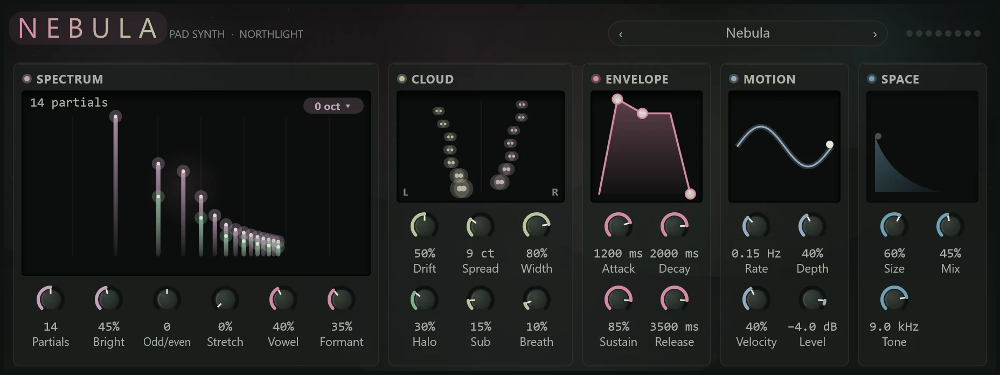

Nebula makes pads: soft, wide sounds that swell in slowly, hold a chord under a song and fade out over seconds, with its own large reverb built in. It plays up to eight notes at once.

Add it from the **+** menu with **MIDI track > With a new instrument > Nebula** (see [MIDI tracks and instruments](../midi/midi-tracks.md)).

## How Nebula makes a sound

Most synths start from a buzzing wave and filter it. Nebula builds each note instead from **partials**: the separate sine tones, at whole multiples of the note's frequency, that every pitched sound is made of. Each partial is a pair of sines tuned slightly apart, wandering in pitch on its own and placed somewhere in the stereo field, which is why Nebula sounds alive even on a held chord. You then shape how loud each partial is, add a reverb, and let a slow LFO (low-frequency oscillator) move it all.

## The face

Clouds drift behind the panels and breathe with the sound, with dust rising through them; they are still when Nebula is silent, or with reduced motion on. Beside the wordmark are the preset bar and eight voice lights.

Knobs drag up or down (Shift for fine), take the mouse wheel, and reset with a double-click.

## Spectrum

The display is the centrepiece: each partial is a column of light on a frequency scale from 55 Hz to 12 kHz, with the halo's partials in their own colour, under a soft cloud that marks the formant. The columns sway as the motion moves them. Drag across the display to move the vowel, and up and down to change the brightness. The chip in its corner sets the **Octave** (−2 to +2).

| Control | What it does |
|---|---|
| **Partials** | How many partials each note has, 4 to 24. More is richer and brighter. |
| **Bright** | The tilt of the spectrum: low is dark and soft, high lets the upper partials through. |
| **Odd/even** | At the left, odd partials only, a hollow, clarinet-like sound. At the right, the even ones lifted, fuller. |
| **Stretch** | Pulls the upper partials sharp, away from a pure harmonic sound and towards a bell. |
| **Vowel** | Where the formant sits, 250 Hz to 3 kHz. A formant is a boost in one region, like the shape of a mouth singing a vowel: low is "oo", higher is "ah" and "ee". |
| **Formant** | How strongly the formant shapes the sound. |

## Cloud

The display shows where the partials sit, left to right in the stereo field and low to high up the height. Each is a pair of dots as far apart as the spread, wandering with the drift.

| Control | What it does |
|---|---|
| **Drift** | How far each partial wanders in pitch. More drift is looser and more alive. |
| **Spread** | The detune between each partial's two sines, 0 to 30 cents: a slow shimmer at low settings, a chorus at high ones. |
| **Width** | How far the partials are panned apart, 0 to 100%. |
| **Halo** | Adds partials an octave up, for air above the note. |
| **Sub** | A sine under the note, for weight. |
| **Breath** | Noise around the note, like breath in a voice or a flute. |

## Envelope

An envelope shapes the volume over a note: **Attack** (how long it takes to swell in, up to 10 seconds), **Decay** (how long to fall to the sustain level), **Sustain** (the level held while the key is down) and **Release** (how long it fades after you let go, up to 15 seconds). Drag the handles on the display, or turn the knobs. The default is a slow swell of 1.2 seconds and a 3.5-second fade.

## Motion

Motion is a slow LFO that sweeps the brightness, the formant and the partials' places in the stereo field together. The display draws its wave with its value now riding it.

| Control | What it does |
|---|---|
| **Rate** | How fast the motion moves, 0.02 to 8 Hz. The default, 0.15 Hz, is one sweep about every seven seconds. |
| **Depth** | How far it moves the sound. |
| **Velocity** | How much playing harder makes a note louder. |
| **Level** | Nebula's output level, −60 to +6 dB. |

## Space

Space is a large reverb on Nebula's output. The display draws its tail as a glowing slope, as long as the size and as bright as the mix. Drag across it for the size and up and down for the mix.

| Control | What it does |
|---|---|
| **Size** | How big the space is, and so how long the tail. |
| **Mix** | How much of the reverb you hear against the dry sound. |
| **Tone** | A gentle low-pass filter before the reverb, 400 Hz to 20 kHz. Turn it down to soften a bright pad. |

Nebula also follows the pitch bend wheel (±2 semitones), the mod wheel and channel pressure (both add vibrato) and the sustain pedal.

## Presets

Step through them with the arrows in the preset bar or click the name for the list; it reads **Custom** once you change a setting. Save your own from the same menu (see [Presets](../effects/presets.md)).

- **Nebula**: the default, a soft, slowly drifting pad.
- **Choir of Dust**: a breathy, vocal pad with a strong, low formant.
- **Glass Halo**: bright and bell-like, with a strong halo and a long tail.
- **Hollow Moon**: odd partials only, dark and hollow, with a sub.
- **Solar Breath**: bright and breathy, wide, with fast motion.
- **Deep Field**: an octave down, dark and very slow, in a huge space.
- **Ice Bells**: stretched, bell-like partials that ring and fade.
- **Drifting Veil**: maximum drift and very slow motion, with long fades.

## Tips

- **Leave room.** Pads fill a mix quickly. Lower **Bright** or **Tone**, or cut the low end with an [EQ](../effects/eq.md), so the pad sits behind the vocal and the bass.
- **For a choir**, raise **Formant**, set **Vowel** low to middle, and add a little **Breath**.
- **For bells**, raise **Stretch**, shorten **Attack**, and set **Sustain** to 0 so each note rings out.
- Nebula's own **Space** saves a reverb send, but its tail is part of the instrument: if you want several instruments in one shared room, turn **Mix** down and use a send to an [FX track](../mixing/routing.md) instead.
