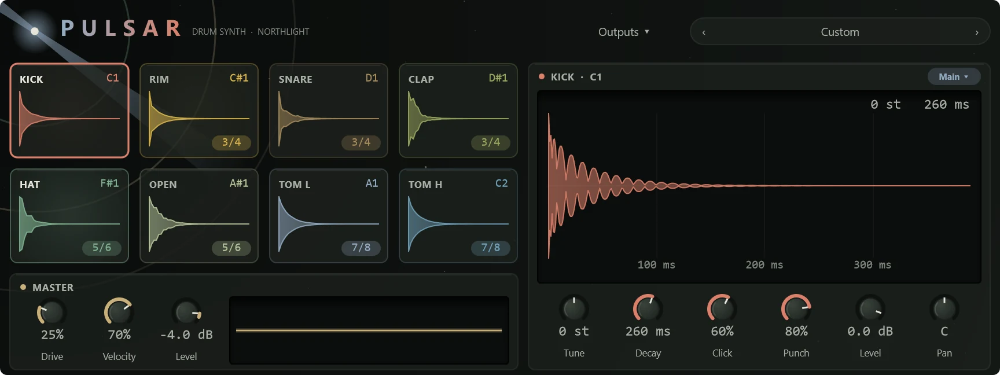

Pulsar is a drum machine: eight synthesised drums for beats, from a deep, booming kick to tight electro hats. Its voices follow the circuits of the Roland TR-808, and every pad sounds the same at any sample rate.

Add it from the **+** menu with **MIDI track > With a new instrument > Pulsar**, then draw or play notes on the MIDI track (see [MIDI tracks and instruments](../midi/midi-tracks.md) and [the piano roll](../midi/piano-roll.md)).

## The pads and their notes

Each pad plays on a General MIDI drum note, so drum patterns from MIDI files and other software play the right drums. The same pads also sit in order on C3 to G3, which is handy on a small keyboard. (Northlight names middle C as C3.)

| Pad | GM note | Also on | Its two shaping controls |
|---|---|---|---|
| Kick | C1 | C3 | **Click**, **Punch** |
| Rim | C#1 | C#3 | **Ring**, **Click** |
| Snare | D1 | D3 | **Snappy**, **Crack** |
| Clap | D#1 | D#3 | **Bright**, **Spread** |
| Closed hat | F#1 | E3 | **Bright**, **Noise** |
| Open hat | A#1 | F3 | **Bright**, **Noise** |
| Low tom | A1 | F#3 | **Noise**, **Punch** |
| High tom | C2 | G3 | **Noise**, **Punch** |

A hit always plays out in full, however short the note, as on a drum machine. The closed hat cuts off (chokes) a ringing open hat.

## The face

The pulsar in the top-left corner turns its beams slowly while Pulsar plays and flares on every hit, sending a ring out across the sky in the pad's colour. It is still when nothing plays, and with reduced motion on.

- **The kit bar** at the top: previous and next around the kit's name. Click the name for the list of kits. It reads **Custom** once you change a setting.
- **Outputs**, beside the kit bar: see [Separate outputs](#separate-outputs).
- **The pad tiles**, four by two. Each shows its name, its note and a picture of its sound, and lights up when it is hit. Click a tile to select it and edit that pad. A tile whose pad has an output of its own shows the pair (such as **3/4**) in its corner.
- **The selected pad's panel**, on the right: its name and note, its output in a chip, its sound drawn large over a time grid, and its six knobs.
- **MASTER**, under the tiles: **Drive**, **Velocity** and **Level**, with a scope of the output.

Drag across the large picture of the sound to change the pad's **Decay**, and up and down to change its **Tune**. Hold Shift for fine changes. The picture redraws as you go, so you can see the hit get longer or tighter. Knobs drag up and down (Shift for fine), take the mouse wheel, and reset with a double-click.

## A pad's controls

| Control | What it does |
|---|---|
| **Tune** | The pad's pitch, ±24 semitones. |
| **Decay** | How long the hit rings, 10 ms to 3 seconds. |
| The two shaping controls | Named for the drum (see the table above). On the kick, **Click** is the beater's click and **Punch** how far the pitch drops at the start. On the snare, **Snappy** is the wires and **Crack** a band of noise for bite. On the hats, **Bright** opens the tone and **Noise** mixes noise with the metallic tone. |
| **Level** | The pad's volume, −60 to +6 dB. |
| **Pan** | Where it sits from left to right. |

The output chip at the right of the pad's caption sends the pad to the main output (**Main**) or to one of seven extra pairs, **3/4** to **15/16**.

## Master

**Drive** saturates the whole kit for weight and grit. **Velocity** sets how much harder playing makes a hit louder; harder hits also drive the kick, toms and snare harder, like the 808's accent. **Level** is Pulsar's output level, applied to every output.

The pitch bend wheel tunes every pad (±2 semitones) and the mod wheel opens up the pads' tone.

## Separate outputs

By default every pad plays through the channel Pulsar sits on, so the kit is mixed as one. To process drums apart (compress the kick, reverb on the snare), give them outputs of their own. Click **Outputs** for:

- **All to the main output**
- **One output per pad**
- **Groups: kick, snares, hats, toms** (the snare, clap and rim share one output, as do the two hats and the two toms)

Or set any pad's output chip yourself. Each extra output is named for the pads on it ("Kick", "Closed hat + Open hat") and becomes a track of its own, with its own fader and inserts, from the output chips in the Instruments panel (F8) or the **Outputs** menu on the mixer's instrument slot. See [Routing](../mixing/routing.md).

## Kits

- **Pulsar**: the default kit.
- **Boom Room**: a long, low kick, longer tails and more drive.
- **Tight Electro**: a short, punchy kick, a higher snare and very short hats.
- **Dusty**: darker, softer and driven hard, for a worn sound.
- **Minimal Clicks**: tiny, bright hits and high, short toms.
- **Industrial**: tuned down, everything at full snap and heavily driven.

Kits are Pulsar's own list: they can't be saved from the kit bar. A Pulsar you have set up is kept in the project, and you can save a project as a [template](../projects/templates.md) to reuse it.

## Tips

- **An 808 boom:** select the kick, lengthen **Decay** to a second or more, lower **Tune** a few semitones and keep **Click** low. Raise **Drive** for a fuller low end on small speakers.
- **Tune the kick to the song:** a kick tuned to the key's root note sits better under the bass.
- **For a realistic hat pattern**, end an open hat with a closed one: the closed hat cuts the open one's ring short, as a drummer's foot does.
- Use a [MIDI effect](../midi/midi-effects.md) such as Note Repeat or Humanise on Pulsar's MIDI track for rolls and a looser feel.
