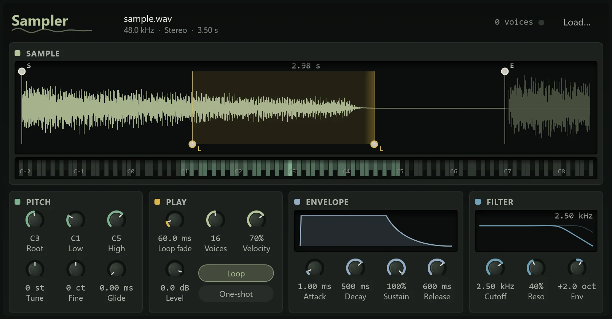

The Sampler plays one audio file across the keyboard: a vocal chop, a single piano note, a drum hit, a sound you recorded yourself. Each key plays the sample at a different pitch, higher keys faster and higher, like speeding up a tape. You can trim it, loop it so a note holds as long as the key, and shape it with an envelope and a filter.

It holds one sample at a time. To play several sounds, such as a drum kit built from your own hits, use a Sampler for each.

## Adding a Sampler and loading a sample

There are three ways to get a sample into a Sampler:

- **From an audio clip:** right-click a clip in the arrange view and choose **Open in Sampler**. Northlight makes a new instrument channel named after the file, with a MIDI track (armed, ready to play) for it, and sets the start and end to the part of the file the clip uses.
- **Drop a file** on the Sampler's waveform, from Explorer or from the browser's **Files** tab.
- **Load…** in the Sampler's header opens a file chooser.

To start with an empty Sampler, choose **MIDI track > With a new instrument > Sampler** from the **+** menu (see [MIDI tracks and instruments](../midi/midi-tracks.md)).

It reads WAV, AIFF, FLAC, MP3 and Ogg files, mono or stereo. The whole file is loaded into memory, up to 10 minutes of it. Loading a file is one undo step, and resets the start, end and loop points to the whole file.

:::caution
The Sampler remembers where the file is on your disk; it doesn't copy it into the project. If you move, rename or delete the file, the Sampler shows its name and the reason it couldn't load it. Keep your samples somewhere they will stay, such as a folder beside the project.
:::

## The header

The file's name, with its sample rate, whether it is mono or stereo, and its length; a count of the voices sounding, with a light; and the **Load…** button.

## Sample

**The waveform** shows the whole file. The part that plays, from the start to the end point, is bright and the rest is dimmed. While a note plays, a line moves across for each voice, so you can see where in the sample it is. The length that plays is shown at the top.

- **S** and **E**, the handles on the top edge, set the start and end. Drag the start in to skip silence or a breath; drag the end in to cut a tail.
- **L** and **L**, the handles on the bottom edge, set the loop's start and end. They show while **Loop** is on, and the loop is shaded, with its crossfade drawn as a gradient before its end.

Each handle stays on its own side of its partner.

**The keyboard** under it shows all 128 notes. The key range the Sampler answers is lit, and the root is solid. Click a key to make it the root: the note that plays the sample at its own pitch. Drag either end of the lit range to set the lowest and highest notes it plays. Notes outside the range are silent. Middle C is C3, as everywhere in Northlight.

## Pitch

| Control | What it does |
|---|---|
| **Root** | The note that plays the sample at its own pitch. Default C3. |
| **Low**, **High** | The lowest and highest notes it plays. |
| **Tune** | Transposes the sample, ±24 semitones. |
| **Fine** | Fine tuning, ±100 cents, to bring a sample that is slightly sharp or flat into tune. |
| **Glide** | The time each note takes to slide from the last note's pitch, up to 2 seconds. 0 is off. |

## Play

| Control | What it does |
|---|---|
| **Loop fade** | The crossfade at the loop's end, up to 500 ms, which smooths the click where the loop jumps back. |
| **Voices** | How many notes can sound at once, 1 to 32. Past the limit the oldest note fades out. Set it to 1 for a monophonic part. |
| **Velocity** | How much playing harder makes a note louder. At 0 every note is the same level. |
| **Level** | The Sampler's output level, −60 to +6 dB. |
| **Loop** | While a key is held, plays the loop over and over, forwards. Let go and the note fades over its release. |
| **One-shot** | Plays from the start to the end point whatever the note's length, ignoring the note's end. Use it for drum hits. |

## Envelope

The envelope shapes the volume over a note: **Attack** (the time to rise, from 0.5 ms), **Decay** (the time to fall to the sustain level), **Sustain** (the level held while the key is down) and **Release** (the time to fade after you let go). The display draws the curve, with times on a gentle scale so short and long envelopes both read. In one-shot mode it is marked **ONE-SHOT**.

## Filter

A resonant low-pass filter, which darkens the sound by removing high frequencies. The display draws its response; a fainter second curve shows where the envelope takes the cutoff. With the cutoff at the top and no envelope, the display reads **Open** and the filter is out of the way.

| Control | What it does |
|---|---|
| **Cutoff** | Where the filter starts to cut, 20 Hz to 20 kHz. |
| **Reso** | A peak at the cutoff, for a more vocal, resonant filter. |
| **Env** | How far the envelope moves the cutoff, ±8 octaves. Positive opens the filter at the start of each note and closes it as the note fades. |

The Sampler has no presets, and doesn't respond to the pitch bend wheel, the mod wheel or the sustain pedal.

## Tips

- **Find the root.** A sample plays at its own pitch only on its root key. If you know the sample's note, click that key; if not, play it against another instrument and adjust **Tune** and **Fine** until they agree.
- **A sustained instrument from one note:** turn on **Loop**, set the loop's handles on a steady part of the sound (not the attack), and raise **Loop fade** until the loop stops clicking or pulsing.
- **Drum hits:** turn on **One-shot**, and use one Sampler per hit, each with its own MIDI track. Setting **Low** and **High** to the root makes the hit play at one pitch only.
- **Chopping a phrase:** use **Open in Sampler** on a clip trimmed to the phrase, then move the start handle to play from different words.
- A sample played far from its root sounds faster and changes character, like a tape sped up. For a natural sound keep within an octave or so of the root.
