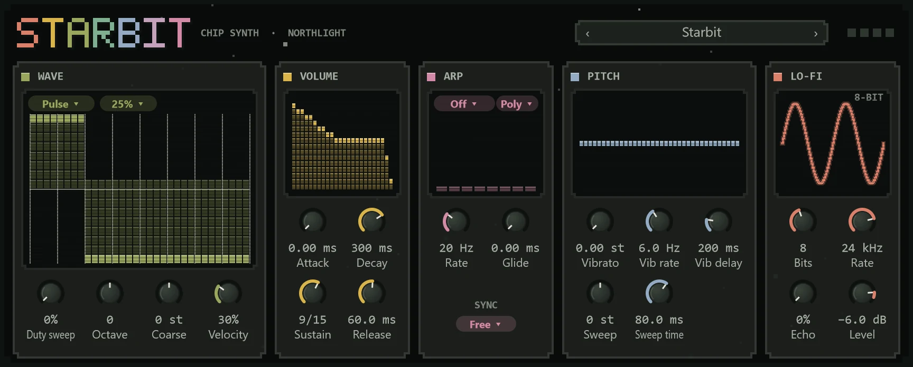

Starbit makes the sounds of old game consoles and home computers: square-wave leads, stepped triangle basses, noise drums and fast arpeggios that fake a chord on one voice. Use it for chiptune, or for a bright, lo-fi colour in any song.

Add it from the **+** menu with **MIDI track > With a new instrument > Starbit** (see [MIDI tracks and instruments](../midi/midi-tracks.md)).

## The face

Starbit is drawn as pixel art: a blocky wordmark, square stars that blink while it plays, and windows whose displays are grids of cells, like a console's screen. Beside the wordmark are the preset bar and four voice lights. The knobs are Northlight's own: drag up or down (Shift for fine), turn the mouse wheel, or double-click to reset.

## Wave

The display shows one cycle of the wave as 32 columns of 16 steps, the coarse resolution of the old chips. The chips above it choose the sound:

- **The wave chip**: **Pulse**, **Triangle**, **Saw**, **Noise** or **Wave**.
- **The duty chip** (for Pulse): **12.5%**, **25%**, **50%** or **75%**. The duty is how much of each cycle the pulse is high. 50% is a full, hollow square; 12.5% is thin and nasal. 25% and 75% sound alike.
- **The noise chip** (for Noise): **Long**, a hiss for snares and cymbals, or **Short**, a metallic, pitched buzz. Noise follows the note, so higher notes hiss higher.

With **Wave** chosen, the display becomes an editor: click and drag across it to draw your own wave, step by step.

| Control | What it does |
|---|---|
| **Duty sweep** | Cycles the pulse through the four duties, faster as you turn it up, for a moving, phasing lead. |
| **Octave** | −3 to +3 octaves. |
| **Coarse** | Transposes by semitones, ±12. |
| **Velocity** | How much playing harder makes a note louder. At 0 every note is the same level, as on the old chips. |

## Volume

The volume envelope, drawn as bars in 16 steps, because the old chips had 16 volume levels. **Attack** is how long a note takes to rise (0 to 2 seconds; 0 starts it at once), **Decay** how long it falls to **Sustain** (shown as a step out of 15), and **Release** how long it fades after the key is let go.

## Arp

An arpeggio plays the notes of a chord one after another, very fast, so one voice sounds like a chord. The display draws the steps as blocks as high as their intervals, the one playing lit.

- **The mode chip**: **Off**; **Chord**, which cycles through the notes you hold (play a chord and Starbit arpeggiates it on one voice); or a shape played on every note: **Octave**, **Major**, **Minor**, **Power**, **Maj7** or **Min7**.
- **The voices chip**: **Mono**, one note at a time (the newest one, sliding legato from the last), or **Poly**, four voices.
- **Rate**: steps a second, 2 to 60. Around 20 to 30 is the classic shimmering chord.
- **SYNC**, under the rate: **Free**, or a note value so each step falls on the song's grid at the project's tempo. While synced, the **Rate** knob dims and shows the note value.
- **Glide**: the time a note takes to slide from the last one's pitch, up to 1 second.

## Pitch

The display draws a note's pitch over its first second: the sweep into it, then the vibrato after its delay.

| Control | What it does |
|---|---|
| **Vibrato** | Vibrato depth, up to 1 semitone. |
| **Vib rate** | Its speed, 0.5 to 15 Hz. |
| **Vib delay** | How long a held note waits before the vibrato starts, up to 1 second. |
| **Sweep** | How far each note starts from its pitch, ±24 semitones: positive starts above and drops, negative rises into it. |
| **Sweep time** | How long the sweep takes. |

## Lo-fi

The display draws a sine as the bits and the rate leave it, stepped and all.

| Control | What it does |
|---|---|
| **Bits** | Bit depth, 2 to 16. Fewer bits are grittier. |
| **Rate** | The sample rate it holds to, 2 kHz to 48 kHz. Lower is more aliased and crunchy. |
| **Echo** | A short chip-style echo. |
| **Level** | Starbit's output level, −60 to +6 dB. |

Starbit also follows the pitch bend wheel (±2 semitones), the mod wheel and channel pressure (both add vibrato) and the sustain pedal.

## Presets

Step through them with the arrows in the preset bar or click the name for the list; it reads **Custom** once you change a setting. Save your own from the same menu (see [Presets](../effects/presets.md)).

- **Starbit**: the default, a 25% pulse.
- **Hero Lead**: a mono square lead with delayed vibrato, glide and echo.
- **Chord Arp**: arpeggiates the chord you hold.
- **Major Sparkle**: a thin pulse arpeggiating a major chord on every note, with echo.
- **Tri Bass**: a mono triangle bass an octave down.
- **Wave Pad**: the drawn wave, slow to start, with vibrato and echo.
- **Laser Zap**: a sweeping pulse that falls two octaves.
- **Noise Snare**: a long-noise snare with a little pitch drop.
- **Metal Hat**: short, metallic noise for hi-hats.
- **Crunchy Saw**: a saw through 4 bits at 8 kHz.

## Tips

- **Chords on one voice:** choose **Chord Arp** and hold a chord. Set **SYNC** to 1/32 for an arpeggio that locks to the beat.
- **A whole chip band:** use one Starbit per part, as the consoles did: a pulse lead, a second pulse for harmony, a triangle bass and noise drums, each on its own MIDI track.
- **Drums:** Noise with a short **Decay** and **Sustain** at 0. Long noise gives snares, Short noise with a high **Octave** gives hats, and a **Sweep** down on a pulse makes a kick.
- For an authentic sound keep **Bits** at 4 to 8 and **Velocity** at 0.
