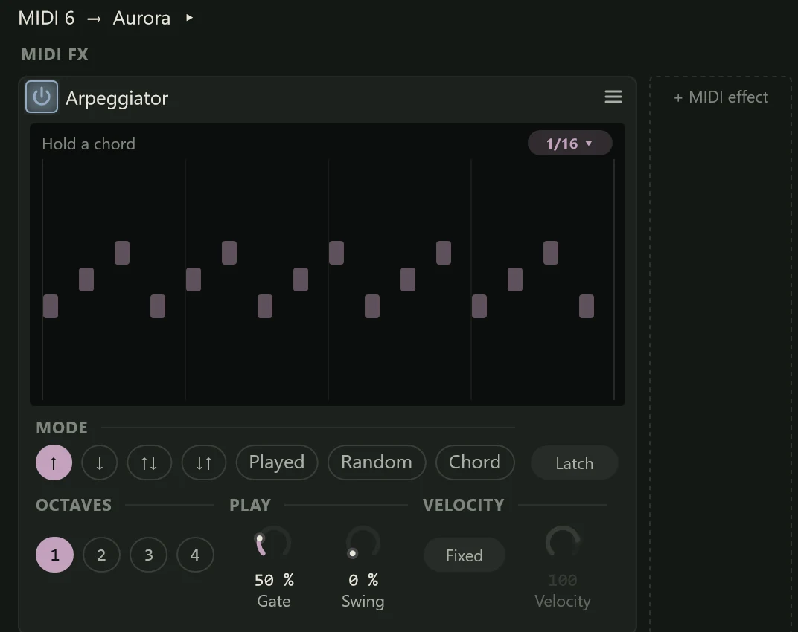

A MIDI effect changes notes rather than sound. It sits on a
[MIDI track](midi-tracks.md), between the notes (from its clips, or what you play
live) and the instrument they play, and can turn one key into a chord, play a held
chord as an arpeggio, keep every note in a key, or even out how hard notes are hit.
Northlight comes with twelve.

## Adding MIDI effects

1. Select the MIDI track. The Editor panel (F3) shows a **MIDI FX** section first,
   before the instrument the track plays.
2. Click **+ MIDI effect** and choose one. The menu lists the effects you used most
   recently first, then the rest in three groups, each with a one-line hint:
   - **Play**: Arpeggiator, Chord, Chord Pads, Note Repeat, Note Echo.
   - **Shape**: Scale, Transpose, Velocity, Note Length, Humanise.
   - **Route**: Key Range, MIDI Filter.

Each effect is a card in the section. The power button in its header switches it
off and on (bypass), and its menu has **Bypass**, **Replace**, **Move up**, **Move
down**, **Copy**, **Copy chain**, **Paste after** and **Remove**. Copied MIDI
effects paste only into another MIDI track's MIDI FX, not among audio inserts.

## How the chain works

- **Order matters.** The effects run left to right, each passing its notes to the
  next. A Chord before an Arpeggiator arpeggiates the chord; a Scale after a
  Transpose keeps the transposed notes in the key. Use **Move up** and **Move
  down** to reorder them.
- **They belong to the MIDI track.** Two MIDI tracks playing one instrument keep
  their own effects. The effects also feed the track's
  [MIDI output](midi-tracks.md#external-instruments-through-a-midi-output), so
  they work on hardware synths too.
- **Recording keeps what you played**, not what the effects made, so you can change
  an effect's settings after the take. The effects' output is what you hear, and
  what an [export](../exporting/index.md) or a [freeze](../mixing/freezing.md)
  renders.
- The MIDI track's header chip names the effects that are on in its tooltip
  ("...through Arpeggiator, Scale").

### Effects that follow the key

Chord, Chord Pads and Scale play in a key. By default they follow the project's key
(set with the [piano roll's key button](piano-roll.md#the-project-key)). Chips in
the corner of their display choose **Own key** or **Project key**, and then the
root and scale of their own key. While the project's key is followed, the root and
scale chips show it, dimmed. With no project key set, the chip reads **Project key
(none set)** and the effect uses its own key. The scales offered are Major, Minor,
Harmonic minor, Dorian, Mixolydian, Major pentatonic, Minor pentatonic and
Chromatic. Transpose's **Steps** always use the project's key.

### Displays and settings rows

The Arpeggiator, Chord, Chord Pads, Velocity and Scale have a display that shows
what they are doing as you play, with their controls grouped below it. The other
seven show their settings as rows, a name and a control on each; drag a number to
change it, or click and type.

### Note values

Effects that play in time (Arpeggiator, Note Repeat, Note Echo, Note Length) take a
note value: **1/64** up to **1/1** (a whole bar of 4/4), each also as a triplet
(**T**, three in the time of two) and dotted (**D**, half as long again). While
the song plays they lock to its grid; with the transport stopped they run at the
project's tempo, starting from the first key you press.

## Arpeggiator

Plays the notes you hold one at a time, in time with the song, instead of all
together. Hold a chord and it becomes a rhythmic pattern: the classic synth
arpeggio, a harp-like run, or a pulsing bass from one key.

**The display** shows the next bar of steps for the chord you hold, in the order
the mode plays them, with octaves stacked above; the step playing is lit. Gate
shows as the length of each step and swing as the late offset of every second one.
Before you play, it shows a C major triad and **Hold a chord**. The rate is the
chip in the display's corner.

| Control | What it does | Range (default) |
|---|---|---|
| Rate (the corner chip) | The length of each step. | 1/64 to 1/1 (1/16) |
| **MODE** | The order: ↑ (up, low to high), ↓ (down), ↑↓ (up then down), ↓↑ (down then up), **Played** (the order you pressed the keys), **Random**, or **Chord** (every held key on each step). | (↑) |
| **Latch** | Keeps the pattern playing after you let go. A new chord replaces the latched one; turn Latch off to stop it. | Off |
| **OCTAVES** | How many octaves the pattern climbs through. | 1 to 4 (1) |
| **Gate** | How long each step's note lasts, as a share of the step. Below 100% is detached; above, the notes overlap. | 5 to 200% (50%) |
| **Swing** | Delays every second step by up to half a step, for a shuffle. | 0 to 75% (0%) |
| **Fixed** and **Velocity** | With Fixed on, every step plays at Velocity instead of how hard you pressed the key. | 1 to 127 (100) |

Random shows each step's possible notes as faint dots and lights the one it plays.

## Chord

One key plays a whole chord: useful when you can't play the chords yourself, or to
stack a big sound from single notes. The chord can be a fixed shape on every key,
or the chord that belongs to each key in a scale.

**The display** names the chord at the top left ("D", "Cmaj7", "C/E" for an
inversion) and shows it on a three-octave keyboard, exactly as voiced, with the
settings as they are now, so changing the inversion or voicing shows straight
away. Before you play, it shows the chord C would play.

| Control | What it does | Choices (default) |
|---|---|---|
| **CHORD**: **Shape** or **In key** | Shape plays the same chord on every key. In key builds each key's chord from the scale (on C in C major, C major; on D, D minor), so every key stays in the key. | (Shape) |
| The Shape menu | The chord, in Shape mode: Major, Minor, 7, Maj7, Min7, Sus2, Sus4, Diminished, Augmented, Add9, Min9, Power (root and fifth), Octaves. | (Major) |
| **IN KEY**: Size | The chord, in In key mode: **Triad**, **7th** or **9th**, stacked in thirds of the scale. A key outside the scale builds on the scale note below it. | (Triad) |
| **INVERSION** | Which chord note is lowest: **Root**, **1st**, **2nd**, **3rd**. Each inversion moves the bottom note up an octave. | (Root) |
| **STRUM** | Plays the notes one after another, like a strummed guitar: **Off**, **Up** (low to high), **Down**, **Alt** (alternating up and down). | (Off) |
| **VOICING** | How the notes are spread: **Close** (as tight as possible), **Open** (the second note from the bottom up an octave), **Drop 2** (the second from the top down an octave), **Spread** (every other note up an octave). | (Close) |
| **Strum time** | The time between strummed notes. | 1 to 200 ms (30 ms) |

The key chips matter only in In key mode, and are dimmed otherwise.

## Chord Pads

Turns the keyboard into a set of chords that all fit the song's key, so you can try
progressions without knowing the theory. Each white key plays one of the key's
chords, the black keys play common chords borrowed from outside it, and each chord
moves smoothly from the last.

On any octave, C, D, E, F, G, A and B play the key's chords I to vii (in C major:
C, Dm, Em, F, G, Am and Bdim). The black keys play borrowed chords: C# is bII, D#
bIII, F# iv, G# bVI and A# bVII. Which octave you play in does not matter.

**The display** shows the key chips along the top, then a map of the twelve pads,
each with its numeral and chord name in the key ("ii Dm", "bVII Bb"), the one
playing lit. Under the pads, a keyboard shows the notes sounding.

| Control | What it does | Choices (default) |
|---|---|---|
| **CHORDS**: Size | **Triad** or **7th**. | (Triad) |
| **Lead** | Voice leading: each chord takes the inversion nearest the last one, so the notes move as little as possible between chords, as a pianist would play them. Off, every chord is in root position. | (On) |
| **Bass** | Adds the chord's root an octave below. | (Off) |
| **REGISTER** | Moves the chords down or up by octaves from the middle of the keyboard. | −2 to +2 (0) |

## Note Repeat

Retriggers a held note over and over in time: drum rolls, hi-hat ratchets,
stuttering synth notes. The first hit is the key itself; the repeats follow at the
rate while you hold it.

| Setting | What it does | Range (default) |
|---|---|---|
| **Rate** | The time between repeats. | 1/64 to 1/1 (1/16) |
| **Gate** | How long each repeat lasts, as a share of the step. | 5 to 100% (50%) |
| **Ramp** | How much each repeat's velocity changes from the last: positive builds up, negative fades out. | −50 to 50% (0%) |

## Note Echo

A delay for notes: each note you play is repeated after it, softer each time, and
can step in pitch, so a single note becomes a cascade. Because the echoes are notes,
each one is played fresh by the instrument rather than being a copy of its sound.

| Setting | What it does | Range (default) |
|---|---|---|
| **Time** | The time between echoes. | 1/64 to 1/1 (1/8) |
| **Repeats** | How many echoes follow each note, at most. | 1 to 16 (3) |
| **Feedback** | The share of the velocity each echo keeps from the one before. The echoes stop early once they fade to nothing. | 10 to 100% (60%) |
| **Pitch** | Semitones each echo moves from the one before: 12 climbs an octave each time, 7 a fifth. | −12 to 12 (0) |

## Scale

Keeps every note in a key, so a wrong note becomes a right one. Use it to play
freely over a song without hitting notes that clash, or to correct a part played in
from a keyboard.

**The display** names the last key's mapping at the top left ("F3 → F#3", or
"C#3 → blocked") and shows it on a two-octave keyboard, with the key's notes
dotted, the key you played marked and where it went lit.

| Control | What it does |
|---|---|
| **MODE** | What happens to a note outside the scale. **Nearest** moves it to the closest scale note (down, if the two are equally close); **Up** and **Down** move it to the next scale note in that direction; **Block** drops it; **White** makes the white keys play the scale from its root, so C D E F G A B on the keyboard play the scale's degrees whatever the key, and the black keys play nothing. |
| Key chips | The key, as described in [Effects that follow the key](#effects-that-follow-the-key). Project key is the default. |

## Transpose

Moves every note up or down. It can move by steps of the project's key, which keeps
a part in the key (a melody moved up three steps in C major stays in C major,
where moving it four semitones would not), and by semitones and octaves.

| Setting | What it does | Range (default) |
|---|---|---|
| **Steps** | Steps of the project's key. With no key set, a step is a semitone. A note outside the scale moves from the scale note below it. | −7 to 7 (0) |
| **Semitones** | Semitones, after the steps. | −24 to 24 (0) |
| **Octaves** | Octaves, after the semitones. | −4 to 4 (0) |

A note moved outside the MIDI range (0 to 127) is not played.

## Velocity

Reshapes how hard notes play: evens out an uneven performance, adds punch, or keeps
a keyboard's quietest notes from disappearing.

**The display** draws the velocity curve: the velocity coming in along the bottom
(1 to 127) and going out up the side, with a straight line where nothing changes.
The last notes you played appear as dots on it. Minimum and Maximum are dashed
lines with handles at their right ends, which you can drag up and down; the Centre
is a handle on the bottom edge, which you can drag across. With Fixed on, the curve
is a flat line.

| Control | What it does | Range (default) |
|---|---|---|
| **Dynamics** | Spreads velocities away from the Centre or squeezes them towards it. 100% leaves them alone; below compresses (at 0% every note plays at the Centre); above expands. | 0 to 200% (100%) |
| **Gain** | Scales every velocity. | 0 to 200% (100%) |
| **Offset** | Adds to every velocity, or takes away. | −127 to 127 (0) |
| **Random** | Varies each note at random by up to this much either way. | 0 to 64 (0) |
| **Fixed** and **Velocity** | Every note plays at Velocity, whatever came in. | 1 to 127 (100) |
| **Minimum**, **Maximum** | The range every result is kept within. | 1 to 127 (1, 127) |
| **Centre** | The velocity Dynamics spreads from or squeezes towards. | 1 to 127 (64) |

Dynamics is applied first, then Gain, Offset and Random, then the range.

## Note Length

Sets how long notes last, whatever length they were played or drawn at.

| Setting | What it does | Choices (default) |
|---|---|---|
| **Length** | **As played** leaves lengths alone; **Note value** makes every note last one note value; **Time** makes every note last a time in milliseconds; **Legato** holds each note until the next one starts (notes struck together, as a chord, stay together). | (As played) |
| **Note value** | The length in Note value mode. | 1/64 to 1/1 (1/16) |
| **Time** | The length in Time mode. | 5 to 4000 ms (100 ms) |
| **Sustain pedal** | **Hold notes** turns the sustain pedal into note lengths: notes released while the pedal is down keep sounding until it lifts, and the pedal itself is not sent on. Useful for an instrument that ignores the pedal. It works with Length set to As played. | (Pass) |

## Humanise

Loosens a part that sounds too exact: pushes notes slightly late, varies how hard
they play, and can leave some out at random.

| Setting | What it does | Range (default) |
|---|---|---|
| **Timing** | Delays each note at random by up to this much. Notes are only ever moved late, so live playing still works; each note keeps its length. | 0 to 50 ms (10 ms) |
| **Velocity** | Varies each note's velocity at random by up to this much either way. | 0 to 64 (8) |
| **Chance** | The share of notes that play. Lower it to thin out a busy hi-hat part. | 0 to 100% (100%) |
| **Seed** | Picks the pattern of variations. The same seed plays the same way every time from the same place, so an export sounds like what you heard. Change it for a different pattern. | 0 to 9999 (1) |

## Key Range

Lets through only the notes inside a range. Put one on each of two MIDI tracks
with the same input to split a keyboard: bass on the left hand, piano on the right.

| Setting | What it does | Range (default) |
|---|---|---|
| **Low** | The lowest note let through, as a note name (C3 is MIDI note 60). | C-2 to G8 (C-2) |
| **High** | The highest note let through. | C-2 to G8 (G8) |
| **Outside** | **Block** drops notes outside the range; **Fold in** moves them by octaves until they fit. | (Block) |

## MIDI Filter

Blocks kinds of MIDI events, and can move one controller to another: stop a
keyboard's pitch bend reaching a part, or send a mod wheel's movements to a
controller the instrument does respond to.

| Setting | What it does | Default |
|---|---|---|
| **Notes**, **Controllers**, **Pitch bend**, **Channel pressure**, **Poly pressure** | **Pass** or **Block** that kind of event. | Pass |
| **Move controller** | On, control change **From CC** becomes **To CC**. | Off |
| **From CC**, **To CC** | The controller moved and where it goes (0 to 127). | 1 (the mod wheel), 11 (expression) |
