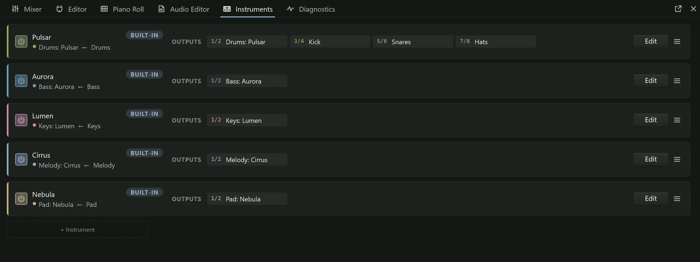

MIDI is a way of describing music as instructions rather than sound: which note
starts, how hard it was struck (its **velocity**, 1 to 127), when it stops, and
how controls such as the mod wheel or the sustain pedal move. A MIDI track holds
those instructions. It makes no sound of its own: it plays an instrument, and the
instrument makes the sound.

## Two kinds of track: notes and sound

In Northlight the notes and the sound live on separate tracks.

- A **MIDI track** holds the notes: its MIDI clips, a MIDI input, the arm and
  monitoring buttons, any [MIDI effects](midi-effects.md) and an optional MIDI
  output. It has no meter, solo or sends, because it carries no audio.
- An **instrument channel** holds the sound: an instrument (built in, VST3 or
  CLAP) in its instrument slot, then the inserts,
  [channel strip](../mixing/channel-strip.md), sends, fader and automation that
  process what the instrument plays. It has no input or arm button: its MIDI
  tracks bring the notes.

A MIDI track aims at one instrument channel. Its header shows a chip with an arrow
and what it plays, such as **→ Drums: Pulsar**, with the MIDI channel after it when
that is not 1 ("ch 2"). The instrument channel's lane says what it is and who plays
it ("Instrument channel: Pulsar ← Drums, Fills").

Keeping the two apart means several MIDI tracks can play one instrument. You might
keep a drum part's verse and its fills on two MIDI tracks, each with its own clips
and effects, both playing the same Pulsar through the same reverb and fader. A
multitimbral plugin (one that plays a different sound on each MIDI channel) tells
its MIDI tracks apart by their MIDI channel.

On a MIDI track, the volume control scales the velocity of the notes it sends
rather than a level (its tooltip says so), and mute stops it sending new notes. To
change how loud the instrument sounds, use the instrument channel's fader.

## Adding a MIDI track

The **+** (Add track) button in the track list has a **MIDI track** submenu:

- **With a new instrument**: pick any built-in or scanned instrument. Northlight
  makes the MIDI track and, directly under it, an instrument channel named for the
  instrument.
- **Playing**: the instrument channels already in the project. The new MIDI track
  goes directly above the one you pick.
- **Playing nothing yet**: a MIDI track with no instrument, to choose one later.

Ctrl+Shift+T, or **Add MIDI track** in the project menu (click the project's name
at the top left), makes a MIDI track with a new
[Aurora](../instruments/aurora.md). An instrument chosen in the browser goes to the
selected instrument channel, or to the channel the selected MIDI track plays, or
gets a new MIDI track and instrument channel of its own.

## Changing what a MIDI track plays

Click the chip in the MIDI track's header, or choose **Plays...** from the track's
right-click menu. The menu lists:

- every instrument channel in the project, under **Plays**,
- **Nothing**, to disconnect the track,
- **MIDI channel**, a submenu of **Channel 1** to **Channel 16**,
- **New instrument**, which makes a new instrument channel for this track.

When the Editor panel (F3) shows a MIDI track, it shows the instrument channel the
track plays, titled with both names ("MIDI 1 → Drums: Pulsar"), so you can reach
the instrument and its effects without selecting the other track. A MIDI track that
plays nothing shows a **+ Instrument** slot there instead.

## The Instruments panel

The Instruments panel (F8) is the rack: one unit for every instrument channel in
the project, in track order. It is the quickest way to see which instruments a song
uses, who plays each one, and where their outputs go.

Each unit shows, left to right:

- **Power**, which switches the instrument on or off (bypasses it). The channel's
  colour runs down the unit's left edge and fades while it is off.
- The instrument's name with a **BUILT-IN**, **VST3** or **CLAP** badge, and under
  it the channel's name and the MIDI tracks that play it, with their MIDI channel
  when it is not 1 ("Drums ← Drums, Fills (ch 2)").
- **OUTPUTS**: a chip for each stereo pair the instrument has (see below).
- **Edit**, which opens the instrument's editor.
- A menu with **Open editor**, **Select track**, **Replace instrument** and
  **Remove instrument**.

**+ Instrument** at the end of the list makes a new instrument channel with the
instrument you choose, and a MIDI track to play it. With no instruments in the
project, the panel says so and offers the same button.

## Multi-output instruments

Most instruments send all their sound out of one stereo pair, which is the
instrument channel itself. Some have more: a drum instrument can give the kick, the
snare and the hats outputs of their own, so each can have its own EQ, compressor
and fader. Each extra stereo output can become an **output track**, with its own
processing like any other channel.

In the Instruments panel, the first chip, **1/2**, is the main pair: the instrument
channel. Each extra pair without a track shows as a dashed chip, **+ Track for
3/4**, or with the name the instrument gives that output (**+ Kick 3/4**). Click it
to make the output track. A pair that has a track shows the track's name; click it
to select that track. The mixer's instrument slot offers the same under **Outputs**
in its menu.

An output track's lane reads "Output 3/4 of Drums: Pulsar". It has no clips of its
own; it carries what the instrument sends out of that pair.

:::caution
An instrument whose extra outputs feed output tracks can't be
[frozen](../mixing/freezing.md) yet.
:::

## Playing an instrument live

To play an instrument from a MIDI keyboard, first enable the keyboard under
**MIDI** > **Inputs** in [Audio Setup](../getting-started/audio-setup.md). Then, on
the MIDI track:

1. Choose the input in the track's header: **All MIDI** (every enabled input, the
   default) or one device. A device that was chosen but is not connected now shows
   "(absent)" after its name.
2. Arm the track with its **R** button, or change its monitoring with **I**.

With monitoring on **automatic** (the default), you hear what you play while the
track is armed and the transport is stopped or recording. To play along while the
song plays back, without recording, set monitoring to **on**. What you play goes
through the track's MIDI effects to its instrument, and to its MIDI output if it
has one. [Recording MIDI](../recording/recording-midi.md) explains takes, merge and
replace.

Choosing one device per track lets you play two instruments from two keyboards at
once. To split one keyboard between two sounds, give two MIDI tracks the same input
and put a [Key Range](midi-effects.md#key-range) effect on each.

## External instruments through a MIDI output

A MIDI track can also play a hardware synthesizer, a drum machine or any other
device connected through a MIDI interface.

1. In [Audio Setup](../getting-started/audio-setup.md), under **MIDI**, choose the
   device as the **Output**.
2. Right-click the MIDI track and open **MIDI output**. The submenu is headed by the
   device's name; choose the **Channel** (1 to 16) the device listens on, or
   **Off**. With no output chosen in Audio Setup, the submenu reads **Choose a MIDI
   output in Audio Setup**.

The track then sends its clips to the device, after its MIDI effects, and while it
monitors, what you play live too. It can play an instrument channel at the same
time, or play **Nothing** and drive only the hardware.

The hardware's sound does not come back over MIDI. To hear it in the mix and record
it, connect the device's audio outputs to your interface's inputs and record them
on an [audio track](../recording/recording-audio.md).
