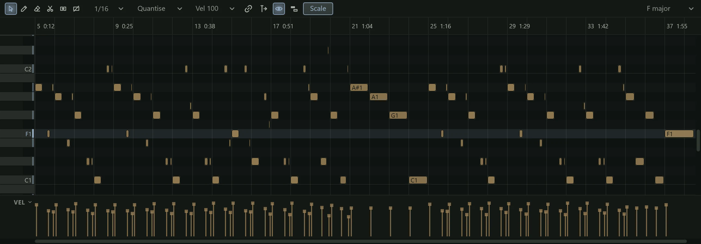

The piano roll is where you edit the notes in a MIDI clip. Pitch runs up the
screen, with a keyboard at the left to show which row is which note, and time runs
to the right on the same bars and beats as the arrange view. Each note is a bar:
where it starts is when it plays, its length is how long it is held, and its row is
its pitch.

## Opening a clip

The piano roll is a panel (F6). It shows the MIDI clip you selected last. To open a
clip, double-click it in the arrange view, or right-click it and choose **Open in
piano roll**. With no MIDI clip selected, the panel says **Select a MIDI clip to
edit its notes**. The track's other clips show faintly behind the one you are
editing (ghost notes), so you can see how a part carries on across clips.

Note names follow the convention where middle C, MIDI note 60, is C3.

## The toolbar

From left to right:

- **The tools**, the same six as the arrange view's, with the same keys:
  select (1), pencil (3), erase (4), split (5), glue (6) and mute (7). See
  [Using the tools](#using-the-tools).
- **The grid menu**, which shows the grid (**1/16**), or **Off 1/16** while snap is
  off. See [The grid](#the-grid).
- **Quantise**, a menu of timing edits. See [Quantise, swing and humanise](#quantise-swing-and-humanise).
- **Vel**, the velocity new notes take (**Vel 100**). It follows the last velocity
  you edited, and its menu (**New notes' velocity**) picks one: 127, 110, 100, 80,
  64, 48 or 32, or **The selected note's** velocity when one note is selected.
- Four toggles: **link zoom** to the arrange view (scrolling and zooming one moves
  the other), **follow the playhead** (the view turns the page as the playhead
  passes its edge), **audition** (on by default: drawing, clicking or moving a note
  plays it through the track's instrument, armed or not) and **ghosts** (shows the
  other MIDI tracks' notes, in their own colours, under this clip's).
- The **named rows** filter, shown only when the instrument names its notes. See
  [Drum rows](#drum-rows).
- **Scale**, which shades the rows outside the project key's scale and marks the
  key's notes on the keyboard, naming the root.
- **The key button** at the right ("C minor", or "No key"). See [The project key](#the-project-key).

A narrow panel hides **Vel** and **Scale** first, so the key button stays in reach.

## Drawing notes

With the **pencil** (3), click on the grid to add a note at the snapped position:
it takes the length of the last note you drew or resized, and the velocity in
**Vel**. Drag right as you draw to set its length. Hold Alt while you click or drag
to place it off the grid.

You can also add a note with the select tool: double-click an empty part of the
grid. Insert adds a note straight after the selected one, at its pitch and length,
or at the playhead with nothing selected.

With audition on, each note you draw sounds as you place it. Clicking a key on the
keyboard plays that note too, whatever audition is set to.

## Selecting and moving notes

With the **select** tool (1):

- Click a note to select it. Shift+click adds a note to the selection; Ctrl+click
  adds or removes one.
- Drag across empty grid to lasso the notes in a rectangle.
- Drag a note to move the selection. Moving up or down transposes it, with the new
  pitch shown beside the pointer. Hold Shift to keep the move to one direction
  (whichever you moved further).
- Drag the start or end edge of a note to change its length (the pointer becomes a
  left-right arrow over an edge).
- Ctrl+drag copies the selection to where you drop it.
- Esc clears the selection; Ctrl+A selects every note.

The pencil moves and resizes existing notes in the same way: it only draws on
empty grid.

The selected notes also show in the [Inspector](../getting-started/the-window.md)
(F5) as a **NOTE** card, where you can type a pitch (C3, F#2 or a number), a start
(bar.beat.tick, with 960 ticks to a beat), a length in beats (0.25 is a sixteenth
note), a velocity (1 to 127) or Mute. With several notes selected, the card shows
the first, and a change moves them all by the same amount.

## Using the tools

- **Erase** (4): click a note, or drag across several, to delete them.
- **Split** (5): click a note to cut it in two at the snapped pointer. If the note
  is selected, every selected note is cut at that point.
- **Glue** (6): click a note to join it with the next note of the same pitch. With
  a selection, each pitch's run of selected notes joins into one.
- **Mute** (7): click or drag across notes to mute or unmute them. The first note
  you touch decides which: drag from a playing note to mute, from a muted one to
  unmute. A muted note is drawn hollow, with a line through it, and plays nothing,
  but stays in the clip so you can bring it back.

## Copy, paste and duplicate

Ctrl+C copies the selected notes and Ctrl+X cuts them. Ctrl+V pastes them at the
playhead when the playhead is inside the clip, and otherwise where the pointer last
was on the grid, snapped. The pasted notes are selected, ready to move. The
clipboard is shared by every piano roll, so you can copy notes from one clip and
paste them into another. Ctrl+D duplicates the selection straight after itself,
rounded to whole grid steps, so you can repeat a phrase with one shortcut.

## The grid

The grid decides where notes land when you draw, move or resize them, and what
**Quantise** lines notes up with. The grid menu offers:

- **Snap**, ticked while snap is on (G turns it on and off).
- **Adaptive**, which picks the finest of bars, beats and their divisions that
  stays readable at the current zoom.
- **Bar**, and the straight values **1/4**, **1/8**, **1/16** (the default) and
  **1/32**.
- **Triplets**: **1/4T**, **1/8T**, **1/16T** and **1/32T**, three in the space of
  two, for shuffles and swung parts.
- **Dotted**: **1/4.**, **1/8.** and **1/16.**, each half as long again.

] makes the grid finer and [ coarser, staying in the same family (a triplet grid
steps through the triplets). A division counts the beat of the bar where the note
falls, so after a change to 6/8 on the [tempo track](../editing/tempo.md) the grid
divides that bar's eighths, as the arrange view's grid does.

## Quantise, swing and humanise

**Quantising** moves notes onto the grid, to tidy the timing of a part you played
in. Q quantises the starts of the selected notes (or of every note, with nothing
selected) and Shift+Q quantises their ends too, so the lengths also line up. The
**Quantise** button's menu has both, and three submenus that set how they work:

- **Strength**: **100%**, **75%**, **50%** or **25%**. At 100% each note goes
  exactly onto the grid; at 50% it moves half way, which tightens a part while
  keeping some of its feel.
- **Swing**: **Off (50%)**, then **54%** to **75%**, counted as drum machines
  count it: the share of each pair of grid steps the first step takes. Swing makes
  every second grid line late, so quantised eighths or sixteenths shuffle. **66%**
  is a triplet feel.
- **Humanise** moves notes at random by a small amount, the opposite of
  quantising, so a programmed part sounds less mechanical: **Timing ±5 ms**,
  **±10 ms** or **±20 ms**, **Velocity ±5** or **±10**, or **Both: ±10 ms, ±8**.
  Each is one edit you can undo.

Strength and swing apply the next time you quantise.

## The note menu

Right-click on the grid for a menu of edits. If the note under the pointer is not
selected, it becomes the selection first. With no notes selected, the edits that
need notes are greyed out.

| Item | What it does |
|---|---|
| **Cut**, **Copy**, **Paste here**, **Duplicate**, **Delete** | As the keys do; Paste here pastes at the pointer. |
| **Quantise**, **Quantise starts and ends** | As Q and Shift+Q. With nothing selected they read **Quantise all**. |
| **Humanise timing (±10 ms)** | Moves the notes' starts at random. |
| **Velocity** | **Set to** 127, 100, 80, 64 or 32; **Louder (+10)**, **Softer (-10)**; **Scale 125%**, **Scale 80%**; **Compress (towards the average)** and **Expand (away from the average)**, which make the notes' dynamics narrower or wider; **Randomise ±5**, **±10** or **±20**; **Humanise (±8)**. |
| **Length** | **Legato (to the next note)**, which lengthens each note to where the next begins; **Set to the grid step**; **Halve**; **Double**. |
| **Transpose** | **Up a semitone (+)**, **Down a semitone (-)**, **Up an octave (Ctrl+Up)**, **Down an octave (Ctrl+Down)**. |
| **Mute** or **Unmute** | As Ctrl+M. |
| **Split here** | Cuts the selected notes at the pointer (snapped). |
| **Join (J)** | Joins the selected notes of each pitch into one. |
| **Select all** *note* | Selects every note of the pitch under the pointer, such as every snare hit. |
| **Select all (Ctrl+A)** | Selects every note in the clip. |

## The velocity lane

Velocity is how hard a note is played. Most instruments play a harder note louder
and often brighter, so velocity is what gives a part its dynamics. The lane under
the grid shows each note's velocity as a bar with a square cap; selected notes'
bars are brighter. The notes themselves are drawn fainter the softer they are.

- Drag a note's cap up or down to change its velocity. The selected notes move with
  it, all by the same amount, so a phrase keeps its shape while it gets louder or
  softer. A tooltip shows the value ("Velocity 96  (+12 each)").
- Hold Alt while you drag to set every selected note to the same value.
- Drag across several bars to draw a ramp, for a crescendo or a fade.

Alt+Up and Alt+Down make the selected notes louder or softer by 8; add Shift to
change them by 1.

## Controller lanes

Besides notes, a MIDI clip can hold controller movements: the pitch bend wheel,
the mod wheel, the sustain pedal, and any of the 128 control changes (CCs) an
instrument responds to. Each lane under the grid shows one of them, with each event
as a point whose value holds until the next.

Click a lane's name, at its left, for its menu:

- **Lane** chooses what the lane shows: **Velocity**, **Pitch bend**, **CC 1 Mod
  wheel**, **CC 11 Expression**, **CC 64 Sustain** or **Channel pressure**, or any
  controller from **Other CC**. A dot after a name means the clip has events
  there.
- **Add a lane** adds another lane under it, up to four.
- **Remove this lane** removes it (the clip's events stay).

Drag a lane's top edge to change its height. The tools work in the lanes too:

- The **pencil** draws points freehand along the grid (every few pixels with snap
  off). Shift+drag draws a straight line. Either way, what was there in that span
  is replaced.
- The **select** tool clicks points (Shift adds), lassos them, and drags them in
  time and value (Shift keeps to one direction). Double-click adds a point.
- **Erase** removes the points it touches.

Delete, Ctrl+A and Esc act on a lane's points while you are working in that lane.

## Drum rows

An instrument that names its notes, such as [Pulsar](../instruments/pulsar.md),
labels those keys with their names (Kick, Rim, Snare, and so on), and the names
appear inside the notes when the rows are tall enough. The **named rows** filter
in the toolbar then hides every row the instrument does not name and that has no
notes, so a kit's eight pads fill the view instead of being scattered across seven
octaves. Each row then reads as a plain key with its name.

## The project key

The key button at the right of the toolbar shows the project's key and sets it:
choose **No key**, or a scale (**Major**, **Minor**, **Harmonic minor**,
**Dorian**, **Mixolydian**, **Major pentatonic**, **Minor pentatonic**) and then
its root note. There is one key for the whole project. The piano roll uses it to
shade the rows when **Scale** is on, [MIDI effects](midi-effects.md) such as Scale
and Chord Pads follow it, and the audio editor's
[Correct](../pitch/correct.md) aims at it. Setting the key is an undo step.

## Scrolling and zooming

- The mouse wheel scrolls up and down through the notes; Shift+wheel scrolls in
  time.
- Ctrl+wheel zooms time around the pointer. Ctrl+= and Ctrl+- zoom in and out.
- Ctrl+Shift+wheel (or Alt+wheel) makes the rows taller or shorter.
- Z zooms to fit the clip's notes, in time and in height.

## While recording

Notes you play while [recording](../recording/recording-midi.md) are drawn in the
record colour as they arrive, and take the track's colour when you stop.

## Keyboard shortcuts

These work while the piano roll has the keyboard focus (click in it first). They
are the default keys: all but the tool numbers and the arrow-key families can be
changed in **Preferences > Shortcuts**, under Piano Roll.

| Key | Action |
|---|---|
| 1, 3, 4, 5, 6, 7 | Select, pencil, erase, split, glue and mute tools |
| Delete or Backspace | Delete the selected notes |
| Ctrl+A | Select every note |
| Esc | Clear the selection |
| Ctrl+C, Ctrl+X, Ctrl+V | Copy, cut and paste notes |
| Ctrl+D | Duplicate the selected notes |
| Insert | Add a note after the selected one (or at the playhead) |
| Left, Right | Move the selected notes a grid step earlier or later (Shift: a finer step) |
| Up, Down | Move the selected notes up or down a semitone (Ctrl: an octave) |
| = or +, - | Transpose up or down a semitone |
| Ctrl+Left, Ctrl+Right | Select the previous or next note (Shift extends the selection) |
| Alt+Left, Alt+Right | Shorten or lengthen the selected notes by a grid step (Shift: a quarter of one) |
| Alt+Up, Alt+Down | Louder or softer by 8 (Shift: by 1) |
| Ctrl+M | Mute or unmute the selected notes |
| S | Split the selected notes at the playhead |
| J | Join the selected notes |
| G | Snap on or off |
| [ and ] | A coarser or finer grid |
| Q | Quantise note starts |
| Shift+Q | Quantise note starts and ends |
| Z | Zoom to the notes |
| Ctrl+= and Ctrl+- | Zoom in and out |

The [keyboard shortcuts](../reference/shortcuts.md) page lists the rest of
Northlight's keys.
