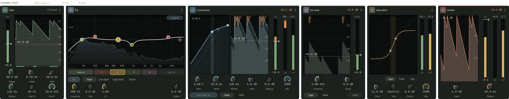

Every track and bus has a **channel strip**: six processors that are always there,
like the channel of a mixing console. You don't add or remove them; you switch on the
ones you need. Between them they cover most of what a channel needs: cleaning up,
tone, level and protection against peaks. The master has no channel strip, and a MIDI
track has none since it makes no sound of its own.

## Where to find it

- In the **Editor** panel (F3), the selected channel's strip sits beside its inserts
  under the caption **CHANNEL STRIP**. Each module is a card with a live display. A
  module that is off folds into a narrow tab with its name running down it: click the
  tab to open the card, and its power button to switch it on.
- In the **mixer**, a row of cells under each strip's input shows the modules by their
  initials (G E C D S L). Click a cell to switch a module on or off; right-click for
  **Edit channel strip**, which opens the channel in the Editor panel.

A module that is off costs almost no processing and adds no delay. Its card still
measures the sound coming in, dimmed, so you can set a threshold against the signal
before switching it on.

The caption row also holds:

- **After inserts ⇄** / **Before inserts ⇄**: whether the strip runs after the inserts
  (the default) or before them. Either way the fader comes last.
- **All off**, which switches every module off in one undo step.
- **Presets ▾** (see [Presets](#presets)).

### Reordering modules

The modules run left to right in the order shown: gate, EQ, compressor, de-esser,
saturation, limiter. Drag a card by its header to move it; a line shows where it will
go. You might put the EQ after the compressor, for example, so a boost doesn't push
the compressor harder.

### Setting a threshold

The gate, compressor, de-esser and limiter set their threshold on a meter rather than a
knob, so you see it against the level it is compared with. Drag the line on the meter
(or click the meter to move it there), hold Shift for fine control, scroll to move it
in 0.5 dB steps, and double-click to reset it. You can also drag the dashed line in
the module's history graph. The history graphs show the last three seconds.

## Gate

A gate silences a sound between its notes: the hum of an amp between phrases, or the
spill from other drums on a tom mic. Below the threshold it closes and turns the sound
down; above it, it opens.

The display shows the level that drives the gate in grey, the output in colour, and a
strip along the bottom that is lit while the gate is open. The header reads "open" or
"closed". The **KEY** meter beside it holds the threshold (-80 to 0 dB, default
-40 dB); you can also drag anywhere in the display to set it.

| Knob | Range | What it does |
|---|---|---|
| **Range** | 0 to 80 dB (40) | How far the gate turns the sound down when closed. A smaller range lowers the spill without cutting it out. |
| **Attack** | 0.05 to 50 ms (0.5) | How fast it opens. |
| **Hold** | 0 to 500 ms (30) | How long it stays open after the level drops. |
| **Release** | 5 ms to 2 s (120 ms) | How slowly it closes. |
| **Key HP**, **Key LP** | 20 Hz to 2 kHz; 1 to 20 kHz | Filters on what the gate listens to (not what you hear), so a kick's spill doesn't open the snare's gate. |

## EQ

An EQ (equaliser) turns parts of the frequency range up or down: less boom, more
clarity, a little air. This one has six bands: a **Low cut**, four bands, and a **High
cut**.

The display shows frequency across (20 Hz to 20 kHz) and gain up (±24 dB). The white
line is the overall curve, and each band has a coloured node: drag a node to set its
frequency and gain (Shift for fine, Alt for gain only), scroll over it to set its Q
(how wide it is) or a cut's slope, double-click to switch it on or off, and right-click
to pick its shape or reset it. Dragging a band that is off switches it on.

With **Analyser** on (the default), the display also shows the sound's spectrum: after
the EQ filled in colour, before it as a faint line.

Under the display, a chip per band selects it (double-click switches it), and the
selected band's controls follow:

- Bands 1 to 4: **On**, the shape (**Peak**, **Low shelf**, **High shelf** or
  **Notch**), **Frequency**, **Gain** (±24 dB) and **Q** (0.1 to 18).
- **Low cut** (20 Hz to 2 kHz, default 80 Hz) and **High cut** (1 to 20 kHz, default
  16 kHz): **On**, the slope from 6 to 48 dB per octave, and **Frequency**. The cuts
  are off until you switch them on.
- **Output**, ±24 dB, on the right.

## Compressor

A compressor turns a sound down when it gets loud, so the loud and quiet parts sit
closer together. The compressor has two models, chosen with **Clean** / **Opto** in
its card's header. Switching keeps the module's place and on/off state, and the
model you left keeps its settings for the session.

### Clean

A modern compressor with every control. It is the same as the built-in
[Compressor](../effects/compressor.md) insert, whose page explains compression in
detail, except that it has no sidechain input.

The display shows the compressor's curve with the live level riding it as a dot, the
three-second history with the gain reduction hanging from the top, and the **IN**,
**GR** (gain reduction) and **OUT** meters. Set the **Threshold** (-60 to 0 dB, default
-18 dB) on the IN meter, on the curve left of the knee, or in the history; drag the
curve right of the knee to bend the ratio.

| Control | Range | What it does |
|---|---|---|
| **Ratio** | 1:1 to 20:1 (3:1) | How firmly it holds the level above the threshold. |
| **Attack** | 0.1 to 100 ms (10) | How fast it clamps down. |
| **Release** | 10 ms to 2 s (120 ms) | How fast it lets go. |
| **Knee** | 0 to 24 dB (6) | How gradually compression starts at the threshold. |
| **Makeup** | 0 to 24 dB | Gain added afterwards. |
| **Mix** | 0 to 100% | Mixes the dry sound back in, for parallel compression. |
| **Auto make-up** | On / off | Adds makeup gain to match the threshold and ratio. |
| **Peak** / **RMS** | | Reacts to short peaks, or to the average level. |

### Opto

A vintage optical compressor, in the style of the LA-2A: a lamp lights up with the
level and a light cell turns the gain down. It has few controls and a smooth sound, and
its release slows down the longer it has been compressing, so it levels a vocal or a
bass without being heard. It is also the built-in
[Opto Compressor](../effects/compressor.md#the-opto-compressor) insert.

The display has a **VU** meter that shows the gain reduction (click it to show the
output instead), the **CELL** with its lamp and the memory of recent compression, and
the three-second history.

| Control | Range | What it does |
|---|---|---|
| **Peak reduction** | 0 to 100 (40) | How much it compresses. Turn it up until the needle shows the reduction you want. |
| **Gain** | -12 to +24 dB | Makeup gain. |
| **Compress** / **Limit** | | About 3:1, or a firmer 10:1. |
| **Emphasis** | 0 to 100% | Makes it react more to high frequencies. |
| **Colour** | 0 to 100% (30) | The warmth of a valve stage after it; 0 is clean. |
| **Mix** | 0 to 100% | Mixes the dry sound back in. |

## De-esser

A de-esser tames the harsh "s" and "t" sounds of a voice (sibilance). It listens to a
band of high frequencies and turns down when that band crosses the threshold.

The display shows the sibilant band's level in grey and the gain reduction from the
top; the **BAND** meter holds the threshold (-60 to 0 dB, default -30 dB).

| Control | Range | What it does |
|---|---|---|
| **Frequency** | 2 to 16 kHz (6 kHz) | Where the sibilance is. Most voices sit between 5 and 8 kHz. |
| **Range** | 0 to 24 dB (8) | The most it will turn down. |
| **Split** / **Wide** | | Split turns down only the high band; Wide turns down the whole sound. |
| **Listen** | On / off | Plays the band on its own, so you can tune Frequency to the esses. |

## Saturation

Saturation adds harmonics and gently rounds off peaks, the warmth and grit of
analogue gear pushed hard. The display shows the shaping curve and, shaded, the part
the sound is using now; IN and OUT meters sit beside it.

| Control | Range | What it does |
|---|---|---|
| **Tape** / **Tube** / **Clip** | | Tape rounds peaks off smoothly. Tube bends the two halves of the wave differently, which adds warmth. Clip flattens peaks more firmly, for more edge. |
| **Drive** | 0 to 36 dB (6) | How hard it is pushed. Half the drive is taken off again on the way out, so more drive adds colour more than level. |
| **Tone** | Dark to Bright | Turns the highs (above about 3 kHz) down or up by as much as 6 dB. |
| **Output** | -24 to +12 dB | Output level. |
| **Mix** | 0 to 100% | Mixes the dry sound back in. |

## Limiter

A limiter stops the level going over a ceiling: a safety net at the end of the chain.
This one adds no delay, so it doesn't look ahead; for the master, the built-in
[Limiter](../effects/limiter.md) insert catches peaks more cleanly.

The display shows the history on a 0 to -36 dB scale with the ceiling as a line you can
drag, and the IN, GR and OUT meters. The **Ceiling** (-12 to 0 dB, default -0.3 dB)
sits on the IN meter.

| Knob | Range | What it does |
|---|---|---|
| **Input** | 0 to 24 dB | Drives the sound into the ceiling, for more level. |
| **Release** | 1 ms to 1 s (60 ms) | How fast it recovers after a peak. |

## Presets

**Presets ▾** in the strip's caption row sets up the whole strip at once: every
module's on/off state and settings, in one undo step. It keeps your module order. The
cards of modules a preset switches on open, and the rest fold to tabs.

| Category | Presets |
|---|---|
| Vocals | **Lead vocal**, **Backing vocals**, **Spoken word** |
| Instruments | **Acoustic guitar**, **Electric guitar**, **Bass**, **Piano**, **Synth pad** |
| Drums | **Kick**, **Snare**, **Drum bus** |
| Buses | **Mix bus glue**, **Reverb return** |

**Lead vocal**, **Bass** and **Piano** use the Opto compressor; the rest use Clean. A
preset is a starting point: adjust the thresholds to your recording's level.

The menu also has:

- **Save as preset…** saves the strip as it is, under a name you give. Your presets
  appear under **Yours** in every project. They are files in
  Documents\Northlight\Strip Presets.
- **Reset strip (all off, defaults)**.
- **Show presets folder**.
