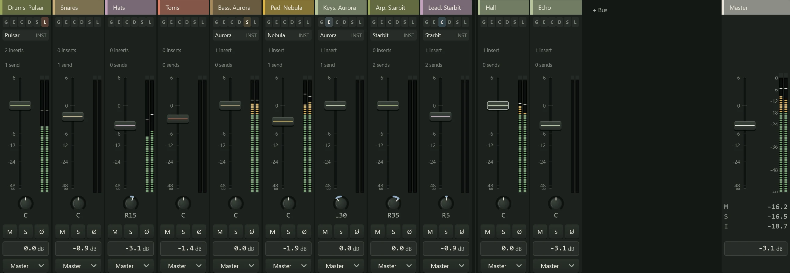

The mixer is where you balance a song: how loud each track is, where it sits between
the speakers, and which effects it goes through. Open it with F2, or the mixer button
in the header bar. It sits in the dock under the arrange view, or in a window of its
own (see [A tour of the window](../getting-started/the-window.md)).

Every track that makes sound (audio tracks and instrument channels) has a **strip**, and so does
every bus and FX track (see [Routing](routing.md)). Tracks come first, then buses after
a dividing line, and the **Master** strip stays pinned on the right while the others
scroll. The master is the whole mix: what you hear and what an
[export](../exporting/index.md) renders.

Selecting a strip (a click on its name) selects that track in the arrange view too,
and the other way round. With no tracks yet, the mixer shows only the master and the
hint "Add a track to start mixing".

## A strip from top to bottom

| Part | What it is |
|---|---|
| **Name** | The track's name in its colour. Click to select the track, double-click to rename it, right-click for the strip's menu. A coloured bar with a number shows its fader group. |
| **Edit button** | The plug icon at the right end of the name. It selects the channel and shows it in the **Editor** panel (F3), where its inserts, channel strip and sends are laid out in full. |
| **Input** | Audio tracks only: the input it records from. See [Inputs](../recording/inputs.md). |
| **Channel strip row** | One small cell per [channel strip](channel-strip.md) module: G, E, C, D, S and L (gate, EQ, compressor, de-esser, saturation, limiter). Click a cell to switch that module on or off; a lit cell is on, and a thin bar along its bottom shows any gain reduction. Right-click for the same switches and **Edit channel strip**. |
| **Inserts** | The effects the channel runs through, one slot each, and a **+** slot to add one. See [Inserts](inserts.md). An instrument channel shows its instrument in a slot above them. |
| **Sends** | Copies of the channel sent to FX tracks or buses, each with a small level slider. See [Routing](routing.md#sends). |
| **Pan** | Where the sound sits between the left and right speakers: **C** is the centre, **L35** or **R12** to one side. Drag it; double-click returns it to the centre. |
| **M S R Ø** | Mute, solo, record arm and phase invert (below). **R** shows only on audio tracks; an instrument channel is recorded through the MIDI tracks that play it. |
| **Fader and meter** | The fader sets the channel's level; the meter beside it shows how loud it is playing. See [Metering and loudness](metering.md). |
| **Gain** | The fader's value in dB. Drag it, or click and type a value. |
| **Output** | Where the channel goes: the **Master**, a bus, or another pair of your audio device's outputs. See [Routing](routing.md#outputs). |
| **Delay line** | A note such as "+2.7 ms", shown only while the channel's plugins delay its sound. See [Delay compensation](delay-compensation.md). |

When the dock is short, the inserts and sends fold into one line each ("3 inserts",
"2 sends"). Click the line to list them, each with its menu, and to add another.

## The fader

The fader is a level control measured in **decibels** (dB). At 0 dB, three quarters
of the way up, the level is left as it is; the top is +6 dB and the bottom is silence.
Every 6 dB down roughly halves the level.

- Drag to move it; hold Shift for fine control.
- Double-click to return it to 0 dB.
- Scroll over it to move it in 0.5 dB steps.
- With the strip focused, the arrow keys move it. Tab moves between strips, and M, S
  and R toggle the focused strip's buttons.

A fader with automation follows its lane while the song plays (see
[Automation lanes](../automation/lanes.md)).

## Mute, solo and phase

- **M** (mute) silences the channel and its sends.
- **S** (solo) lets you hear only the soloed channels. Solo more than one to hear a
  few together. Soloing a bus or FX track keeps the channels that feed it audible, and
  gives their strips a faint outline so you can see why.
- **Ctrl+click S** solos that channel alone: every other solo is cleared, in one undo
  step. Ctrl+click it again to clear it.
- **Ø** (phase invert) flips the channel's waveform upside down. Use it when two mics
  on one source, such as the top and bottom of a snare drum, cancel each other out and
  sound thin: if flipping one makes the pair fuller, leave it flipped.

From the keyboard, Shift+M and Shift+S mute and solo the selected track.

### Solo safe

A channel marked **Solo safe** is never silenced by another channel's solo. Right-click
its name and choose **Solo safe**; its solo button's tooltip then says so. It suits an
FX track that holds the song's reverb, so a soloed vocal keeps its reverb, or a click
or reference track. A solo-safe channel can still be muted.

## Fader groups

A fader group links strips so they move together: the drum mics, say, or a pair of
backing vocals.

1. Right-click a strip's name and choose **Fader group > New group**. The strip joins
   "Group 1" and its name gets a coloured bar with the group's number.
2. On each of the other strips, right-click the name and choose that group under
   **Fader group**.

In a group, moving one fader moves the others by the same amount, so their balance
stays as it was. Muting or soloing one mutes or solos the whole group. Hold Alt as you
start dragging a fader to move it on its own this once. To take a strip out of its
group, choose **Fader group > None**; **Remove group** breaks the group up.

A fader group only links the controls. To process several tracks together, for
example with one compressor on all the drums, route them to a bus instead (see
[Routing](routing.md)).

## The strip's menu

Right-click a strip's name for:

- **Fader group** and **Colour**.
- **Solo safe**.
- **Hide strip** takes the strip out of the mixer. The track still plays as before.
- **Wide strips** makes every strip wider, with a dB scale between the fader and the
  meter and a pan control on each send. Northlight remembers the choice.
- **Remove bus**, on a bus.

Right-click the empty space beside the strips for **Wide strips**, **Hidden strips**
(show one hidden strip again, or **Show all**) and **Close all plugin windows**. While
any strip is hidden, a button under **+ Bus** says how many ("2 hidden") and opens the
same list.

## The master strip

The master is wider than the others and has no input, sends or pan. It has:

- **Inserts** that process the whole mix before the master fader, such as a bus
  compressor or a limiter. The loudness readout and exports hear them. See
  [Inserts](inserts.md#the-masters-inserts).
- A larger meter with a scale, and the loudness readout (see
  [Metering and loudness](metering.md)).
- Under its gain, the project's total plugin delay ("PDC 12 ms") while there is any.
