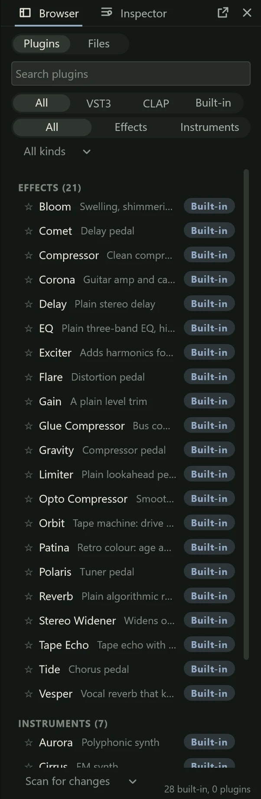

Besides its built-in effects and instruments, Northlight can use **plugins**: effects
and instruments from other makers, installed separately. It hosts the two open plugin
formats, **VST3** and **CLAP**. It does not load VST2 or AU plugins; many makers ship a
VST3 version of the same plugin, so install that one.

## Scanning for plugins

Northlight has to look at your plugins once before it can list them. This is called a
**scan**. It looks in the standard folders:

- VST3: C:\Program Files\Common Files\VST3
- CLAP: C:\Program Files\Common Files\CLAP, and the CLAP folder under your user's
  AppData\Local\Programs\Common (plus any folders in the `CLAP_PATH` environment
  variable)

To scan, open the **Browser** panel (F4), click the scan button at the top and choose
**Scan for changes**. An insert's menu, the effects menu and **Preferences > Plugins**
have **Scan for plugins** too. While it runs, a progress bar shows "Scanning 12 of 48"
and the file it is looking at, with **Cancel**; plugins appear in the list as they are
found.

**Scan for changes** only looks at plugins that are new or have changed since the last
scan, so it is quick. **Rescan all** looks at every file again. Plugins you uninstall
are dropped from the list on the next scan.

### Plugins in other folders

If a plugin is installed somewhere else:

1. Open **Preferences > Plugins** (Ctrl+, opens Preferences).
2. Under **Folders**, click **Add folder…** and choose the folder.
3. Scan again.

These folders are scanned as well as the standard ones. On the same page, **Scan on
launch** looks for new and changed plugins every time Northlight starts (it is off
until you switch it on).

### The scan is safe

Each plugin file is opened in a separate small program, not in Northlight itself. If a
plugin crashes while it is being looked at, or hangs for more than a minute, only that
program ends: Northlight carries on and puts the file on the **blocklist**, so it is never
loaded again. The Browser panel lists blocked files under **Blocked**, with the reason
and a **Retry** button for each; the scan button's menu and **Preferences > Plugins**
have **Clear blocklist**. Retry a plugin after updating it.

## Using a plugin

Add a plugin effect as an [insert](inserts.md), from the effects menu where your
plugins are listed by kind, under **Favourites** and **By maker**. A plugin
instrument goes in an instrument channel's instrument slot (see
[MIDI tracks and instruments](../midi/midi-tracks.md)).

A plugin's card in the **Editor** panel (F3) shows its kind, name, maker, format and
delay, with an **Open editor** button; double-clicking the card does the same. In the
mixer, click its slot's name. A plugin with no window of its own shows its parameters
as a list of controls instead.

## The plugin window

The plugin's own editor opens in a window, with a Northlight bar along its top:

| Control | What it does |
|---|---|
| Power button | Bypass: the sound passes through untouched. |
| Title | The plugin's name and the track it is on, with its format. |
| Mix slider | Wet/dry: how much of the processed sound is heard. Double-click for 100%. |
| **Presets** | Names the current preset. The menu has the plugin's factory programs, your preset files, **Save preset as…** and **Load preset file…**. |
| Pin | Keeps this plugin's windows on top of the others. |
| Settings button | For plugins that have both, switches between the plugin's own editor and a generic one with plain controls. |

Loading a preset is one undo step, so Ctrl+Z gives the plugin back the settings it
had. Preset files are kept in Documents\VST3 Presets or Documents\CLAP Presets, in a
folder for each maker and plugin.

Northlight remembers each plugin's window position, size and pin. Windows that were
open when you saved a project open again with it. Closing a window doesn't remove or
stop the plugin. **Close all plugin windows** (Ctrl+Shift+W, also in the app menu and
the mixer's background menu) closes every one at once. To keep every plugin window
above the main window, switch on **Keep on top** in **Preferences > Plugins**.

## The Browser panel

The **Browser** panel (F4) lists every built-in effect and instrument and every plugin
found by a scan. Its **Plugins** tab has:

- A search field (Ctrl+F) that matches names, makers, formats and the built-ins'
  descriptions as you type.
- A format filter (**All**, **VST3**, **CLAP**, **Built-in**), **Effects** or
  **Instruments**, and **All kinds** to show one kind of effect.
- **Favourites** (click a row's star), **Recent** (the last 16 used), then **Effects**,
  **Instruments** and **Blocked**.
- At the bottom, a count such as "26 built-in, 41 plugins, 1 blocked".

Press Enter to insert the highlighted plugin on the selected track, or drag a row onto
the Editor panel's chain, a mixer strip or a track header. **Plugins...** in the app
menu (Ctrl+Shift+P) opens the panel in a window of its own. Its **Files** tab is a file
browser for audio files (see [Importing](../projects/importing.md)).

## Plugins in trouble

When a plugin can't be used, its slot and card say so, with the reason when you hover,
and offer a way out. Its settings are never lost.

- **Not installed**: the project uses a plugin this computer doesn't have, or hasn't
  scanned yet. The slot keeps the plugin's name and settings. Install it and choose
  **Scan for plugins…**; the plugin then loads with its settings. You can also
  replace or remove it.
- **Failed**: the plugin is installed but wouldn't load. A message gives the reason,
  with **Blocklist** to stop Northlight trying it again. The card has **Retry**.
- **Crashed**: the plugin crashed while playing. Northlight switches it off and lets
  the sound pass through, and keeps running. A message says so, with **Reload
  plugin**, which starts the plugin again from the settings it had before the crash.
  Save your project first, to be safe.

When you open a project with plugins missing or failing, one message names them ("2
plugins are not installed: …"). If a plugin keeps crashing, look for an update from its
maker. See also [Troubleshooting](../reference/troubleshooting.md).

Plugins run inside Northlight. It catches most crashes as described above, but a
plugin that misbehaves badly can still take Northlight down with it, which is one more
reason to save often.
