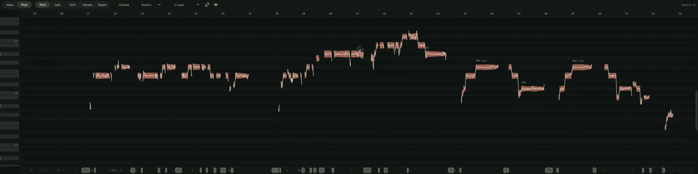

Northlight can find the notes in a recorded vocal and let you change them: move a
note that went flat, steady a wobble, pull a whole take gently towards the key, or
turn down the breaths between phrases. All of it happens in the audio editor, and
none of it changes your recording: every edit is a setting on a note that you can
change or undo later.

Pitch editing works on one voice at a time: a lead vocal, a backing vocal, or a solo
instrument such as a flute or a fretless bass. It cannot pull apart a chord or a
group singing together. The cleaner and drier the recording, the better the notes it
finds.

## Opening a vocal

1. Double-click an audio clip in the arrange view. The **Audio Editor** panel opens
   in the dock with that clip (F9 shows or hides the panel).
2. Click **Pitch** in the **Wave** / **Pitch** switch at the top left.
3. The first time, Northlight analyses the clip. A progress bar reads "Analysing
   pitch" with a percentage, and the rest of Northlight carries on working.
4. When it finishes, the notes appear.

The analysis is saved beside the audio file, in a file ending `.northlight-pitch`, so
the clip opens straight away next time. Finding the notes adds an **Analyse pitch**
step to the undo history, but nothing you hear changes.

**Wave** mode shows the clip's waveform with its gain line and fades, for the same
kind of clip editing as the arrange view. Pitch editing is all in **Pitch** mode.

## What you see

The editor is laid out like the [piano roll](../midi/piano-roll.md): a keyboard down
the left, a row for each semitone, and time running left to right with the same bars
and beats as the arrange view. Rows for notes outside the project's key are shaded
darker, so you can see which notes belong.

- **The blocks** are the notes Northlight found. Each sits on the row of the pitch
  it plays, and its thickness follows how loud the singer was, so a note that swells
  looks like it. A wide enough block is labelled with its note and how far it is from
  that semitone, for example "F#2 −4 ct".
- **The traced line** running through the blocks is the pitch as it plays, moment
  by moment: the scoop into a note, the vibrato, the slide to the next. Once you
  change something, the original pitch also shows as a fainter line behind it, so
  you can compare the two.
- **The lane along the bottom** holds what lies between the notes: breaths (grey,
  hatched blocks), consonants and silence. See [Breaths](breaths.md).
- **The info bar** under the lane describes the selected note (the pitch it plays,
  the pitch it was sung at, its drift, vibrato and gain) or, with nothing selected,
  what the current tool does.

## Cents

Pitch editing measures in **cents**: a hundredth of a semitone. A note 50 cents flat
is halfway to the semitone below. Differences of a few cents are very hard to hear;
a held note 20 or 30 cents out starts to sound sour. When the editor shows
"A3 +12 ct", the note is 12 cents sharp of A3.

Northlight names notes with middle C as C3, as the piano roll does.

## How Northlight finds the notes

The analysis traces the pitch of the voice every few milliseconds, then splits that
line into notes where the singer breathes or stops, where a new syllable starts, and
where the pitch jumps to a new height and stays there. For each note it works out a
**centre**: the pitch your ear hears as the note, taken from its steady middle and
leaving out the scoop at the start and the fall at the end.

What is left of the line, around that centre, is split into two parts that you can
change on their own:

- **Drift**: the slow wander of the pitch across the note, as a singer goes a little
  sharp or flat while holding it.
- **Vibrato**: the faster, regular wave on top.

Keeping the centre, the drift and the vibrato apart is what lets an edit still sound
like the singer. Moving a note moves its centre and takes the vibrato and the
singer's own slides with it, instead of flattening the note to a straight line.

The analysis can get things wrong. It may split one note in two, join two notes into
one, or mistake a breath for a consonant. You can fix each of these: see
[Editing notes](notes.md#splitting-and-joining) and [Breaths](breaths.md).

## Edits never change the recording

The audio file on disk is never rewritten. Each note keeps its edits as settings
(pitch, drift, vibrato, slides, gain, mute), and Northlight renders the result in
the background, a phrase at a time; until a new version is ready, the previous one
keeps playing. A note you have not touched plays exactly as it was recorded.

Every edit is a step in the [undo history](../editing/undo.md), and a note's menu
can put its pitch back as it was sung. The edits play wherever the clip plays: in
playback, in [an export](../exporting/index.md) and when the track is
[frozen](../mixing/freezing.md). They work on a clip that is time-stretched or
transposed too; the editor shows a transposed clip's notes at the pitch they now
play.

## Where to go next

- [Editing notes](notes.md): moving, splitting and joining notes, and the keys.
- [Correcting towards a key](correct.md): tuning a whole take in one pass.
- [Drift, vibrato and slides](shaping.md): shaping a note, and the Inspector.
- [Breaths](breaths.md): turning the breaths down.
