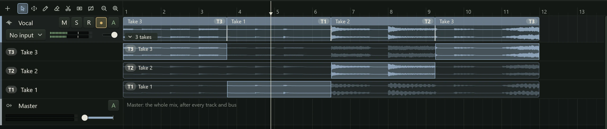

Few parts are perfect in one go. Northlight lets you record the same stretch several
times, keeps every attempt as a **take**, and lets you build the part from the best
phrases of each. Building a part from pieces of several takes is called **comping**
(short for compiling). This page covers loop recording, punching in, the take lanes
and comping.

## The range: loop and punch

Loop and punch recording both use the range in the ruler. Drag across the ruler's bar
numbers to set it; drag its ends to change it, or drag inside it to move it. A
double-click in the ruler's bars row sets it to the clip or region under the pointer.

There is one range, and the two toggles in the header bar decide what it means:

- **Loop** (L) plays the range over and over.
- **Punch** (P) records only inside the range.

**Loop** is unavailable until there is a range; its tooltip says "Set a loop region in
the ruler".

## Loop recording

Loop recording is the quickest way to get several takes: the part repeats, you play
it again and again without stopping, and each pass becomes a take.

1. Set the range around the part, with a little room before and after it.
2. Turn on **Loop** (L).
3. Arm the track and press Record (R).
4. Play the part as many times as you like. Each time the playhead wraps back to the
   start of the range, a new take begins.
5. Press Space to stop.

The passes become takes in a **take group** on the track, numbered T1, T2, T3 and so
on. The newest take plays: if you stopped half way through the last pass, it plays as
far as it got and the take before it plays the rest. A pass you stopped right at the
wrap, with nothing in it, is dropped.

## Punching in

Punching in replaces one part of a recording, such as a single wrong line, without
touching the rest.

1. Set the range around the part you want to redo.
2. Turn on **Punch** (P).
3. Arm the track and press Record.

Playback starts one bar before the range so you can hear your way in. Recording
starts exactly at the range's start and stops at its end; playback carries on until
you stop it. The new recording becomes a take covering the range, so the original
stays as an older take and you can go back to it.

With **Monitor** on **Auto**, you hear your input from when you press Record, together
with what the track already has, so you can play along in the run-up to find your
place.

## When a recording makes takes

- Several loop passes become a take group.
- A punch recording becomes a take covering the range.
- A recording over an existing take group joins it as its newest take.
- One pass anywhere else is a plain clip. If it lands on clips already on the track,
  it lies over them; they are not turned into takes.

## Take lanes

A take group's takes sit in **take lanes** under the track, one lane per take, newest
on top. To open or close them, click the chip at the group's lower left on the track
(it reads "3 takes"), choose **Show take lanes** from the track menu, or press Alt+T.

In each lane, the take is drawn as a clip. The parts of it that are playing are lit;
the parts that are not are dim. Each lane's header shows the take's number and name,
and **Comp** when that take plays from start to finish.

On the track itself, the comp plays as ordinary clips, one for each piece, with a
badge saying which take it comes from ("T2"). Thin lines through the clips show where
one take hands over to the next.

## Comping by swiping

To choose which take plays where:

- **Swipe**: drag across a take's lane over the stretch you want from it. That take
  then plays there. With snap on, the swipe snaps to the grid.
- **Click** a take's lane (without dragging) to make it play in the piece under the
  pointer.
- **Click a lane's header** to make that take play all the way through.
- **Drag a boundary**: on the track, drag one of the lines between pieces left or
  right to move where the takes change over. Dragged all the way across a piece, it removes
  that piece.
- **Keys**: with the track selected, Alt+Up plays the next newer take in the piece at
  the playhead, and Alt+Down the next older one, skipping takes with nothing there.

Where two takes meet, Northlight crossfades them over 10 milliseconds so the join
doesn't click. Every comp change is one undo step.

A good way to work: listen through each take once, swipe the best phrase from each,
then play the comp back and adjust the boundaries by ear.

## Take menus

Right-click a take's lane, or its header, for:

| Item | What it does |
|---|---|
| **Use whole take** | That take plays all the way through. |
| **Rename take...** | Type a new name over the header; Enter keeps it, Escape cancels. |
| **Move take to new track** | Makes a new track under this one with the take as its clip, and removes it from the group. Handy for a harmony or a double-track you want to keep. |
| **Delete take** | Removes the take from the group. |
| **Flatten comp** | See below. |
| **Hide take lanes** | Closes the lanes. |

Right-click the comp's clips on the track for **Show take lanes** (or **Hide take
lanes**), **Use take** (a list of every take, with a tick by the one that plays all
the way through, if any) and **Flatten comp**.

Clicking one of the comp's clips selects the whole group, so dragging moves all of it,
takes and comp together (onto another track too), and Delete removes it, takes and all.

## Flattening

**Flatten comp** ends the take group: the comp stays on the track as ordinary clips
and the take lanes go. Do it when the part is finished.

You can edit the comp's clips like any clip, but while the group exists the next comp
change rebuilds them from the takes, undoing your edits. So if you want to trim or fade
the comp's clips by hand, flatten it first.

Recording MIDI makes takes in the same way: see [Recording MIDI](recording-midi.md).
