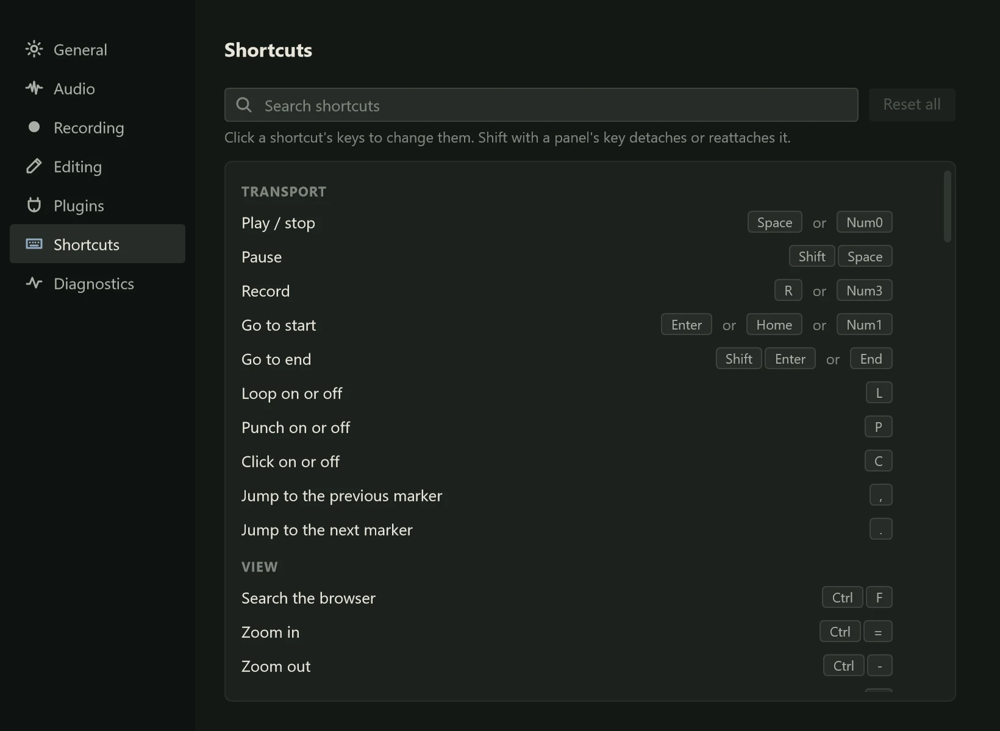

Preferences hold the settings that belong to you rather than to a project: where
projects are saved, how Northlight looks, how recordings are named, your audio
device, your plugin folders and your keys. Open it from the app menu with
**Preferences...**, or press Ctrl+, (Ctrl and comma).

The pages are listed down the left: **General**, **Audio**, **Recording**,
**Editing**, **Plugins**, **Shortcuts** and **Diagnostics**. Up and Down move
between them when the list has the focus. Every change applies straight away; there
is no OK button. Settings are saved in `%APPDATA%\Northlight`, so they stay when you
update or reinstall Northlight.

A setting marked **Coming soon** is kept, but this version does not use it yet.

## General

**Projects**

| Setting | Default | What it does |
|---|---|---|
| **Folder** | Your Documents folder | Where new projects are saved. **Choose...** picks another folder |
| **Recent** | 8 | How many projects the Project menu's **Recent** list shows (0 to 20) |
| **Autosave** | 2 min | How often unsaved changes are kept for recovery after a crash, 0 to 60 minutes. 0 turns autosave off |
| **Keep backup** | On | Each save keeps the version it replaces beside the project, as a `.northlight-bak` file |
| **Copy media** | On | Imported audio is copied into the project's media folder, so the folder holds everything the project plays |
| **Reopen last** | Off | Opens the last project when Northlight starts |

See [Saving and opening](../projects/saving.md) for how autosave and backups help when
something goes wrong, and [Media and missing files](../projects/media.md) for the
media folder.

**Appearance**

| Setting | Default | What it does |
|---|---|---|
| **Theme** | Dark | **Dark** is the only theme for now; **Light** is coming soon |
| **Accent** | Overcast | The colour of selections, lit buttons and the focus ring. Six swatches (Overcast, Loch, Sea grass, Machair, Heather, Thrift), or type any colour as `#RRGGBB` in the field beside them |
| **Contrast** | System | **High** brightens lines, secondary text and the small print on effect faces, and outlines clip lights. **System** turns it on when Windows uses a contrast theme |
| **Reduce motion** | System | **On** makes panels, sheets and menus appear without sliding and stops animated glows; meters still move. **System** follows Windows' Show animations setting |
| **UI scale** | Follow system | The size of the whole interface: **Follow system**, **100%**, **125%**, **150%** or **200%** |

Contrast and Reduce motion are described more fully in
[Accessibility](accessibility.md).

## Audio

The Audio page is **Audio Setup**, shown inline: the same settings you reach from the
app menu with **Audio Setup...** (Ctrl+Shift+A) or by clicking the device name in the
status bar. Its cards:

- **Device**: the **Driver type** (ASIO or one of the Windows Audio modes), the
  device (one **Device**, or an **Output device** and **Input device** for drivers
  that keep them apart), **Sample rate**, **Buffer size**, and **Control Panel...**,
  which opens the driver's own settings.
- **Channels**: which of the device's **Inputs** and **Outputs** are turned on, with
  a small meter beside each input.
- **Stereo inputs**: pairs of inputs that tracks can record from as one stereo input.
  **Add stereo input** adds one; **Remove** takes it away.
- **MIDI**: the MIDI **Inputs** Northlight listens to and the MIDI **Output** it plays
  to.
- **Latency**: the delay the driver **Reported**, the delay **Measured** by
  calibration, and the **Loopback** pair used to measure it, with **Calibrate** and
  **Clear**.
- **Monitoring**: **Pass inputs through to outputs**, which sends the inputs straight
  to the outputs at the **Level** you set (off by default: use headphones), and
  input and output meters.

A status line at the bottom says whether the device is running, with which driver,
how many channels and how many dropouts there have been.

[Setting up audio](../getting-started/audio-setup.md) explains these settings and how
to choose them, and [Latency and monitoring](../recording/latency.md) covers
calibration.

## Recording

**Files**

| Setting | Default | What it does |
|---|---|---|
| **Format** | WAV 32-bit float | **WAV 32-bit float** cannot clip; **WAV 24-bit** files are a quarter smaller |
| **Take names** | `{track} {take}` | How each take's clip and file are named. `{track}` becomes the track's name and `{take}` the take number, so "Vox 3" |

**Count-in and click**

| Setting | Default | What it does |
|---|---|---|
| **Count-in** | 1 bar | **Off**, **1 bar**, **2 bars** or **4 bars** of click before recording starts. Used when a project opens; the header bar's count-in button changes it while you work |
| **Pre-roll** | 0 bars | Plays up to 8 bars before the playhead without recording them. Not used when punching or looping |
| **Click level** | −6 dB | The metronome's volume, −40 to 0 dB |

**Transport**

| Setting | Default | What it does |
|---|---|---|
| **Return on stop** | On | Stop takes the playhead back to where playback started. Pause (Shift+Space) leaves it where it is |

See [Recording audio](../recording/recording-audio.md) for the click, count-in and
pre-roll in use.

## Editing

**Snap**

| Setting | Default | What it does |
|---|---|---|
| **Snap** | On | Whether snap is on when a project opens. N turns it on and off while you work |
| **Grid** | Adaptive | The snap grid a project starts with: **Adaptive**, **Bar**, **Beat**, **1/8**, **1/16**, **1/32**, the triplet grids (**Beat triplet**, **1/8 triplet**, **1/16 triplet**, **1/32 triplet**) and the dotted ones (**Beat dotted**, **1/8 dotted**, **1/16 dotted**) |

**Edits**

| Setting | Default | What it does |
|---|---|---|
| **Ripple** | Off | Whether ripple is on when a project opens. Shift+N turns it on and off |
| **Fade** | 10 ms | Coming soon: the fade new clips start with |

**View**

| Setting | Default | What it does |
|---|---|---|
| **Follow playhead** | On | Scrolls the arrange view to keep the playhead in sight |

[Clips](../editing/clips.md) and [The tools](../editing/tools.md) explain snap and
ripple.

## Plugins

**Folders**: the folders Northlight scans for plugins as well as the standard VST3
and CLAP folders. **Add folder...** adds one, and the cross on a folder's row removes
it. With none added, the list says "Only the standard VST3 and CLAP folders are
scanned."

**Scanning**

| Setting | Default | What it does |
|---|---|---|
| **Scan on launch** | Off | Looks for new and changed plugins when Northlight starts |
| **Scan** | | **Scan for changes** looks for new and changed plugins now |
| **Blocklist** | None | Plugins that crashed or hung while being scanned are skipped until cleared. Shows how many there are, and **Clear** empties the list so they are tried again |

**Windows**

| Setting | Default | What it does |
|---|---|---|
| **Keep on top** | Off | Plugin windows stay above the main window |

See [VST3 and CLAP plugins](../mixing/plugins.md).

## Shortcuts

Every action's keys, which you can change: click an action's keys and press the new
ones. The search field at the top finds an action by its name, its keys or its
group, and **Reset all** puts every key back to its default.
[Keyboard shortcuts](shortcuts.md) lists every default key and explains rebinding
in full.

## Diagnostics

**Crash reports**

| Setting | Default | What it does |
|---|---|---|
| **Send reports** | Off | Coming soon. Reports are always kept on this computer, in the settings folder's `Crashes` folder |

**Support**

| Setting | What it does |
|---|---|
| **Settings** | The path of the settings folder. **Show in Explorer** opens it |
| **Report** | **Copy system report** copies device, plugin and system details for a bug report |

These help when you ask for help or report a bug: see [Getting help](help.md). The
live performance figures are in the **Diagnostics** panel (F7), described in
[Troubleshooting](troubleshooting.md#the-diagnostics-panel).
