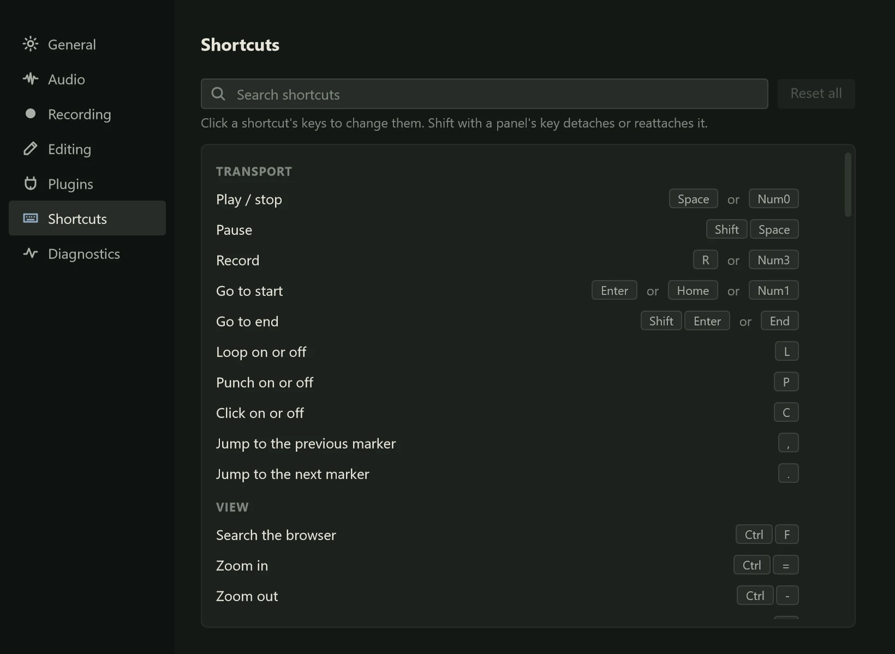

Almost everything you do often in Northlight has a key. This page lists every
default key, grouped as **Preferences > Shortcuts** groups them, and explains how to
change them. Tooltips and menus always show the key an action has now, so if you
change one, the app keeps up.

## Changing a key

1. Open **Preferences > Shortcuts** (Ctrl+, then **Shortcuts**).
2. Find the action: scroll, or type in **Search shortcuts**. The search matches an
   action's name, its keys ("Ctrl+M") and its group.
3. Click the action's keys. They change to "Press a key…".
4. Press the new key, with any of Ctrl, Shift and Alt.

The new key works at once. It replaces the action's old key, or keys: an action with
two defaults, such as Play / stop (Space or Num0), keeps only the one you pressed.

If another action already uses that key, the row says so ("Ctrl+M is used by
“Mute or unmute the selected clips”.") and offers **Replace**, which moves the key to
this action and leaves the other without it, or **Cancel**.

To stop without changing anything, press Esc or click elsewhere. Esc and Tab
themselves cannot be given to an action.

A changed action shows a reset button at the end of its row, which puts back its
default (its tooltip names it). **Reset all**, beside the search field, puts every
key back.

Your keys are saved with your other [Preferences](preferences.md), so they stay when
Northlight is updated.

### Keys that cannot be changed

The tools' number keys in the arrange view and the audio editor, and the families of
arrow keys (selecting tracks, clips and notes, nudging, stepping takes), work as sets
and cannot be rebound. Their rows say so when you hover over them. The piano roll's
tool keys are separate actions and can be changed one by one.

### Where a key works

Some keys work anywhere in the main window; others only in one view. Keys marked
*arrange view* below work when the arrange view (the tracks and their clips) has the
focus. Piano Roll and Audio Editor keys work while that editor has the focus (click in
it), and take priority there over the window's keys. So the same key can do
different things in different places: F2 shows the mixer, but renames the selected
track while the arrange view has the focus.

## Transport

| Action | Default key |
|---|---|
| Play / stop | Space or Num0 |
| Pause | Shift+Space |
| Record | R or Num3 |
| Go to start | Enter, Home or Num1 |
| Go to end | Shift+Enter or End |
| Loop on or off | L |
| Punch on or off | P |
| Click on or off | C |
| Jump to the previous marker (*arrange view*) | , (comma) |
| Jump to the next marker (*arrange view*) | . (full stop) |

## View

| Action | Default key |
|---|---|
| Search the browser | Ctrl+F |
| Zoom in | Ctrl+= (Ctrl++ also works) |
| Zoom out | Ctrl+- |
| Zoom to fit | Z |
| Zoom to the selection | Shift+Z |
| Open the menu of what has the focus | Shift+F10 (the Menu key also works) |
| Mixer | F2 |
| Editor | F3 |
| Browser | F4 |
| Inspector | F5 |
| Piano Roll | F6 |
| Diagnostics | F7 |
| Instruments | F8 |
| Audio Editor | F9 |

The panel keys show and hide each panel. Add Shift (Shift+F2 and so on) to detach the
panel into its own window, or to put it back.

## Tracks

| Action | Default key |
|---|---|
| Arm the selected track | Shift+R |
| Mute the selected track | Shift+M |
| Solo the selected track | Shift+S |
| Add an audio track | Ctrl+T |
| Add a MIDI track | Ctrl+Shift+T |
| Add a bus | Ctrl+B |
| Rename the selected track (*arrange view*) | F2 |
| Select the track above or below; Shift extends (*arrange view*, fixed) | Up / Down |
| Open or close the selected track's automation lanes (*arrange view*) | A |

## Editing

| Action | Default key |
|---|---|
| Snap on or off | N |
| Ripple on or off | Shift+N |
| Undo | Ctrl+Z |
| Redo | Ctrl+Y or Ctrl+Shift+Z |
| Delete the selected marker, else the selected clips (*arrange view*) | Delete or Backspace |
| Add a marker at the playhead (*arrange view*) | M |
| Add a region from the loop (*arrange view*) | Alt+M |
| Duplicate (*arrange view*) | Ctrl+D |
| Copy (*arrange view*) | Ctrl+C |
| Cut (*arrange view*) | Ctrl+X |
| Paste at the playhead (*arrange view*) | Ctrl+V |
| Tools: select, range, pencil, erase, split, glue, mute (*arrange view*, fixed) | 1 to 7 |
| Mute or unmute the selected clips (*arrange view*) | Ctrl+M |
| Play the newer or older take (*arrange view*, fixed) | Alt+Up / Alt+Down |
| Show or hide the take lanes (*arrange view*) | Alt+T |
| Nudge by a grid step; Shift: a quarter of one (*arrange view*, fixed) | Alt+Left / Alt+Right |
| Select every clip (*arrange view*) | Ctrl+A |
| Normalise (*arrange view*) | Ctrl+Shift+N |
| Clear the selection (*arrange view*) | Esc |
| Split at the playhead (*arrange view*) | S |
| Split at the time selection (*arrange view*) | Alt+S |
| Join (*arrange view*) | J |
| Crossfade (*arrange view*) | X |
| Select the previous or next clip on the track; Shift extends (*arrange view*, fixed) | Ctrl+Left / Ctrl+Right |
| Nudge the selected clips by a grid step (*arrange view*, fixed) | Left / Right |

The tool keys pick, in order: **1** select, **2** range, **3** pencil, **4** erase,
**5** split, **6** glue and **7** mute. See [The tools](../editing/tools.md).

## Files

| Action | Default key |
|---|---|
| New project | Ctrl+N |
| Open | Ctrl+O |
| Save | Ctrl+S |
| Save as | Ctrl+Shift+S |
| Import audio | Ctrl+I |
| Export | Ctrl+E |

## App

| Action | Default key |
|---|---|
| Audio Setup | Ctrl+Shift+A |
| Preferences | Ctrl+, (comma) |
| Plugins | Ctrl+Shift+P |
| Close all plugin windows | Ctrl+Shift+W |

## Piano Roll

These work while the [piano roll](../midi/piano-roll.md) has the focus. The window's
zoom keys (Ctrl+=, Ctrl+- and Z) zoom the piano roll while it has the focus; Z fits
the notes.

| Action | Default key |
|---|---|
| Delete the selected notes | Delete or Backspace |
| Select tool | 1 |
| Draw tool | 3 |
| Erase tool | 4 |
| Split tool | 5 |
| Glue tool | 6 |
| Mute tool | 7 |
| Copy notes | Ctrl+C |
| Cut notes | Ctrl+X |
| Paste notes | Ctrl+V |
| Mute or unmute the selected notes | Ctrl+M |
| Split the selected notes at the playhead | S |
| Join the selected notes | J |
| Select every note | Ctrl+A |
| Duplicate notes | Ctrl+D |
| Clear the note selection | Esc |
| Snap notes on or off | G |
| Quantise note starts | Q |
| Quantise note starts and ends | Shift+Q |
| Finer grid | ] |
| Coarser grid | [ |
| Transpose up a semitone | = (+ and the keypad's + also work) |
| Transpose down a semitone | - (the keypad's - also works) |
| Nudge notes by a grid step; Shift: fine (fixed) | Left / Right |
| Select the previous or next note; Shift extends (fixed) | Ctrl+Left / Ctrl+Right |
| Shorten or lengthen notes by a grid step; Shift: fine (fixed) | Alt+Left / Alt+Right |
| Move notes up or down a semitone; Ctrl: an octave (fixed) | Up / Down |
| Louder or softer notes; Shift: by one (fixed) | Alt+Up / Alt+Down |
| Add a note after the selected one (else at the playhead) | Insert |

## Audio Editor

These work in the [audio editor](../pitch/notes.md)'s pitch mode, while it has the
focus.

| Action | Default key |
|---|---|
| Tools: pitch, split, drift, vibrato, breath (fixed) | 1 to 5 |
| Move notes up or down a semitone; Shift: 10 cents (fixed) | Up / Down |
| Select the previous or next note; Shift extends (fixed) | Left / Right |
| Mute or unmute the selected notes | M |
| Select every note | Ctrl+A |
| Clear the note selection | Esc |

## Not on the page

A few things are done with a key and the mouse together, or only in one field, so they
are not listed on the Shortcuts page and cannot be changed:

- T taps the tempo while the tempo field in the header bar has the focus.
- Tab and Shift+Tab move the keyboard focus around the window (see
  [Accessibility](accessibility.md#working-from-the-keyboard)).
- Ctrl+click on a channel's solo button solos it alone.
